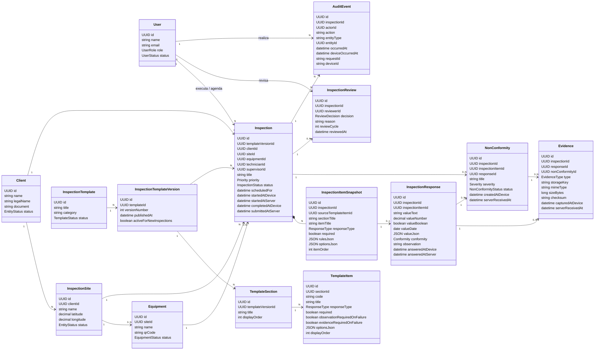

# Diagrama de classes

Derivado do documento [10 - Modelo de Dados](../notion/10-modelo-de-dados.md) (10.3 e 10.5 a
10.12). Mostra as entidades centrais, os atributos que identificam e relacionam cada uma e os
enums do [contrato compartilhado](../contrato-compartilhado.md). Campos de controle comuns a
quase todas as entidades (`createdAt`, `updatedAt`, `version`) foram omitidos para manter o
diagrama legível. Nomes de atributo em camelCase, como no JSON.

Notas:

- `InspectionItemSnapshot` é uma composição da inspeção: é criado junto com ela e não existe
  sem ela (ADR-0004).
- A versão com `versionNumber = 0` e `publishedAt` nulo é o rascunho do modelo
  ([ADR-001 do backend](https://github.com/FieldOps-Project/backend/blob/develop/docs/adr/ADR-001-draft-representation-strategy.md)).
- `InspectionResponse.inspectionItemId` aponta para o item do snapshot, não para o
  `TemplateItem`.
- O par `*AtDevice` / relógio do servidor segue a seção 4 do contrato compartilhado.
- O `backend` tem ainda `inspection_review_items` (itens a corrigir de cada reprovação), que
  não aparece no documento 10 e por isso não está no diagrama.
- As estruturas locais do aplicativo (`SyncOperation`, `SyncMetadata`, documento 10.13) não
  fazem parte do modelo central e ficam fora deste diagrama.
