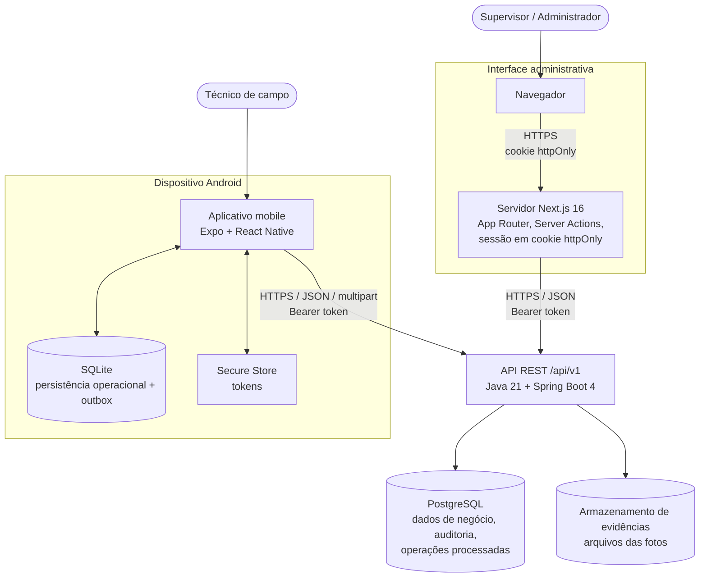

# Diagrama de contexto

Visão das três aplicações e dos serviços de que dependem (documento
[11 - Arquitetura](../notion/11-arquitetura.md), 11.1, atualizado pelo
[ADR-0001](../adr/0001-tres-aplicacoes-com-contrato-de-api.md) e pelo
[ADR-0008](../adr/0008-nextjs-16-na-interface-administrativa.md)).

- O navegador nunca chama a API nem recebe o token: todo acesso passa pelo servidor Next.js
  (ADR-0008).
- O aplicativo trabalha sobre o SQLite e sincroniza com a API quando há conexão (ADR-0002 e
  ADR-0003).
- O banco guarda só metadados e a chave do arquivo de cada evidência; o arquivo fica no
  armazenamento de evidências (documento 11.8). No `backend` atual a implementação é
  `LocalEvidenceStorage` (disco local); armazenamento de objetos compatível com S3 é a
  recomendação do documento 11.8 para produção.
