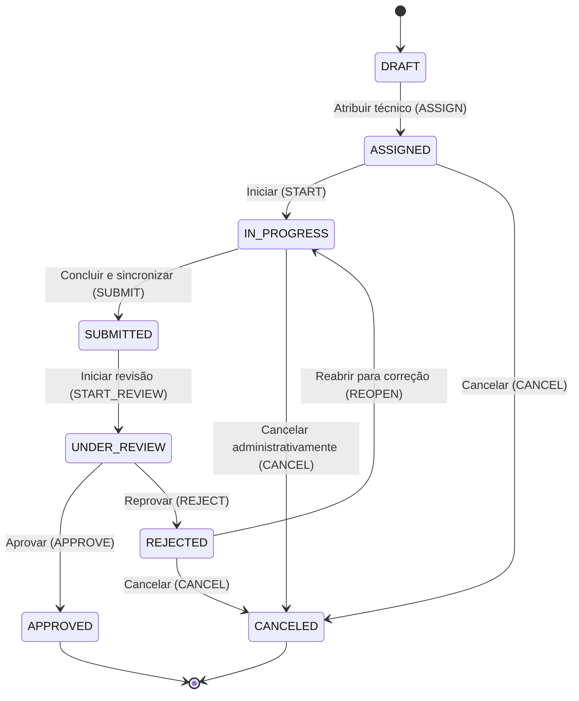

# Máquina de estados da inspeção

Reflete a tabela 7.6 do documento [07 - Fluxo Geral](../notion/07-fluxo-geral.md) e a
implementação em `InspectionStateMachine` do `backend`. Os estados usam o literal do
[contrato compartilhado](../contrato-compartilhado.md); a ação entre parênteses é o valor de
`InspectionAction`.

| # | Estado atual | Ação | Próximo estado | Quem executa |
| --- | --- | --- | --- | --- |
| 1 | `DRAFT` | `ASSIGN` | `ASSIGNED` | Supervisor |
| 2 | `ASSIGNED` | `START` | `IN_PROGRESS` | Técnico |
| 3 | `ASSIGNED` | `CANCEL` | `CANCELED` | Supervisor/Administrador |
| 4 | `IN_PROGRESS` | `SUBMIT` | `SUBMITTED` | Técnico/API |
| 5 | `IN_PROGRESS` | `CANCEL` | `CANCELED` | Supervisor/Administrador |
| 6 | `SUBMITTED` | `START_REVIEW` | `UNDER_REVIEW` | Supervisor |
| 7 | `UNDER_REVIEW` | `APPROVE` | `APPROVED` | Supervisor |
| 8 | `UNDER_REVIEW` | `REJECT` | `REJECTED` | Supervisor |
| 9 | `REJECTED` | `REOPEN` | `IN_PROGRESS` | Técnico |
| 10 | `REJECTED` | `CANCEL` | `CANCELED` | Supervisor/Administrador |

- Qualquer outra combinação responde `409 INSPECTION_INVALID_TRANSITION`.
- `APPROVED` e `CANCELED` são finais: não existe transição de saída (RN-082 para a aprovada).
- A reabertura (9) é explícita, feita pelo técnico, conforme o
  [ADR-002 do backend](https://github.com/FieldOps-Project/backend/blob/develop/docs/adr/ADR-002-explicit-reopen-after-rejection.md).
- A coluna "Quem executa" segue o documento 7.4.
- Este diagrama mostra o estado de negócio. O estado local de sincronização do aplicativo
  (`SYNCED`, `PENDING`, `SYNCING`, `ERROR`, `CONFLICT`) é independente e não aparece aqui.
