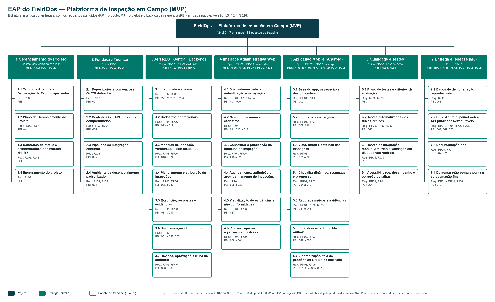

# EAP — Estrutura Analítica do Projeto

---

## Identificação

| Campo | Informação |
|---|---|
| **Projeto** | FieldOps — Plataforma de Inspeção em Campo (MVP) |
| **Gerente do projeto** | Felipe Marques |
| **Integrantes** | Felipe Marques; Gabriel Ribeiro Camargo Miranda; Pedro Henrique Dias de Paula; André dos Santos Fernandes; João Victor de Souza Santos |
| **Data** | 18/11/2026 |
| **Versão** | 1.0 |
| **Instituição / disciplina** | UniSENAI-SP, Campus Sorocaba — Gestão de Projetos (Prof. Me. Deivison S. Takatu) |
| **Fontes** | TAP (30/09/2026), Declaração de Escopo (04/10/2026), documentação do produto (Notion, docs 01 a 20) e backlog (documento 15) |

---

## Diagrama da EAP

O diagrama mostra os 7 ramos de nível 1 e os 36 pacotes de trabalho de nível 2. Em cada caixa aparecem os **requisitos atendidos** (RP = produto, RJ = projeto, da Declaração de Escopo) e os **itens do backlog (PBI)**, como pede o enunciado da Aula 03. Por espaço, os parênteses de detalhe dos nomes ficam no dicionário.



---

## Estrutura Analítica do Projeto (texto)

```text
FIELDOPS — PLATAFORMA DE INSPEÇÃO EM CAMPO (MVP)
│
├── 1. GERENCIAMENTO DO PROJETO
│   ├── 1.1 Termo de Abertura e Declaração de Escopo aprovados
│   ├── 1.2 Plano de Gerenciamento do Projeto
│   ├── 1.3 Relatórios de status e demonstrações dos marcos M1–M8
│   └── 1.4 Encerramento do projeto
│
├── 2. FUNDAÇÃO TÉCNICA
│   ├── 2.1 Repositórios e convenções Git/PR definidos
│   ├── 2.2 Contrato OpenAPI e padrões compartilhados
│   ├── 2.3 Pipelines de integração contínua
│   └── 2.4 Ambiente de desenvolvimento padronizado
│
├── 3. API REST CENTRAL (BACKEND)
│   ├── 3.1 Identidade e acesso
│   ├── 3.2 Cadastros operacionais
│   ├── 3.3 Modelos de inspeção versionados com snapshot
│   ├── 3.4 Planejamento e atribuição de inspeções
│   ├── 3.5 Execução, respostas e evidências
│   ├── 3.6 Sincronização idempotente
│   └── 3.7 Revisão, aprovação e trilha de auditoria
│
├── 4. INTERFACE ADMINISTRATIVA WEB
│   ├── 4.1 Shell administrativo, autenticação e navegação
│   ├── 4.2 Gestão de usuários e cadastros
│   ├── 4.3 Construtor e publicação de modelos de inspeção
│   ├── 4.4 Agendamento, atribuição e acompanhamento de inspeções
│   ├── 4.5 Visualização de evidências e não conformidades
│   └── 4.6 Revisão: aprovação, reprovação e histórico
│
├── 5. APLICATIVO MOBILE (ANDROID)
│   ├── 5.1 Base do app, navegação e design system
│   ├── 5.2 Login e sessão segura
│   ├── 5.3 Lista, filtros e detalhes das inspeções
│   ├── 5.4 Checklist dinâmico, respostas e progresso
│   ├── 5.5 Recursos nativos e evidências
│   ├── 5.6 Persistência offline e fila outbox
│   └── 5.7 Sincronização, tela de pendências e fluxo de correção
│
├── 6. QUALIDADE E TESTES
│   ├── 6.1 Plano de testes e critérios de aceitação
│   ├── 6.2 Testes automatizados dos fluxos críticos
│   ├── 6.3 Testes de integração mobile–API–web e validação em dispositivos Android
│   └── 6.4 Acessibilidade, desempenho e correção de falhas
│
└── 7. ENTREGA E RELEASE (M8)
    ├── 7.1 Dados de demonstração reproduzíveis
    ├── 7.2 Build Android, painel web e API publicados/executáveis
    ├── 7.3 Documentação final
    └── 7.4 Demonstração ponta a ponta e apresentação final
```

### Mesma estrutura em Mermaid

```mermaid
flowchart LR
    R["FieldOps (MVP)"]
    R --> N1["1 Gerenciamento do Projeto"]
    N1 --> N1_1["1.1 Termo de Abertura e Declaração de Escopo aprovados"]
    N1 --> N1_2["1.2 Plano de Gerenciamento do Projeto"]
    N1 --> N1_3["1.3 Relatórios de status e demonstrações dos marcos M1–M8"]
    N1 --> N1_4["1.4 Encerramento do projeto"]
    R --> N2["2 Fundação Técnica"]
    N2 --> N2_1["2.1 Repositórios e convenções Git/PR definidos"]
    N2 --> N2_2["2.2 Contrato OpenAPI e padrões compartilhados"]
    N2 --> N2_3["2.3 Pipelines de integração contínua"]
    N2 --> N2_4["2.4 Ambiente de desenvolvimento padronizado"]
    R --> N3["3 API REST Central (Backend)"]
    N3 --> N3_1["3.1 Identidade e acesso"]
    N3 --> N3_2["3.2 Cadastros operacionais"]
    N3 --> N3_3["3.3 Modelos de inspeção versionados com snapshot"]
    N3 --> N3_4["3.4 Planejamento e atribuição de inspeções"]
    N3 --> N3_5["3.5 Execução, respostas e evidências"]
    N3 --> N3_6["3.6 Sincronização idempotente"]
    N3 --> N3_7["3.7 Revisão, aprovação e trilha de auditoria"]
    R --> N4["4 Interface Administrativa Web"]
    N4 --> N4_1["4.1 Shell administrativo, autenticação e navegação"]
    N4 --> N4_2["4.2 Gestão de usuários e cadastros"]
    N4 --> N4_3["4.3 Construtor e publicação de modelos de inspeção"]
    N4 --> N4_4["4.4 Agendamento, atribuição e acompanhamento de inspeções"]
    N4 --> N4_5["4.5 Visualização de evidências e não conformidades"]
    N4 --> N4_6["4.6 Revisão: aprovação, reprovação e histórico"]
    R --> N5["5 Aplicativo Mobile (Android)"]
    N5 --> N5_1["5.1 Base do app, navegação e design system"]
    N5 --> N5_2["5.2 Login e sessão segura"]
    N5 --> N5_3["5.3 Lista, filtros e detalhes das inspeções"]
    N5 --> N5_4["5.4 Checklist dinâmico, respostas e progresso"]
    N5 --> N5_5["5.5 Recursos nativos e evidências"]
    N5 --> N5_6["5.6 Persistência offline e fila outbox"]
    N5 --> N5_7["5.7 Sincronização, tela de pendências e fluxo de correção"]
    R --> N6["6 Qualidade e Testes"]
    N6 --> N6_1["6.1 Plano de testes e critérios de aceitação"]
    N6 --> N6_2["6.2 Testes automatizados dos fluxos críticos"]
    N6 --> N6_3["6.3 Testes de integração mobile–API–web e validação em dispositivos Android"]
    N6 --> N6_4["6.4 Acessibilidade, desempenho e correção de falhas"]
    R --> N7["7 Entrega e Release (M8)"]
    N7 --> N7_1["7.1 Dados de demonstração reproduzíveis"]
    N7 --> N7_2["7.2 Build Android, painel web e API publicados/executáveis"]
    N7 --> N7_3["7.3 Documentação final"]
    N7 --> N7_4["7.4 Demonstração ponta a ponta e apresentação final"]
```



---

## Como a EAP foi construída

- **Orientada a entregas.** Todos os elementos são substantivos ou particípios (repositórios definidos, contrato publicado, testes automatizados), não verbos como "programar" ou "fazer reunião".
- **Três critérios de agrupamento**, no mesmo estilo do exemplo do PMBOK usado em aula (que mistura entregas do produto com gerenciamento e testes): *gestão* (1), *componentes do produto* (2 a 5: fundação, API, web e mobile, divididos como o produto é de fato construído e como a equipe se organiza) e *verificação e entrega* (6 e 7).
- **Regra dos 100%.** O escopo do MVP da Declaração de Escopo está inteiro na EAP e nada fora dele. Verificado por script: os 72 itens P0 do backlog (PBI-001 a PBI-072) aparecem em algum pacote; os 10 itens P1 (PBI-073 a PBI-082: dashboard, notificações, assinatura, PDF, etc.) ficam fora da linha de base e só entram por controle de mudanças.
- **Exclusões.** Portal do cliente, multiempresa, pagamento, IA, IoT, assinatura com validade jurídica, mais de um técnico por inspeção e validação obrigatória fora do Android não têm pacote.
- **Pacote de trabalho** é o menor nível usado para planejar e controlar: é nele que o cronograma, o orçamento, o RACI e as aquisições se penduram, usando estes mesmos códigos.

---

## Dicionário da EAP

Cada linha traz o código, o elemento (nome oficial da EAP), a descrição, os requisitos atendidos, o épico ou PBI de referência no backlog e o critério de aceitação resumido (os critérios completos estão nos documentos 17 e 18 da especificação: AC-AUTH, AC-SYNC, AC-REVIEW, AC-RELEASE e a Definição de Pronto). Entregas de nível 1 estão em negrito e usam o sufixo `.0`, como no modelo.

| Código | Elemento | Descrição | Requisitos atendidos | PBI / épico de referência | Critério de aceitação (resumo) |
|---|---|---|---|---|---|
| **1.0** | **Gerenciamento do Projeto** | Entregas de gestão que autorizam, planejam, acompanham e encerram o projeto (iniciação, planejamento, monitoramento e controle, encerramento). | RJ02, RJ07, RJ08 | — | Documentos aprovados pela coordenação e pelo orientador, versionados no repositório da disciplina. |
| 1.1 | Termo de Abertura e Declaração de Escopo aprovados | TAP e Declaração de Escopo assinados, com requisitos RP/RJ, premissas, restrições e exclusões. Formam a linha de base do escopo. | RJ07 | — | Aprovado pela coordenação (PI-01), com versão e data; mudança de escopo só por controle de mudanças. |
| 1.2 | Plano de Gerenciamento do Projeto (escopo, cronograma, custos, qualidade, recursos, comunicações, riscos, aquisições, partes interessadas) | Plano de gerenciamento com os planos subsidiários das nove áreas além da integração, e as linhas de base de escopo, prazo e custo. | RJ02, RJ07 | — | Cobre todas as áreas do plano; linhas de base definidas; aprovado pelo orientador (PI-02). |
| 1.3 | Relatórios de status e demonstrações dos marcos M1–M8 | Um relatório de status e uma demonstração por marco, de M1 a M8, com entregas concluídas, desvios e ação corretiva. | RJ02, RJ08 | — | 8 relatórios e 8 demonstrações registrados; desvio de prazo tratado com a ordem de corte (RJ07). |
| 1.4 | Encerramento do projeto (aceite, lições aprendidas, relatório final) | Aceite formal da release, lições aprendidas e relatório final do projeto. | RJ08 | — | Aceite registrado pelo comitê; lições aprendidas documentadas; relatório final entregue. |
| **2.0** | **Fundação Técnica** | Base comum que deixa mobile, web e API evoluírem em paralelo: repositórios, contrato, CI e ambiente padronizado. | RJ01, RJ03, RJ04 | EP-01 | M1: três aplicações executáveis e contrato OpenAPI inicial publicado. |
| 2.1 | Repositórios e convenções Git/PR definidos | Quatro repositórios (docs, backend, frontend, app) com CONTRIBUTING, templates de issue e PR, Conventional Commits e branches no padrão tipo/épico-slug. | RJ03 | PBI-001 | Repositórios criados com README e templates; PR exige revisão antes de integrar. |
| 2.2 | Contrato OpenAPI e padrões compartilhados (enums, IDs, erros) | Contrato OpenAPI inicial e padrões compartilhados entre as aplicações: enums, identificadores e formato de erro. | RP06, RJ01 | PBI-006 | OpenAPI publicado e navegável; web e app consomem o mesmo contrato; mudanças versionadas. |
| 2.3 | Pipelines de integração contínua (backend, web, app) | Pipelines de integração contínua (lint, verificação de tipos, testes e build) nos repositórios backend, web e app. | RJ03 | PBI-005 | Todo PR é compilado, testado e analisado automaticamente antes da revisão humana. |
| 2.4 | Ambiente de desenvolvimento padronizado (Docker Compose, PostgreSQL, migrações) | Docker Compose com PostgreSQL, migrações versionadas (Flyway) e variáveis de ambiente de exemplo, sem segredos no repositório. | RJ04, RJ06 | PBI-004 | Ambiente sobe a partir do README; banco criado por migrações; .env.example sem credenciais. |
| **3.0** | **API REST Central (Backend)** | Serviço Java/Spring Boot com PostgreSQL que concentra regras de negócio, segurança, persistência, sincronização, upload de evidências e auditoria para web e mobile. | RP03, RP05 a RP10 | EP-02…EP-09 (lado API) | Endpoints do MVP documentados no OpenAPI e cobertos pelos critérios AC-AUTH, AC-SYNC, AC-REVIEW e AC-SECURITY. |
| 3.1 | Identidade e acesso (JWT, perfis, autorização) | Login com JWT e renovação de sessão, perfis (administrador, supervisor, técnico) e validação do perfil em cada operação. | RP07, RJ06 | PBI-007, 010, 011, 012 | Login válido, inválido e de usuário inativo tratados; token expirado renovado uma vez; técnico recebe bloqueio da API em rota administrativa. |
| 3.2 | Cadastros operacionais (usuários, clientes, locais, equipamentos, QR) | Cadastros de usuários, clientes, locais, equipamentos e código QR único, com busca, filtro e paginação. | RP04, RP06 | PBI-013…017 | Nome obrigatório; local pertence a um cliente; equipamento pertence a um local; QR único; inativos não entram em nova inspeção. |
| 3.3 | Modelos de inspeção versionados com snapshot | Modelos em rascunho com seções e itens, publicação de versão imutável e snapshot do modelo dentro de cada inspeção. | RP05, RP06 | PBI-018…024 | Publicar exige título, ao menos uma seção e um item válido; alterar modelo já usado cria nova versão e preserva o snapshot anterior. |
| 3.4 | Planejamento e atribuição de inspeções | Criação de inspeção a partir de versão publicada, vínculo cliente/local/equipamento, atribuição a técnico ativo, prioridade, prazo, instruções e cancelamento com justificativa. | RP05, RP06 | PBI-025…030 | Local pertence ao cliente e equipamento ao local; técnico ativo; snapshot gerado ao confirmar; cancelamento exige justificativa e é auditado. |
| 3.5 | Execução, respostas e evidências (upload de arquivos, localização, não conformidades) | Download da inspeção, início, respostas, observações, conclusão, upload de evidências no armazenamento S3, localização e não conformidades. | RP06, RP08 | PBI-031…047 (API) | Conclusão bloqueada com item obrigatório pendente; arquivo validado (formato e tamanho) e com identificador próprio; não conformidade crítica exige evidência. |
| 3.6 | Sincronização idempotente (push/pull, cursor, conflitos) | Envio de operações em lote com identificador, resposta individual por operação, cursor de sincronização e detecção de conflito de versão. | RP03 | PBI-051…053, 055 | Reenvio com o mesmo identificador não duplica; falha parcial preserva o que foi confirmado; conflito é retornado e o dado local preservado. |
| 3.7 | Revisão, aprovação e trilha de auditoria | Estados de revisão (em revisão, aprovada, reprovada), trilha de auditoria (quem, o quê, quando) e proteção da inspeção aprovada contra edição comum. | RP09, RP10 | PBI-056…063 (API) | Reprovar exige motivo; aprovar registra revisor e horário e protege as respostas; toda mudança de estado é auditada. |
| **4.0** | **Interface Administrativa Web** | Painel Next.js 16 (App Router) usado por administradores e supervisores para cadastrar, modelar, planejar, acompanhar e revisar. Não pode ser substituído por Swagger ou acesso ao banco. | RP04, RP05, RP07 a RP09, RJ04 | EP-02…EP-09 (lado web) | Fluxo administrativo completo executável sem acesso direto ao banco (AC-RELEASE, etapas 1 a 4, 16 e 17). |
| 4.1 | Shell administrativo, autenticação e navegação | Layout administrativo, login, sessão, rotas protegidas por perfil e navegação. | RP04, RP07, RJ04 | PBI-003, 009 | Rotas protegidas; logout remove dados sensíveis; menu por perfil, com a API continuando como barreira real de autorização. |
| 4.2 | Gestão de usuários e cadastros | Telas de usuários, clientes, locais e equipamentos (com QR), com busca, filtros e paginação. | RP04 | PBI-011, 013…017 | Formulários validam campos obrigatórios; e-mail não duplica; estados de carregamento, vazio e erro tratados. |
| 4.3 | Construtor e publicação de modelos de inspeção | Construtor de modelos: seções, itens, tipos de resposta, obrigatoriedade e regra de evidência, prévia e publicação de versão. | RP04, RP05 | PBI-018…023 | Publicação inválida é bloqueada e lista as pendências; modelo publicado fica disponível para novas inspeções. |
| 4.4 | Agendamento, atribuição e acompanhamento de inspeções | Agendamento encadeado (cliente, local, equipamento), atribuição ao técnico, listagem com filtros e destaque de atrasadas. | RP04 | PBI-025…030 | Listagem paginada com filtros por estado, técnico, cliente, prioridade e período; atrasadas identificadas. |
| 4.5 | Visualização de evidências e não conformidades | Visualização das fotos e das não conformidades de cada inspeção sincronizada. | RP04, RP08 | PBI-047 | Evidência sincronizada aparece no painel; evidência de inspeção aprovada é somente leitura. |
| 4.6 | Revisão: aprovação, reprovação e histórico | Fila de revisão, revisão por seção e item, ampliação de fotos, aprovação, reprovação com motivo e histórico. | RP04, RP09 | PBI-056…061 | Iniciar revisão muda o estado e é auditado; reprovação sem motivo é bloqueada; aprovada fica protegida. |
| **5.0** | **Aplicativo Mobile (Android)** | Aplicativo Expo/React Native + TypeScript, validado em Android, que o técnico usa para executar inspeções, inclusive sem internet. | RP01 a RP03, RP07 a RP09, RJ04, RJ05 | EP-02…EP-09 (lado app) | Técnico executa a inspeção completa em Android, online e offline, e sincroniza sem duplicidade. |
| 5.1 | Base do app, navegação e design system | Projeto Expo com TypeScript, Expo Router, estrutura por features e componentes-base (design system). | RP01, RJ04 | PBI-002 | App executa em Android com rotas e componentes-base prontos para as telas das demais sprints. |
| 5.2 | Login e sessão segura | Login do técnico, sessão guardada de forma segura, renovação automática e logout. | RP01, RP07 | PBI-008, 010 | Credenciais inválidas e usuário inativo tratados; logout remove dados sensíveis da sessão. |
| 5.3 | Lista, filtros e detalhes das inspeções | Lista das inspeções atribuídas, filtros por estado, data e prioridade, e tela de detalhes antes de iniciar. | RP01 | PBI-031…033 | Mostra só inspeções autorizadas; filtro não apaga dado local; estado vazio não vira erro; detalhe abre offline. |
| 5.4 | Checklist dinâmico, respostas e progresso | Checklist gerado do snapshot, componente por tipo de resposta, validação, observações, progresso e conclusão condicionada às regras. | RP01, RP02 | PBI-034…040 | Resposta confirmada vai para o SQLite; fechar e reabrir preserva; itens obrigatórios pendentes identificáveis; conclusão incompleta é bloqueada. |
| 5.5 | Recursos nativos (câmera, QR Code, localização) e evidências | Câmera, leitura de QR Code, localização pontual e registro de não conformidade, com permissões e foto pendente quando o upload falha. | RP01, RP08, RJ05 | PBI-041…046 | Prévia e confirmação da foto; QR lido uma vez por ciclo; consentimento de localização; negativa de permissão não encerra o app. |
| 5.6 | Persistência offline (SQLite) e fila outbox | SQLite como persistência operacional (não cache descartável) e fila outbox persistente. | RP02, RP03 | PBI-048…050 | Inspeção baixada abre sem internet; respostas sobrevivem ao fechamento do app; a outbox não é apagada ao sair e entrar. |
| 5.7 | Sincronização, tela de pendências e fluxo de correção | Sincronização em lote, tela de pendências, falhas e última sincronização, e recebimento da inspeção reprovada com instruções de correção. | RP03, RP09 | PBI-051, 054, 055, 062 | Cursor só avança após persistir localmente; estado individual por arquivo pendente; reprovada chega na sincronização seguinte. |
| **6.0** | **Qualidade e Testes** | Entregas que verificam o produto: plano de testes, testes automatizados, integração em dispositivos e correção de falhas. | RJ05, RJ08 | PBI-064, 065 | Sem defeito crítico ou alto aberto na release (definição de defeitos por severidade do documento 18). |
| 6.1 | Plano de testes e critérios de aceitação | Plano de testes com casos mapeados para os critérios de aceitação (AC-*) e para a Definição de Pronto. | RJ05, RJ08 | — | Plano aprovado pelo gerente; cada AC-* tem ao menos um caso. |
| 6.2 | Testes automatizados dos fluxos críticos | Testes automatizados dos fluxos críticos: autenticação e autorização, sincronização idempotente e regras de revisão. | RP03, RP07, RJ06 | PBI-065 | Rodam no CI; cobrem o caso principal e ao menos uma exceção por regra crítica. |
| 6.3 | Testes de integração mobile–API–web e validação em dispositivos Android | Testes de integração mobile-API-web e validação do aplicativo em dispositivos Android reais. | RP01, RJ05 | RJ05 | AC-RELEASE executado em Android, sem edição manual do banco durante o fluxo. |
| 6.4 | Acessibilidade, desempenho e correção de falhas | Mensagens e estados de tela (carregamento, vazio, erro, offline), acessibilidade básica, desempenho e correção de falhas. | RP01, RP04 | PBI-064 | Estados tratados nas duas interfaces; nenhum defeito crítico ou alto em aberto. |
| **7.0** | **Entrega e Release (M8)** | Pacote final do MVP: dados de demonstração, builds e ambientes, documentação e demonstração integrada (marco M8). | RP01, RP04, RP06, RJ01, RJ05, RJ08 | EP-10 | Definição de Pronto do MVP atendida e AC-RELEASE demonstrado. |
| 7.1 | Dados de demonstração reproduzíveis | Carga de dados de demonstração reproduzível: usuários, clientes, locais, equipamentos, modelos e inspeções. | RJ08 | PBI-066 | Carga repetível a partir do zero e suficiente para percorrer o fluxo ponta a ponta. |
| 7.2 | Build Android (EAS), painel web e API publicados/executáveis | Build Android via EAS, painel web publicado ou executável e API publicada ou executável por contêiner. | RP01, RP04, RP06, RJ05 | PBI-068, 069, 070 | Build instala em Android; painel acessível; API sobe por contêiner com banco criado por migrações. |
| 7.3 | Documentação final (README, OpenAPI, diagramas) | README de cada repositório com instruções de execução, OpenAPI consultável e diagramas principais (arquitetura, dados, estados). | RP06, RJ01 | PBI-067, 071 | Avaliador executa os projetos seguindo apenas o README; OpenAPI atualizado. |
| 7.4 | Demonstração ponta a ponta e apresentação final | Demonstração ponta a ponta do AC-RELEASE (19 etapas, do login administrativo ao histórico mínimo) e apresentação final. | RP01 a RP10, RJ08 | PBI-072 | As 19 etapas executadas com dados de teste, sem edição manual do banco; defesa técnica individual. |

---

## Matriz de rastreabilidade: requisito para pacote

Gerada pelo mesmo dado do dicionário e verificada por script: nenhum dos 10 requisitos de produto nem dos 8 de projeto ficou sem pacote, e todos têm ao menos um pacote que os implementa ou define (grupos 1 a 5). A última coluna mostra onde cada um é verificado ou entregue.

| Requisito | Descrição | Épicos | Pacotes que implementam ou definem (1 a 5) | Pacotes que verificam ou entregam (6 e 7) |
|---|---|---|---|---|
| **RP01** | Aplicativo mobile de execução | EP-06, EP-07 | 5.1, 5.2, 5.3, 5.4, 5.5 | 6.3, 6.4, 7.2, 7.4 |
| **RP02** | Operação offline (SQLite) | EP-08 | 5.4, 5.6 | 7.4 |
| **RP03** | Sincronização idempotente (outbox) | EP-08 | 3.6, 5.6, 5.7 | 6.2, 7.4 |
| **RP04** | Interface administrativa web | EP-02 a EP-09 (web) | 3.2, 4.1, 4.2, 4.3, 4.4, 4.5, 4.6 | 6.4, 7.2, 7.4 |
| **RP05** | Modelos de inspeção versionados | EP-04 | 3.3, 3.4, 4.3 | 7.4 |
| **RP06** | API REST central + OpenAPI | EP-01 a EP-09 (API) | 2.2, 3.2, 3.3, 3.4, 3.5 | 7.2, 7.3, 7.4 |
| **RP07** | Autenticação e autorização por perfil | EP-02 | 3.1, 4.1, 5.2 | 6.2, 7.4 |
| **RP08** | Evidências rastreáveis (S3) | EP-07 | 3.5, 4.5, 5.5 | 7.4 |
| **RP09** | Fluxo de revisão (aprova, reprova, corrige) | EP-09 | 3.7, 4.6, 5.7 | 7.4 |
| **RP10** | Auditoria | EP-09 | 3.7 | 7.4 |
| **RJ01** | Contrato OpenAPI desde M1 | EP-01 | 2.2 | 7.3 |
| **RJ02** | 8 sprints e marcos M1 a M8 | EP-01, EP-10 | 1.2, 1.3 | — |
| **RJ03** | Git, PR e revisão de código | EP-01 | 2.1, 2.3 | — |
| **RJ04** | Stack definida | EP-01 | 2.4, 4.1, 5.1 | — |
| **RJ05** | Validação em Android | EP-10 | 5.5 | 6.1, 6.3, 7.2 |
| **RJ06** | Segurança (sem segredos; autorização no backend) | EP-02, EP-10 | 2.4, 3.1 | 6.2 |
| **RJ07** | Controle de escopo e ordem de corte | (gestão) | 1.1, 1.2 | — |
| **RJ08** | Avaliação por marcos | EP-10 | 1.3, 1.4 | 6.1, 7.1, 7.4 |

Pacotes por requisito: RP01 (9), RP02 (3), RP03 (5), RP04 (10), RP05 (4), RP06 (8), RP07 (5), RP08 (4), RP09 (4), RP10 (2), RJ01 (2), RJ02 (2), RJ03 (2), RJ04 (3), RJ05 (4), RJ06 (3), RJ07 (2), RJ08 (5).

---

## Requisitos do projeto por categoria (Aula 03)

A Aula 03 divide os requisitos em seis classes. Abaixo, os requisitos do FieldOps nessas classes, com o pacote da EAP que responde por cada um.

### 1. Necessidades de negócio

| ID | Necessidade | Pacotes |
|---|---|---|
| NN-01 | Substituir formulários em papel, planilhas e registros informais por um fluxo digital único | 3, 4, 5 |
| NN-02 | Padronizar a execução das inspeções com modelos e checklists versionados | 3.3, 4.3 |
| NN-03 | Reduzir a perda e o preenchimento incompleto de informações | 3.5, 5.4, 5.6 |
| NN-04 | Reduzir o intervalo entre a execução em campo e a disponibilidade do resultado | 3.6, 5.7, 4.6 |
| NN-05 | Garantir rastreabilidade e auditoria das ações em cada inspeção | 3.7, 3.5 |
| NN-06 | Permitir inspeção em locais sem conectividade | 5.6, 5.7 |
| NN-07 | (Acadêmica) integrar mobile, backend e web em um produto único e realista | 2, 7 |

### 2. Requisitos das partes interessadas

| ID | Parte interessada | Necessidade | Pacotes |
|---|---|---|---|
| RPI-01 | Técnicos de campo (PI-07, persona Carlos) | Receber só as inspeções atribuídas; ver itens obrigatórios; ligar a foto ao item; trabalhar sem internet sem perder dados | 5.3, 5.4, 5.5, 5.6 |
| RPI-02 | Supervisores (PI-08, persona Marina) | Ver o andamento, revisar respostas e evidências por item, aprovar ou reprovar com motivo, identificar atrasadas | 4.4, 4.5, 4.6 |
| RPI-03 | Administradores (PI-09, persona Ana) | Cadastros centralizados, usuários e perfis, histórico de alterações, operar sem acesso ao banco ou ao Swagger | 3.2, 4.1, 4.2 |
| RPI-04 | Responsáveis do cliente (PI-10, persona Roberto) | Receber resultados e evidências. **Fora do MVP** (portal do cliente excluído); fica registrado para versão futura | sem pacote (exclusão) |
| RPI-05 | Coordenação, orientador e comitê (PI-01 a PI-04) | Validar por marco, avaliar com participação equilibrada, integração real entre as três aplicações | 1.3, 1.4, 7.4 |
| RPI-06 | Organização operadora (PI-11) | Padronização, rastreabilidade e menos retrabalho | 3.3, 3.7 |

### 3. Requisitos de solução

Atributos, funções e características do produto: são os requisitos RP01 a RP10 da Declaração de Escopo (04/10/2026).

| ID | Requisito | Tipo | Pacotes principais |
|---|---|---|---|
| RP01 | Aplicativo mobile de execução | Funcional | 5.1, 5.2, 5.3, 5.4, 5.5 |
| RP02 | Operação offline (SQLite) | Funcional e não funcional | 5.4, 5.6 |
| RP03 | Sincronização idempotente (outbox) | Funcional e não funcional | 3.6, 5.6, 5.7 |
| RP04 | Interface administrativa web | Funcional | 3.2, 4.1, 4.2, 4.3, 4.4, 4.5, 4.6 |
| RP05 | Modelos de inspeção versionados | Funcional | 3.3, 3.4, 4.3 |
| RP06 | API REST central + OpenAPI | Funcional | 2.2, 3.2, 3.3, 3.4, 3.5 |
| RP07 | Autenticação e autorização por perfil | Segurança | 3.1, 4.1, 5.2 |
| RP08 | Evidências rastreáveis (S3) | Funcional | 3.5, 4.5, 5.5 |
| RP09 | Fluxo de revisão (aprova, reprova, corrige) | Funcional | 3.7, 4.6, 5.7 |
| RP10 | Auditoria | Segurança e conformidade | 3.7 |

Regras de negócio que detalham a solução (documento 09 da especificação): modelo publicado é imutável e cada inspeção guarda um snapshot; um técnico responsável por inspeção; localização coletada de forma pontual, com consentimento; inspeção aprovada fica protegida contra edição comum; reenvio com o mesmo identificador não duplica dado.

### 4. Requisitos de transição

Capacidades temporárias para passar do estado atual (formulários e planilhas) ao estado futuro (FieldOps em uso).

| ID | Requisito | Pacotes |
|---|---|---|
| RT-01 | Dados de demonstração reproduzíveis (usuários, clientes, locais, equipamentos, modelos, inspeções) | 7.1 |
| RT-02 | Build Android instalável, painel web e API executáveis ou publicados | 7.2 |
| RT-03 | Instruções para executar tudo a partir do zero e roteiro da demonstração | 7.3, 7.4 |
| RT-04 | Usuários de demonstração por perfil (administrador, supervisor, técnico) | 7.1 |
| RT-05 | Não há migração de dados legados no MVP: os cadastros nascem no sistema (premissa) | — |

### 5. Requisitos de projeto

Ações, processos e condições que o próprio projeto deve cumprir: RJ01 a RJ08.

| ID | Requisito | Pacotes |
|---|---|---|
| RJ01 | Contrato OpenAPI desde M1 | 2.2, 7.3 |
| RJ02 | 8 sprints e marcos M1 a M8 | 1.2, 1.3 |
| RJ03 | Git, PR e revisão de código | 2.1, 2.3 |
| RJ04 | Stack definida | 2.4, 4.1, 5.1 |
| RJ05 | Validação em Android | 5.5, 6.1, 6.3, 7.2 |
| RJ06 | Segurança (sem segredos; autorização no backend) | 2.4, 3.1, 6.2 |
| RJ07 | Controle de escopo e ordem de corte | 1.1, 1.2 |
| RJ08 | Avaliação por marcos | 1.3, 1.4, 6.1, 7.1, 7.4 |

### 6. Requisitos de qualidade

Condições para validar que uma entrega foi concluída com sucesso (documentos 17 e 18).

| ID | Requisito | Pacotes |
|---|---|---|
| RQ-01 | Cada funcionalidade atende aos critérios de aceitação (AC-*) e às regras de negócio relacionadas | 6.1 |
| RQ-02 | Definição de Pronto: lint, tipos, revisão por PR, sem segredos no repositório, estados de carregamento, vazio, erro e offline tratados | 2.3, 6.4 |
| RQ-03 | Testes automatizados dos fluxos críticos, com o caso principal e ao menos uma exceção | 6.2 |
| RQ-04 | Autorização validada no backend (a interface nunca é a única barreira) | 3.1, 6.2 |
| RQ-05 | Nenhum defeito crítico ou alto em aberto na release (perda de dados, falha de segurança, fluxo principal impossível) | 6.4 |
| RQ-06 | Fluxo ponta a ponta (AC-RELEASE, 19 etapas) executado sem edição manual do banco, em Android | 6.3, 7.4 |
| RQ-07 | Contrato OpenAPI atualizado e usado igualmente por web e app | 2.2, 7.3 |

### Como os requisitos foram coletados

A Aula 03 lista técnicas de coleta (entrevistas, grupos de discussão, brainstorming, mapas mentais, questionários, observação e benchmarking). Abaixo, o que o projeto realmente usou e o que é premissa.

| Técnica | Situação | Evidência ou observação | Requisitos que originou |
|---|---|---|---|
| Análise de documentos | Usada | Especificação do produto (24 arquivos do Notion do Prof. Glauco Todesco), TAP e Declaração de Escopo | RP01 a RP10, RJ01 a RJ08, NN-01 a NN-06 |
| Personas e cenários de uso | Usada | Documentos 04 (personas Carlos, Marina, Ana e Roberto) e 06 (casos de uso) e a seção "Principais dores" do documento 03 | RPI-01 a RPI-04 |
| Benchmarking | Usada, de forma informal | A Declaração de Escopo compara o FieldOps com as alternativas planilha compartilhada e formulário genérico, que não funcionam offline, não ligam a evidência ao equipamento, não têm revisão formal nem histórico auditável | RP02, RP05, RP08, RP09, RP10 |
| Refinamento do backlog com critérios de aceitação | Usada | Documentos 15 e 17: PBIs com histórias de usuário e cenários dado/quando/então | RQ-01, RQ-05, RQ-06 |
| Reuniões com o professor orientador (product owner acadêmico) | **Premissa**: plausível, sem ata nos repositórios | O Prof. Glauco é autor da especificação e define regras de negócio; o grupo confirma dúvidas de requisito com ele | ajustes de escopo, ordem de corte (RJ07) |
| Brainstorming e discussão do grupo | **Premissa**: plausível | Decisões de divisão de trabalho e de stack aparecem nas issues e nos PRs, não em registros de reunião | RJ03, RJ04 |
| Entrevistas e questionários com usuários de campo, observação in loco | Não usadas | Não há usuários reais no MVP acadêmico; os perfis são representados pelas personas | — |

---

## Checklist

- [x] O projeto está representado no nível superior (FieldOps — Plataforma de Inspeção em Campo (MVP))
- [x] As principais entregas foram identificadas (7 entregas de nível 1)
- [x] As entregas foram decompostas (36 pacotes de nível 2)
- [x] Os pacotes de trabalho foram definidos (descrição e critério de aceitação de cada um)
- [x] Os elementos possuem códigos (1 a 7 e 1.1 a 7.4, sem lacunas, verificados por script)
- [x] A EAP representa entregas (nomes em substantivo ou particípio, sem verbos de atividade)
- [x] O escopo completo foi contemplado (72 PBIs P0 e 18 requisitos RP/RJ cobertos; exclusões e P1 explicitamente fora)
- [x] O dicionário da EAP foi preenchido (43 linhas: 7 entregas + 36 pacotes)
- [ ] A estrutura foi revisada pela equipe (pendente: o grupo ainda precisa conferir; os responsáveis por pacote são proposta do gerente)

### Verificações automáticas desta versão

- 7 entregas e 36 pacotes, todos com descrição, requisito e aceite
- 18 requisitos (RP01-RP10, RJ01-RJ08) com ao menos um pacote
- 72 PBIs P0 (001 a 072) cobertos por algum pacote
- PBIs P1 (073 a 082) fora da linha de base
- numeração dos pacotes sem lacunas
- todo requisito tem pacote de implementação (grupos 1 a 5) e a matriz é gerada do mesmo dado do dicionário

---

## Observações

- Os códigos e nomes desta EAP são a referência única para os demais artefatos (cronograma, orçamento, RACI, riscos, aquisições, qualidade).
- A EAP foi mantida na stack real do produto: o painel web é **Next.js 16**, embora o TAP e a Declaração de Escopo citem Angular (divergência registrada no TAP do FieldOps). O nome do pacote 4 não depende do framework.
- A EAP cobre o **baseline do MVP**. O atraso das sprints 6 e 7 em 18/11/2026 não muda a estrutura: ele é tratado no cronograma e no controle de escopo pela ordem de corte (RJ07), que age sobre pacotes e PBIs desta EAP (por exemplo, o dashboard avançado, PBI-073, já está fora da linha de base).
