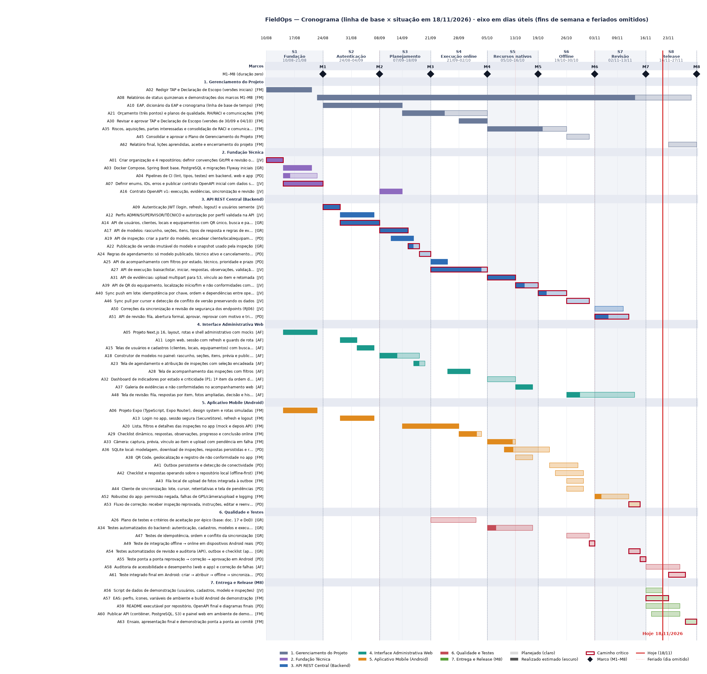

# 📅 Cronograma do Projeto — FieldOps

> Atividade da Aula 04 (Planejamento do Projeto) — Gestão de Projetos, Prof. Me. Deivison S. Takatu. Tabela, gráfico e verificações foram gerados e conferidos por script a partir de um único conjunto de dados (o mesmo que alimenta o orçamento e a tabela de aquisições).

---

## 📌 Identificação

| Campo | Informação |
|---|---|
| **Projeto** | FieldOps — Plataforma de Inspeção em Campo (MVP) |
| **Gerente do projeto** | Felipe Marques (FM) |
| **Integrantes** | Felipe Marques; Gabriel Ribeiro Camargo Miranda; Pedro Henrique Dias de Paula; André dos Santos Fernandes; João Victor de Souza Santos |
| **Instituição / disciplina** | Centro Universitário SENAI São Paulo — UniSENAI-SP, Campus Sorocaba · Análise e Desenvolvimento de Sistemas · Gestão de Projetos |
| **Data de elaboração** | 18/11/2026 |
| **Versão** | 1.0 — linha de base com situação monitorada em 18/11/2026 |
| **Início previsto** | 10/08/2026 (segunda-feira; criação dos repositórios) |
| **Término previsto** | 27/11/2026 (sexta-feira; M8 Release) |
| **Janela do projeto** | 16 semanas, 8 sprints de 2 semanas, 76 dias úteis (descontados 4 feriados em dia útil) |
| **Itens do cronograma** | **71** (63 atividades + 8 marcos de duração zero), todos ligados a um pacote da EAP |
| **Esforço planejado** | 967 h para 5 pessoas (capacidade de referência: 960 h = 5 × 16 sem × 12 h) |
| **Fontes** | Roadmap oficial (`16-roadmap`), backlog (`15`), arquitetura (`11`), API (`12`), mobile (`13`), web (`14`), critérios de aceitação (`17`), TAP/Declaração de Escopo, EAP congelada (v. `eap-fieldops.md`) e milestones do GitHub |

---

## 🧭 Premissas e convenções do cronograma

Rotuladas como **premissa** (P) onde não há dado documentado. Todas valem para as seções abaixo.

| # | Convenção | Conteúdo |
|---|---|---|
| P1 | Calendário | Segunda a sexta. Feriados em dia útil descontados: 07/09 (Independência), 12/10 (N. Sra. Aparecida), 02/11 (Finados) e 20/11 (Consciência Negra). 15/11 (Proclamação) cai num domingo e não afeta o prazo. As datas dos marcos M1–M8 (sextas-feiras) **não mudam** com os feriados; as durações das atividades que os atravessam foram dimensionadas em dias úteis. |
| P2 | Duração | Número de **dias úteis** entre início e término, ambos inclusive. Sprints com feriado têm 9 dias úteis (S3, S5, S7, S8); as demais, 10. |
| P3 | Esforço × duração | A coluna *Esforço (h)* é trabalho, não prazo. Cada pessoa dedica 12 h por semana ao projeto (2,4 h por dia útil); uma atividade de 5 dias com 14 h ocupa uma pessoa por cerca de 1,2 semana de dedicação, em paralelo a outras. |
| P4 | Responsável | **Proposta a confirmar com o grupo**: o responsável de cada atividade é o R do pacote da EAP (§ matriz R/A do plano). Quem apoia aparece só nas horas (seção Responsáveis). |
| P5 | Tipos de dependência | **TI** término→início (a sucessora começa no dia útil seguinte ao término da predecessora); **II** início→início (começa no mesmo dia ou depois); **TT** término→término (termina no mesmo dia ou depois); **IT** início→término (não usado). Para marcos, TI significa que o marco ocorre no dia do término da última predecessora ou depois. |
| P6 | Portões de sprint | Cada marco Mk funciona como portão: as atividades de abertura da sprint seguinte dependem dele (TI). Foi uma escolha de gestão (demonstração aceita antes de seguir), não uma restrição técnica. |
| P7 | Percentual realizado | O GitHub informa **issues concluídas por sprint**, não avanço por atividade. O percentual por atividade é **estimativa do gerente, calibrada para reproduzir a razão de issues de cada sprint** (diferença máxima de 1 ponto percentual, ver seção Acompanhamento). Confirmar com o grupo antes de usar como medição oficial. |
| P8 | Responsáveis e % de 1.x | Os documentos de planejamento (1.2) foram marcados conforme o que existe no repositório de documentação em 18/11 (EAP e cronograma concluídos; plano consolidado pendente). Confirmar com o grupo. |

---

## 📊 Cronograma

### Gráfico de Gantt (imagem)



*Cores por entrega da EAP; parte escura = realizado estimado em 18/11; contorno vermelho = caminho crítico; losangos = marcos; linha vermelha = hoje (18/11/2026). O eixo omite fins de semana e feriados, então cada coluna é um dia útil.*

### Gráfico de Gantt (Mermaid)

```mermaid
gantt
    title Cronograma FieldOps — 10/08/2026 a 27/11/2026 (marcos M1–M8; vermelho = caminho crítico; cinza = concluída; roxo = em andamento)
    dateFormat  YYYY-MM-DD
    axisFormat  %d/%m
    excludes weekends, 2026-09-07, 2026-10-12, 2026-11-02, 2026-11-20
    todayMarker off

    section Marcos
    M1 Fundação :milestone, m1, 2026-08-21, 0d
    M2 Autenticação :milestone, m2, 2026-09-04, 0d
    M3 Planejamento :milestone, m3, 2026-09-18, 0d
    M4 Execução online :milestone, m4, 2026-10-02, 0d
    M5 Recursos nativos :milestone, m5, 2026-10-16, 0d
    M6 Offline :milestone, m6, 2026-10-30, 0d
    M7 Revisão :milestone, m7, 2026-11-13, 0d
    M8 Release :milestone, m8, 2026-11-27, 0d
    section 1. Gerenciamento do Projeto
    A02 Redigir TAP e Declaração de Escopo (versões iniciais) :done, a02, 2026-08-10, 8d
    A08 Relatórios de status quinzenais e demonstrações dos marco… :active, a08, 2026-08-21, 66d
    A10 EAP, dicionário da EAP e cronograma (linha de base de tem… :done, a10, 2026-08-24, 14d
    A21 Orçamento (três pontos) e planos de qualidade, RH/RACI e… :active, a21, 2026-09-14, 15d
    A30 Revisar e aprovar TAP e Declaração de Escopo (versões de… :done, a30, 2026-09-28, 5d
    A35 Riscos, aquisições, partes interessadas e consolidação de… :active, a35, 2026-10-05, 14d
    A45 Consolidar e aprovar o Plano de Gerenciamento do Projeto :a45, 2026-10-26, 4d
    A62 Relatório final, lições aprendidas, aceite e encerramento… :a62, 2026-11-23, 5d
    section 2. Fundação Técnica
    A01 Criar organização e 4 repositórios, definir convenções Gi… :crit, done, a01, 2026-08-10, 3d
    A03 Docker Compose, Spring Boot base, PostgreSQL e migrações… :done, a03, 2026-08-13, 5d
    A04 Pipelines de CI (lint, tipos, testes) em backend, web e a… :active, a04, 2026-08-13, 6d
    A07 Definir enums, IDs, erros e publicar contrato OpenAPI ini… :crit, done, a07, 2026-08-13, 7d
    A16 Contrato OpenAPI v1 - execução, evidências, sincronização… :done, a16, 2026-09-08, 4d
    section 3. API REST Central (Backend)
    A09 Autenticação JWT (login, refresh, logout) e usuários seme… :crit, done, a09, 2026-08-24, 3d
    A12 Perfis ADMIN/SUPERVISOR/TÉCNICO e autorização por perfil… :done, a12, 2026-08-27, 6d
    A14 API de usuários, clientes, locais e equipamentos com QR ú… :crit, done, a14, 2026-08-27, 7d
    A17 API de modelos - rascunho, seções, itens, tipos de respos… :crit, done, a17, 2026-09-08, 5d
    A19 API de inspeção - criar a partir do modelo, encadear clie… :done, a19, 2026-09-10, 4d
    A22 Publicação de versão imutável do modelo e snapshot usado… :crit, active, a22, 2026-09-15, 2d
    A24 Regras de agendamento - só modelo publicado, técnico ativ… :crit, a24, 2026-09-17, 2d
    A25 API de acompanhamento com filtros por estado, técnico, pr… :done, a25, 2026-09-21, 3d
    A27 API de execução - baixar/listar, iniciar, respostas, obse… :crit, active, a27, 2026-09-21, 10d
    A31 API de evidências - upload multipart para S3, vínculo ao… :crit, done, a31, 2026-10-05, 5d
    A39 API de QR do equipamento, localização início/fim e não co… :crit, active, a39, 2026-10-13, 4d
    A40 Sync push em lote - idempotência por chave, ordem e depen… :crit, active, a40, 2026-10-19, 5d
    A46 Sync pull por cursor e detecção de conflito de versão pre… :crit, a46, 2026-10-26, 4d
    A50 Correções da sincronização e revisão de segurança dos end… :a50, 2026-11-03, 5d
    A51 API de revisão - fila, abertura formal, aprovar, reprovar… :crit, active, a51, 2026-11-03, 6d
    section 4. Interface Administrativa Web
    A05 Projeto Next.js 16, layout, rotas e shell administrativo… :done, a05, 2026-08-13, 6d
    A11 Login web, sessão com refresh e guards de rota :done, a11, 2026-08-27, 3d
    A15 Telas de usuários e cadastros (clientes, locais, equipame… :done, a15, 2026-09-01, 3d
    A18 Construtor de modelos no painel - rascunho, seções, itens… :active, a18, 2026-09-08, 7d
    A23 Tela de agendamento e atribuição de inspeções com seleção… :active, a23, 2026-09-16, 2d
    A28 Tela de acompanhamento das inspeções com filtros :done, a28, 2026-09-24, 4d
    A32 Dashboard de indicadores por estado e criticidade (P1, 1º… :a32, 2026-10-05, 5d
    A37 Galeria de evidências e não conformidades no acompanhamen… :done, a37, 2026-10-13, 3d
    A48 Tela de revisão - fila, respostas por item, fotos ampliad… :active, a48, 2026-10-26, 12d
    section 5. Aplicativo Mobile (Android)
    A06 Projeto Expo (TypeScript, Expo Router), design system e r… :done, a06, 2026-08-13, 6d
    A13 Login no app, sessão segura (SecureStore), refresh e logo… :done, a13, 2026-08-27, 6d
    A20 Lista, filtros e detalhes das inspeções no app (mock e de… :done, a20, 2026-09-14, 10d
    A29 Checklist dinâmico, respostas, observações, progresso e c… :active, a29, 2026-09-28, 4d
    A33 Câmera - captura, prévia, vínculo ao item e upload com pe… :active, a33, 2026-10-05, 5d
    A36 SQLite local - modelagem, download de inspeções, resposta… :active, a36, 2026-10-08, 8d
    A38 QR Code, geolocalização e registro de não conformidade no… :a38, 2026-10-13, 3d
    A41 Outbox persistente e detecção de conectividade :a41, 2026-10-21, 5d
    A42 Checklist e respostas operando sobre o repositório local… :a42, 2026-10-22, 5d
    A43 Fila local de upload de fotos integrada à outbox :a43, 2026-10-26, 3d
    A44 Cliente de sincronização - lote, cursor, retentativas e t… :a44, 2026-10-26, 3d
    A52 Robustez do app - permissão negada, falhas de GPS/câmera/… :active, a52, 2026-11-03, 6d
    A53 Fluxo de correção - receber inspeção reprovada, instruçõe… :crit, a53, 2026-11-11, 2d
    section 6. Qualidade e Testes
    A26 Plano de testes e critérios de aceitação por épico (base… :a26, 2026-09-21, 8d
    A34 Testes automatizados do backend - autenticação, cadastros… :active, a34, 2026-10-05, 8d
    A47 Testes de idempotência, ordem e conflito da sincronização :a47, 2026-10-26, 4d
    A49 Teste de integração offline -> online em dispositivos And… :crit, a49, 2026-10-30, 1d
    A54 Testes automatizados de revisão e auditoria (API), outbox… :crit, a54, 2026-11-11, 2d
    A55 Teste ponta a ponta reprovação -> correção -> aprovação e… :crit, a55, 2026-11-13, 1d
    A58 Auditoria de acessibilidade e desempenho (web e app) e co… :a58, 2026-11-16, 6d
    A61 Teste integrado final em Android - criar -> atribuir -> o… :crit, a61, 2026-11-23, 3d
    section 7. Entrega e Release (M8)
    A56 Script de dados de demonstração (usuários, cadastros, mod… :a56, 2026-11-16, 3d
    A57 EAS - perfis, ícones, variáveis de ambiente e build Andro… :crit, a57, 2026-11-16, 4d
    A59 README executável por repositório, OpenAPI final e diagra… :a59, 2026-11-16, 6d
    A60 Publicar API (contêiner, PostgreSQL, S3) e painel web em… :a60, 2026-11-17, 5d
    A63 Ensaio, apresentação final e demonstração ponta a ponta a… :crit, a63, 2026-11-26, 2d
```



> No Mermaid, as barras usam duração em dias úteis (`excludes weekends` + os 4 feriados), por isso coincidem com as datas da tabela abaixo.

---

## 📋 Lista de Atividades

63 atividades e 8 marcos, em ordem de início. **WBS** é o código do pacote da EAP congelada. Duração em dias úteis (du). Status em 18/11/2026 (ver Acompanhamento).

| ID | WBS | Atividade | Início | Término | Duração | Resp. | Predecessoras (tipo) | Esforço (h) | Sprint | Status |
|---|---|---|---|---|---:|---|---|---:|---|---|
| A01 | 2.1 | Criar organização e 4 repositórios; definir convenções Git/PR e revisão obrigatória 🔺 | 10/08 | 12/08 | 3 du | JV | — | 9 | S1 | 🔵 Concluída |
| A02 | 1.1 | Redigir TAP e Declaração de Escopo (versões iniciais) | 10/08 | 19/08 | 8 du | FM | — | 8 | S1 | 🔵 Concluída |
| A03 | 2.4 | Docker Compose, Spring Boot base, PostgreSQL e migrações Flyway iniciais | 13/08 | 19/08 | 5 du | GR | A01 (TI) | 14 | S1 | 🔵 Concluída |
| A04 | 2.3 | Pipelines de CI (lint, tipos, testes) em backend, web e app | 13/08 | 20/08 | 6 du | PD | A01 (TI) | 14 | S1 | 🔴 Atrasada (20%) |
| A05 | 4.1 | Projeto Next.js 16, layout, rotas e shell administrativo com mocks | 13/08 | 20/08 | 6 du | AF | A01 (TI) | 24 | S1 | 🔵 Concluída |
| A06 | 5.1 | Projeto Expo (TypeScript, Expo Router), design system e rotas simuladas | 13/08 | 20/08 | 6 du | FM | A01 (TI) | 12 | S1 | 🔵 Concluída |
| A07 | 2.2 | Definir enums, IDs, erros e publicar contrato OpenAPI inicial com dados simulados 🔺 | 13/08 | 21/08 | 7 du | JV | A01 (TI) | 18 | S1 | 🔵 Concluída |
| A08 | 1.3 | Relatórios de status quinzenais e demonstrações dos marcos M1–M8 | 21/08 | 26/11 | 66 du | FM | — | 14 | S1–S8 | 🟡 Atenção (85%) |
| **M1** | — | 🚩 **Marco M1 — Fundação** | 21/08 | 21/08 | 0 du | — | A07 (TI), A06 (TI), A05 (TI), A03 (TI), A04 (TI) | — | S1 | 🟡 Atingido com pendências |
| A09 | 3.1 | Autenticação JWT (login, refresh, logout) e usuários semente 🔺 | 24/08 | 26/08 | 3 du | JV | A07 (TI), A03 (TI), M1 (TI) | 14 | S2 | 🔵 Concluída |
| A10 | 1.2 | EAP, dicionário da EAP e cronograma (linha de base de tempo) | 24/08 | 11/09 | 14 du | FM | A02 (TI), M1 (TI) | 14 | S2–S3 | 🔵 Concluída |
| A11 | 4.1 | Login web, sessão com refresh e guards de rota | 27/08 | 31/08 | 3 du | AF | A09 (TI), A05 (TI), M1 (TI) | 10 | S2 | 🔵 Concluída |
| A12 | 3.1 | Perfis ADMIN/SUPERVISOR/TÉCNICO e autorização por perfil validada na API | 27/08 | 03/09 | 6 du | JV | A09 (TI) | 12 | S2 | 🔵 Concluída |
| A13 | 5.2 | Login no app, sessão segura (SecureStore), refresh e logout | 27/08 | 03/09 | 6 du | FM | A09 (TI), A06 (TI), M1 (TI) | 18 | S2 | 🔵 Concluída |
| A14 | 3.2 | API de usuários, clientes, locais e equipamentos com QR único, busca e paginação 🔺 | 27/08 | 04/09 | 7 du | GR | A09 (TI) | 32 | S2 | 🔵 Concluída |
| A15 | 4.2 | Telas de usuários e cadastros (clientes, locais, equipamentos) com busca e paginação | 01/09 | 03/09 | 3 du | AF | A11 (TI), A14 (II) | 14 | S2 | 🔵 Concluída |
| **M2** | — | 🚩 **Marco M2 — Autenticação** | 04/09 | 04/09 | 0 du | — | A14 (TI), A12 (TI), A11 (TI), A15 (TI), A13 (TI) | — | S2 | 🔵 Atingido |
| A16 | 2.2 | Contrato OpenAPI v1: execução, evidências, sincronização e revisão | 08/09 | 11/09 | 4 du | JV | M2 (TI) | 16 | S3 | 🔵 Concluída |
| A17 | 3.3 | API de modelos: rascunho, seções, itens, tipos de resposta e regras de evidência 🔺 | 08/09 | 14/09 | 5 du | GR | M2 (TI) | 18 | S3 | 🔵 Concluída |
| A18 | 4.3 | Construtor de modelos no painel: rascunho, seções, itens, prévia e publicação | 08/09 | 16/09 | 7 du | AF | M2 (TI), A22 (TT) | 24 | S3 | 🔴 Atrasada (45%) |
| A19 | 3.4 | API de inspeção: criar a partir do modelo, encadear cliente/local/equipamento, atribuir técnico | 10/09 | 15/09 | 4 du | PD | M2 (TI) | 14 | S3 | 🔵 Concluída |
| A20 | 5.3 | Lista, filtros e detalhes das inspeções no app (mock e depois API) | 14/09 | 25/09 | 10 du | FM | M2 (TI) | 12 | S3–S4 | 🔵 Concluída |
| A21 | 1.2 | Orçamento (três pontos) e planos de qualidade, RH/RACI e comunicações | 14/09 | 02/10 | 15 du | FM | A10 (TI) | 17 | S3–S4 | 🔴 Atrasada (50%) |
| A22 | 3.3 | Publicação de versão imutável do modelo e snapshot usado pela inspeção 🔺 | 15/09 | 16/09 | 2 du | GR | A17 (TI) | 12 | S3 | 🔴 Atrasada (50%) |
| A23 | 4.4 | Tela de agendamento e atribuição de inspeções com seleção encadeada | 16/09 | 17/09 | 2 du | AF | A19 (TI), A22 (II) | 8 | S3 | 🔴 Atrasada (50%) |
| A24 | 3.4 | Regras de agendamento: só modelo publicado, técnico ativo e cancelamento com justificativa 🔺 | 17/09 | 18/09 | 2 du | PD | A22 (TI), A19 (TI) | 12 | S3 | 🔴 Atrasada |
| **M3** | — | 🚩 **Marco M3 — Planejamento** | 18/09 | 18/09 | 0 du | — | A22 (TI), A24 (TI), A18 (TI), A23 (TI) | — | S3 | 🟡 Atingido com pendências |
| A25 | 3.4 | API de acompanhamento com filtros por estado, técnico, prioridade e prazo | 21/09 | 23/09 | 3 du | PD | M3 (TI) | 12 | S4 | 🔵 Concluída |
| A26 | 6.1 | Plano de testes e critérios de aceitação por épico (base: doc. 17 e DoD) | 21/09 | 30/09 | 8 du | GR | M3 (TI) | 22 | S4 | 🔴 Atrasada |
| A27 | 3.5 | API de execução: baixar/listar, iniciar, respostas, observações, validação e conclusão 🔺 | 21/09 | 02/10 | 10 du | JV | M3 (TI), A16 (TI) | 30 | S4 | 🟡 Atenção (90%) |
| A28 | 4.4 | Tela de acompanhamento das inspeções com filtros | 24/09 | 29/09 | 4 du | AF | A25 (TI) | 12 | S4 | 🔵 Concluída |
| A29 | 5.4 | Checklist dinâmico, respostas, observações, progresso e conclusão online | 28/09 | 01/10 | 4 du | FM | A20 (TI), A27 (II) | 22 | S4 | 🟡 Atenção (80%) |
| A30 | 1.1 | Revisar e aprovar TAP e Declaração de Escopo (versões de 30/09 e 04/10) | 28/09 | 02/10 | 5 du | FM | A02 (TI) | 6 | S4 | 🔵 Concluída |
| **M4** | — | 🚩 **Marco M4 — Execução online** | 02/10 | 02/10 | 0 du | — | A27 (TI), A29 (TI), A28 (TI) | — | S4 | 🟡 Atingido com pendências |
| A31 | 3.5 | API de evidências: upload multipart para S3, vínculo ao item e retomada 🔺 | 05/10 | 09/10 | 5 du | JV | M4 (TI), A27 (TI) | 14 | S5 | 🔵 Concluída |
| A32 | 4.4 | Dashboard de indicadores por estado e criticidade (P1; 1º item da ordem de corte) | 05/10 | 09/10 | 5 du | AF | A28 (TI) | 8 | S5 | 🔴 Atrasada |
| A33 | 5.5 | Câmera: captura, prévia, vínculo ao item e upload com pendência em falha | 05/10 | 09/10 | 5 du | FM | M4 (TI), A31 (TT) | 14 | S5 | 🟡 Atenção (90%) |
| A34 | 6.2 | Testes automatizados do backend: autenticação, cadastros, modelos e execução | 05/10 | 15/10 | 8 du | GR | A27 (TI), A26 (TI) | 26 | S5 | 🔴 Atrasada (20%) |
| A35 | 1.2 | Riscos, aquisições, partes interessadas e consolidação de RACI e comunicações | 05/10 | 23/10 | 14 du | FM | A21 (II) | 19 | S5–S6 | 🟡 Atenção (70%) |
| A36 | 5.6 | SQLite local: modelagem, download de inspeções, respostas persistidas e retomada | 08/10 | 20/10 | 8 du | PD | A29 (TI) | 30 | S5–S6 | 🔴 Atrasada (20%) |
| A37 | 4.5 | Galeria de evidências e não conformidades no acompanhamento web | 13/10 | 15/10 | 3 du | AF | A31 (TI), A28 (TI) | 14 | S5 | 🔵 Concluída |
| A38 | 5.5 | QR Code, geolocalização e registro de não conformidade no app | 13/10 | 15/10 | 3 du | FM | A33 (TI), A39 (II) | 12 | S5 | 🔴 Atrasada |
| A39 | 3.5 | API de QR do equipamento, localização início/fim e não conformidades com criticidade 🔺 | 13/10 | 16/10 | 4 du | JV | A31 (TI) | 12 | S5 | 🔴 Atrasada (40%) |
| **M5** | — | 🚩 **Marco M5 — Recursos nativos** | 16/10 | 16/10 | 0 du | — | A39 (TI), A38 (TI), A33 (TI), A37 (TI) | — | S5 | 🔴 Não atingido |
| A40 | 3.6 | Sync push em lote: idempotência por chave, ordem e dependências entre operações 🔺 | 19/10 | 23/10 | 5 du | JV | M5 (TI), A16 (TI), A39 (TI) | 14 | S6 | 🔴 Atrasada (30%) |
| A41 | 5.6 | Outbox persistente e detecção de conectividade | 21/10 | 27/10 | 5 du | PD | A36 (II) | 14 | S6 | 🔴 Atrasada |
| A42 | 5.4 | Checklist e respostas operando sobre o repositório local (offline-first) | 22/10 | 28/10 | 5 du | FM | A36 (II) | 12 | S6 | 🔴 Atrasada |
| A43 | 5.5 | Fila local de upload de fotos integrada à outbox | 26/10 | 28/10 | 3 du | FM | A41 (II), A33 (TI) | 8 | S6 | 🔴 Atrasada |
| A44 | 5.7 | Cliente de sincronização: lote, cursor, retentativas e tela de pendências | 26/10 | 28/10 | 3 du | PD | A40 (TI), A41 (II), A46 (II) | 14 | S6 | 🔴 Atrasada |
| A45 | 1.2 | Consolidar e aprovar o Plano de Gerenciamento do Projeto | 26/10 | 29/10 | 4 du | FM | A35 (TI) | 4 | S6 | 🔴 Atrasada |
| A46 | 3.6 | Sync pull por cursor e detecção de conflito de versão preservando os dados 🔺 | 26/10 | 29/10 | 4 du | JV | A40 (TI) | 12 | S6 | 🔴 Atrasada |
| A47 | 6.2 | Testes de idempotência, ordem e conflito da sincronização | 26/10 | 29/10 | 4 du | GR | A40 (TI), A46 (II) | 24 | S6 | 🔴 Atrasada |
| A48 | 4.6 | Tela de revisão: fila, respostas por item, fotos ampliadas, decisão e histórico | 26/10 | 11/11 | 12 du | AF | A16 (TI), M5 (TI), A51 (TT) | 34 | S6–S7 | 🔴 Atrasada (20%) |
| A49 | 6.3 | Teste de integração offline → online em dispositivos Android reais 🔺 | 30/10 | 30/10 | 1 du | PD | A46 (TI), A44 (TI), A42 (TI), A43 (TI) | 6 | S6 | 🔴 Atrasada |
| **M6** | — | 🚩 **Marco M6 — Offline** | 30/10 | 30/10 | 0 du | — | A49 (TI), A47 (TI), A45 (TI) | — | S6 | 🔴 Não atingido |
| A50 | 3.6 | Correções da sincronização e revisão de segurança dos endpoints (RJ06) | 03/11 | 09/11 | 5 du | JV | M6 (TI), A47 (TI) | 14 | S7 | 🔴 Atrasada |
| A51 | 3.7 | API de revisão: fila, abertura formal, aprovar, reprovar com motivo e trilha de auditoria 🔺 | 03/11 | 10/11 | 6 du | PD | M6 (TI) | 22 | S7 | 🔴 Atrasada (40%) |
| A52 | 5.5 | Robustez do app: permissão negada, falhas de GPS/câmera/upload e logging | 03/11 | 10/11 | 6 du | FM | M6 (TI) | 8 | S7 | 🔴 Atrasada (20%) |
| A53 | 5.7 | Fluxo de correção: receber inspeção reprovada, instruções, editar e reenviar 🔺 | 11/11 | 12/11 | 2 du | PD | A51 (TI), A44 (TI) | 10 | S7 | 🔴 Atrasada |
| A54 | 6.2 | Testes automatizados de revisão e auditoria (API), outbox e checklist (app), fluxos do painel 🔺 | 11/11 | 12/11 | 2 du | GR | A51 (TI), A50 (TI) | 27 | S7 | 🔴 Atrasada |
| A55 | 6.3 | Teste ponta a ponta reprovação → correção → aprovação em Android 🔺 | 13/11 | 13/11 | 1 du | PD | A53 (TI), A48 (TI), A54 (TI) | 5 | S7 | 🔴 Atrasada |
| **M7** | — | 🚩 **Marco M7 — Revisão** | 13/11 | 13/11 | 0 du | — | A55 (TI), A48 (TI), A54 (TI) | — | S7 | 🔴 Não atingido |
| A56 | 7.1 | Script de dados de demonstração (usuários, cadastros, modelo e inspeções) | 16/11 | 18/11 | 3 du | JV | M7 (TI) | 14 | S8 | 🔴 Atrasada |
| A57 | 7.2 | EAS: perfis, ícones, variáveis de ambiente e build Android de demonstração 🔺 | 16/11 | 19/11 | 4 du | FM | M7 (TI) | 10 | S8 | 🔴 Atrasada |
| A58 | 6.4 | Auditoria de acessibilidade e desempenho (web e app) e correção de falhas | 16/11 | 24/11 | 6 du | AF | M7 (TI) | 24 | S8 | 🔴 Atrasada |
| A59 | 7.3 | README executável por repositório, OpenAPI final e diagramas finais | 16/11 | 24/11 | 6 du | PD | M7 (TI) | 22 | S8 | 🔴 Atrasada |
| A60 | 7.2 | Publicar API (contêiner, PostgreSQL, S3) e painel web em ambiente de demonstração | 17/11 | 24/11 | 5 du | FM | M7 (TI), A56 (II) | 24 | S8 | 🔴 Atrasada |
| A61 | 6.3 | Teste integrado final em Android: criar → atribuir → offline → sincronizar → revisar 🔺 | 23/11 | 25/11 | 3 du | PD | A57 (TI), A56 (TI), A55 (TI), A60 (TT) | 16 | S8 | ⬜ Não iniciada |
| A62 | 1.4 | Relatório final, lições aprendidas, aceite e encerramento do projeto | 23/11 | 27/11 | 5 du | FM | M7 (TI) | 8 | S8 | ⬜ Não iniciada |
| A63 | 7.4 | Ensaio, apresentação final e demonstração ponta a ponta ao comitê 🔺 | 26/11 | 27/11 | 2 du | FM | A61 (TI), A58 (TI), A59 (TI), A60 (TI) | 8 | S8 | ⬜ Não iniciada |
| **M8** | — | 🚩 **Marco M8 — Release** | 27/11 | 27/11 | 0 du | — | A63 (TI) | — | S8 | ⬜ Futuro (risco alto) |

🔺 = atividade do caminho crítico. Total de esforço: **967 h**. Datas sem ano são de 2026.

---

## 🔗 Dependências

Todas as predecessoras (com tipo) estão na coluna própria da lista acima. As relações abaixo são as que **definem a ordem técnica** do projeto e que o roteiro de integração exige.

```text
Fundação (S1)       repositórios → contrato OpenAPI inicial → [M1]
Acesso (S2)         autenticação JWT → API de usuários e cadastros → [M2]  (login antes de cadastros)
Planejamento (S3)   modelo de inspeção → versão publicada + snapshot → agendamento/atribuição → [M3]
Execução (S4)       API de execução → checklist online no app → [M4]
Nativos (S5)        API de evidências → câmera → QR/GPS/não conformidade → [M5]
Offline (S6)        SQLite → outbox → sync push → sync pull → teste offline→online → [M6]
Revisão (S7)        API de revisão → correção no app → teste reprovação→aprovação → [M7]
Release (S8)        build EAS + dados de demo → teste final em Android → apresentação → [M8]
```

| Atividade (predecessora) | Atividade (sucessora) | Tipo | Por que a ordem importa |
|---|---|---|---|
| A07 Definir enums, IDs, erros e publicar contrato  | A09 Autenticação JWT (login, refresh, logout) e us | TI | Contrato OpenAPI antes de integrar: app e painel consomem o contrato, não código de backend (RJ01). |
| A09 Autenticação JWT (login, refresh, logout) e us | A14 API de usuários, clientes, locais e equipament | TI | Login antes de cadastros: todo endpoint de cadastro exige JWT e perfil. |
| A09 Autenticação JWT (login, refresh, logout) e us | A13 Login no app, sessão segura (SecureStore), ref | TI | O app só integra login depois que o endpoint de autenticação existe. |
| A09 Autenticação JWT (login, refresh, logout) e us | A11 Login web, sessão com refresh e guards de rota | TI | Idem para o painel web. |
| A22 Publicação de versão imutável do modelo e snap | A24 Regras de agendamento | TI | Modelo publicado antes de agendar: a inspeção nasce de uma versão imutável (snapshot). |
| A19 API de inspeção | A24 Regras de agendamento | TI | As regras de agendamento validam a inspeção criada pela API. |
| A27 API de execução | A29 Checklist dinâmico, respostas, observações, pr | II | App e API de execução avançam juntos; a integração fecha no mesmo marco. |
| A29 Checklist dinâmico, respostas, observações, pr | A36 SQLite local | TI | Checklist online antes de offline: o armazenamento local espelha o fluxo que já funciona online. |
| A31 API de evidências | A33 Câmera | TT | A câmera só fecha depois que o upload da API existe. |
| A40 Sync push em lote | A46 Sync pull por cursor e detecção de conflito de | TI | Push idempotente define o formato de operação antes do pull por cursor. |
| A46 Sync pull por cursor e detecção de conflito de | A49 Teste de integração offline → online em dispos | TI | Teste offline→online só depois que push e pull estão prontos. |
| A44 Cliente de sincronização | A53 Fluxo de correção | TI | Sincronização antes da revisão ponta a ponta: a correção reenvia a inspeção pela outbox. |
| A51 API de revisão | A53 Fluxo de correção | TI | O app só recebe inspeção reprovada depois que a API de revisão decide e registra o motivo. |
| A53 Fluxo de correção | A55 Teste ponta a ponta reprovação → correção → ap | TI | Teste de reprovação → correção → aprovação exige o fluxo de correção pronto. |
| A55 Teste ponta a ponta reprovação → correção → ap | A61 Teste integrado final em Android | TI | Teste final em Android parte do ciclo de revisão já validado. |
| A57 EAS | A61 Teste integrado final em Android | TI | O teste final usa a build Android de demonstração. |
| A61 Teste integrado final em Android | A63 Ensaio, apresentação final e demonstração pont | TI | Apresentação final depois do teste ponta a ponta. |

### 📋 Dependências com os marcos (portões)

| Marco | Depende de (término) | Libera (início na sprint seguinte) |
|---|---|---|
| M1 — Fundação (21/08) | A07, A06, A05, A03, A04 | A09, A10, A11, A13 |
| M2 — Autenticação (04/09) | A14, A12, A11, A15, A13 | A16, A17, A18, A19, A20 |
| M3 — Planejamento (18/09) | A22, A24, A18, A23 | A25, A26, A27 |
| M4 — Execução online (02/10) | A27, A29, A28 | A31, A33 |
| M5 — Recursos nativos (16/10) | A39, A38, A33, A37 | A40, A48 |
| M6 — Offline (30/10) | A49, A47, A45 | A50, A51, A52 |
| M7 — Revisão (13/11) | A55, A48, A54 | A56, A57, A58, A59, A60, A62 |
| M8 — Release (27/11) | A63 | — |

---

## 🔺 Caminho crítico

**Como foi encontrado.** (1) Cada atividade foi posicionada na data mais cedo permitida pelas predecessoras e pela abertura da sprint; um script confere que nenhuma começa antes do que as dependências permitem. (2) A passagem para trás parte do marco M8 em 27/11/2026 e calcula, em dias úteis, o **término mais tardio** (TT) de cada atividade respeitando o tipo de cada dependência (TI: início da sucessora − 1; II: início da sucessora + duração − 1; TT: término da sucessora). (3) **Folga total = término mais tardio − término planejado.** O caminho crítico é o conjunto de atividades com folga zero. Não há nivelamento de recursos: é o caminho da rede de dependências, e a carga por pessoa é tratada à parte.

| Ordem | ID | Atividade | Resp. | Início | Término | Dur. | Folga | Predecessora crítica |
|---:|---|---|---|---|---|---:|---:|---|
| 1 | A01 | Criar organização e 4 repositórios; definir convenções Git/PR e revisão obrigatória | JV | 10/08 | 12/08 | 3 | 0 | — |
| 2 | A07 | Definir enums, IDs, erros e publicar contrato OpenAPI inicial com dados simulados | JV | 13/08 | 21/08 | 7 | 0 | A01 |
| 3 | **M1** | 🚩 Marco M1 — Fundação | — | 21/08 | 21/08 | 0 | 0 | — |
| 4 | A09 | Autenticação JWT (login, refresh, logout) e usuários semente | JV | 24/08 | 26/08 | 3 | 0 | A07, M1 |
| 5 | A14 | API de usuários, clientes, locais e equipamentos com QR único, busca e paginação | GR | 27/08 | 04/09 | 7 | 0 | A09 |
| 6 | **M2** | 🚩 Marco M2 — Autenticação | — | 04/09 | 04/09 | 0 | 0 | — |
| 7 | A17 | API de modelos: rascunho, seções, itens, tipos de resposta e regras de evidência | GR | 08/09 | 14/09 | 5 | 0 | M2 |
| 8 | A22 | Publicação de versão imutável do modelo e snapshot usado pela inspeção | GR | 15/09 | 16/09 | 2 | 0 | A17 |
| 9 | A24 | Regras de agendamento: só modelo publicado, técnico ativo e cancelamento com justificativa | PD | 17/09 | 18/09 | 2 | 0 | A22 |
| 10 | **M3** | 🚩 Marco M3 — Planejamento | — | 18/09 | 18/09 | 0 | 0 | — |
| 11 | A27 | API de execução: baixar/listar, iniciar, respostas, observações, validação e conclusão | JV | 21/09 | 02/10 | 10 | 0 | M3 |
| 12 | **M4** | 🚩 Marco M4 — Execução online | — | 02/10 | 02/10 | 0 | 0 | — |
| 13 | A31 | API de evidências: upload multipart para S3, vínculo ao item e retomada | JV | 05/10 | 09/10 | 5 | 0 | M4, A27 |
| 14 | A39 | API de QR do equipamento, localização início/fim e não conformidades com criticidade | JV | 13/10 | 16/10 | 4 | 0 | A31 |
| 15 | **M5** | 🚩 Marco M5 — Recursos nativos | — | 16/10 | 16/10 | 0 | 0 | — |
| 16 | A40 | Sync push em lote: idempotência por chave, ordem e dependências entre operações | JV | 19/10 | 23/10 | 5 | 0 | M5, A39 |
| 17 | A46 | Sync pull por cursor e detecção de conflito de versão preservando os dados | JV | 26/10 | 29/10 | 4 | 0 | A40 |
| 18 | A49 | Teste de integração offline → online em dispositivos Android reais | PD | 30/10 | 30/10 | 1 | 0 | A46 |
| 19 | **M6** | 🚩 Marco M6 — Offline | — | 30/10 | 30/10 | 0 | 0 | — |
| 20 | A51 | API de revisão: fila, abertura formal, aprovar, reprovar com motivo e trilha de auditoria | PD | 03/11 | 10/11 | 6 | 0 | M6 |
| 21 | A53 | Fluxo de correção: receber inspeção reprovada, instruções, editar e reenviar | PD | 11/11 | 12/11 | 2 | 0 | A51 |
| 22 | A54 | Testes automatizados de revisão e auditoria (API), outbox e checklist (app), fluxos do painel | GR | 11/11 | 12/11 | 2 | 0 | A51 |
| 23 | A55 | Teste ponta a ponta reprovação → correção → aprovação em Android | PD | 13/11 | 13/11 | 1 | 0 | A53, A54 |
| 24 | **M7** | 🚩 Marco M7 — Revisão | — | 13/11 | 13/11 | 0 | 0 | — |
| 25 | A57 | EAS: perfis, ícones, variáveis de ambiente e build Android de demonstração | FM | 16/11 | 19/11 | 4 | 0 | M7 |
| 26 | A61 | Teste integrado final em Android: criar → atribuir → offline → sincronizar → revisar | PD | 23/11 | 25/11 | 3 | 0 | A57, A55 |
| 27 | A63 | Ensaio, apresentação final e demonstração ponta a ponta ao comitê | FM | 26/11 | 27/11 | 2 | 0 | A61 |
| 28 | **M8** | 🚩 Marco M8 — Release | — | 27/11 | 27/11 | 0 | 0 | — |

**Leitura.** O caminho principal é uma corrente sem folga de 10/08 a 27/11: 20 atividades e 8 marcos com folga zero, e **todas as atividades críticas são do backend** (API/contrato), exceto os testes de integração, a build EAS e a demonstração final. Isso casa com o que o GitHub mostra: o backend é o repositório mais atrasado (14 de 41 issues fechadas) e a sincronização (S6) é o ponto onde a corrente quebrou.

- **Ramo paralelo em S7:** após `A51`, `A53` e `A54` têm folga zero e se encontram em `A55`.
- **A62 (relatório final e aceite)** termina em 27/11 sem predecessora crítica: a folga zero vem apenas de ele ser a última atividade do projeto (convenção).
- **Quase críticas (folga de 1 du):** A04, A05, A06, A08, A11, A12, A13, A15, A19, A20, A23, A29, A33, A35, A37, A38, A42, A43, A44, A45, A47, A48, A50, A56, A58, A59, A60. Qualquer atraso de um dia nelas já consome a única folga que sobra antes do marco.
- **Folga de 2 du:** A03, A18.

### Situação do caminho crítico em 18/11/2026

| ID | Atividade | Término planejado | Realizado | Situação |
|---|---|---|---:|---|
| A22 | Publicação de versão imutável do modelo e snapshot usado pela inspeção | 16/09 | 50% | 🔴 Atrasada |
| A24 | Regras de agendamento: só modelo publicado, técnico ativo e cancelamento com justificativa | 18/09 | 0% | 🔴 Atrasada |
| A27 | API de execução: baixar/listar, iniciar, respostas, observações, validação e conclusão | 02/10 | 90% | 🟡 Atenção |
| A39 | API de QR do equipamento, localização início/fim e não conformidades com criticidade | 16/10 | 40% | 🔴 Atrasada |
| A40 | Sync push em lote: idempotência por chave, ordem e dependências entre operações | 23/10 | 30% | 🔴 Atrasada |
| A46 | Sync pull por cursor e detecção de conflito de versão preservando os dados | 29/10 | 0% | 🔴 Atrasada |
| A49 | Teste de integração offline → online em dispositivos Android reais | 30/10 | 0% | 🔴 Atrasada |
| A51 | API de revisão: fila, abertura formal, aprovar, reprovar com motivo e trilha de auditoria | 10/11 | 40% | 🔴 Atrasada |
| A53 | Fluxo de correção: receber inspeção reprovada, instruções, editar e reenviar | 12/11 | 0% | 🔴 Atrasada |
| A54 | Testes automatizados de revisão e auditoria (API), outbox e checklist (app), fluxos do painel | 12/11 | 0% | 🔴 Atrasada |
| A55 | Teste ponta a ponta reprovação → correção → aprovação em Android | 13/11 | 0% | 🔴 Atrasada |
| A57 | EAS: perfis, ícones, variáveis de ambiente e build Android de demonstração | 19/11 | 0% | 🔴 Atrasada |
| A61 | Teste integrado final em Android: criar → atribuir → offline → sincronizar → revisar | 25/11 | 0% | ⬜ Não iniciada |
| A63 | Ensaio, apresentação final e demonstração ponta a ponta ao comitê | 27/11 | 0% | ⬜ Não iniciada |

Se o que falta da corrente crítica for executado em sequência, sem compressão, restam **32,5 dias úteis de trabalho** (soma de duração × (1 − % realizado) nas atividades críticas). Contados a partir de 18/11 (já considerando o recesso de 25/12), o marco M8 só seria atingido por volta de **06/01/2027**, isto é, 40 dias corridos depois de 27/11. É uma projeção de ordem de grandeza, não uma previsão: ela supõe que o backend restante seja feito pela equipe atual no ritmo planejado e que nenhum corte seja aplicado. As ações de corte e re-baseline estão na seção *Atrasos e Ações*.

---

## 🚩 Marcos do Projeto

Marcos têm duração zero e ocorrem na sexta-feira que fecha a sprint. O critério de aceitação é o incremento demonstrável do roadmap oficial (`16-roadmap`, §16.6). A situação usa a razão de issues da sprint no GitHub: 🔵 ≥ 95%, 🟡 de 70% a 94%, 🔴 abaixo de 70%.

| Marco | Data prevista | Sprint | Critério de aceitação | Predecessoras | Situação em 18/11 |
|---|---|---|---|---|---|
| 🚩 **M1 — Fundação** | 21/08/2026 | S1 | 3 aplicações executáveis (API, web, app) e contrato OpenAPI inicial publicado | A07, A06, A05, A03, A04 | 🟡 Atingido com pendências (15/17 issues) |
| 🚩 **M2 — Autenticação** | 04/09/2026 | S2 | Login integrado nos 2 frontends; usuários e cadastros disponíveis | A14, A12, A11, A15, A13 | 🔵 Atingido (17/17 issues) |
| 🚩 **M3 — Planejamento** | 18/09/2026 | S3 | Supervisor cria modelo, publica versão, agenda e atribui inspeção pela web | A22, A24, A18, A23 | 🟡 Atingido com pendências (7/10 issues) |
| 🚩 **M4 — Execução online** | 02/10/2026 | S4 | Técnico executa checklist dinâmico pelo app e o envia à API | A27, A29, A28 | 🟡 Atingido com pendências (10/14 issues) |
| 🚩 **M5 — Recursos nativos** | 16/10/2026 | S5 | Foto, QR Code, localização e não conformidade funcionando em Android | A39, A38, A33, A37 | 🔴 Não atingido (4/8 issues) |
| 🚩 **M6 — Offline** | 30/10/2026 | S6 | Inspeção concluída sem rede e sincronizada de forma idempotente | A49, A47, A45 | 🔴 Não atingido (2/13 issues) |
| 🚩 **M7 — Revisão** | 13/11/2026 | S7 | Aprovação/reprovação com histórico, correção no app e testes dos fluxos críticos | A55, A48, A54 | 🔴 Não atingido (2/14 issues) |
| 🚩 **M8 — Release** | 27/11/2026 | S8 | Build Android, painel web e API executáveis; demo ponta a ponta apresentada | A63 | ⬜ Futuro (risco alto) |

---

## 👥 Responsáveis

Responsável por atividade = R do pacote da EAP (**proposta a confirmar com o grupo**). As colunas de esforço somam as horas lançadas à pessoa em qualquer atividade (como responsável ou apoio).

| Responsável | Papel no projeto | Atividades como responsável (ID) | Nº ativ. | Esforço total (h) | Desvio da média |
|---|---|---|---:|---:|---:|
| **FM** — Felipe Marques | Gerente do projeto + dev. mobile | A02, A06, A08, A10, A13, A20, A21, A29, A30, A33, A35, A38, A42, A43, A45, A52, A57, A60, A62, A63 | 20 | 202 | +4,4% |
| **JV** — João Victor Souza | Dev. backend (líder técnico da API) | A01, A07, A09, A12, A16, A27, A31, A39, A40, A46, A50, A56 | 12 | 190 | -1,8% |
| **GR** — Gabriel Ribeiro | Dev. backend (cadastros, modelos, testes) | A03, A14, A17, A22, A26, A34, A47, A54 | 8 | 192 | -0,7% |
| **PD** — Pedro Dias | Dev. backend + mobile offline + documentação | A04, A19, A24, A25, A36, A41, A44, A49, A51, A53, A55, A59, A61 | 13 | 191 | -1,2% |
| **AF** — André Fernandes | Dev. web (Next.js) | A05, A11, A15, A18, A23, A28, A32, A37, A48, A58 | 10 | 192 | -0,7% |
| **Total** | | | 63 | **967** | média 193,4 h |

Todas as pessoas ficam dentro de ±15% de 192 h (faixa 163 a 221 h) e o total está a +0,7% de 960 h (faixa ±10%: 864 a 1.056 h).

### Carga por sprint (esforço distribuído uniformemente nos dias úteis de cada atividade)

Capacidade = 24 h por pessoa por sprint (2 semanas × 12 h). Semáforo: 🟢 até 24 h; 🟡 até 30 h (125%); 🔴 acima.

| Pessoa | S1 | S2 | S3 | S4 | S5 | S6 | S7 | S8 | Total | Pico semanal (semana de) |
|---|---:|---:|---:|---:|---:|---:|---:|---:|---:|---|
| **FM** | 19,2 🟢 | 22,7 🟢 | 14,0 🟢 | 31,5 🔴 | 33,1 🔴 | 31,0 🔴 | 14,9 🟢 | 35,7 🔴 | 202 | 22,3 h (26/10) |
| **JV** | 24,0 🟢 | 26,0 🟡 | 16,0 🟢 | 30,0 🟡 | 27,3 🟡 | 30,7 🔴 | 20,0 🟢 | 16,0 🟢 | 190 | 18,0 h (24/08) |
| **GR** | 16,0 🟢 | 28,0 🟡 | 31,0 🔴 | 24,0 🟢 | 30,9 🔴 | 26,1 🟡 | 18,0 🟢 | 18,0 🟢 | 192 | 20,4 h (26/10) |
| **PD** | 16,0 🟢 | 11,4 🟢 | 27,6 🟡 | 24,0 🟢 | 21,4 🟢 | 29,6 🟡 | 31,0 🔴 | 30,0 🟡 | 191 | 20,3 h (09/11) |
| **AF** | 24,0 🟢 | 24,0 🟢 | 33,0 🔴 | 14,0 🟢 | 23,9 🟢 | 21,2 🟢 | 23,8 🟢 | 28,0 🟡 | 192 | 20,2 h (26/10) |

Das 40 combinações pessoa × sprint, 9 estão em 🔴 e 9 em 🟡. O gerente (FM) tem 🔴 em S4, S5, S6 e S8 (gestão + 5 pacotes de mobile + build e demonstração): é a evidência de sobrecarga e de ponto único de falha registrada no plano de riscos. Os picos de sobreposição de S3 (GR, AF) e S7 (AF, PD) vêm de atividades que precisam terminar antes do marco.

### Rastreabilidade com a EAP (todos os 36 pacotes cobertos)

| Pacote | Entrega | R | A | Atividades | Esforço (h) |
|---|---|---|---|---|---:|
| 1.1 | Termo de Abertura e Declaração de Escopo aprovados | FM | PI-01 | A02, A30 | 14 |
| 1.2 | Plano de Gerenciamento do Projeto | FM | PI-02 | A10, A21, A35, A45 | 54 |
| 1.3 | Relatórios de status e demonstrações dos marcos M1–M8 | FM | PI-03 | A08 | 14 |
| 1.4 | Encerramento do projeto | FM | PI-01 | A62 | 8 |
| 2.1 | Repositórios e convenções Git/PR definidos | JV | FM | A01 | 9 |
| 2.2 | Contrato OpenAPI e padrões compartilhados | JV | FM | A07, A16 | 34 |
| 2.3 | Pipelines de integração contínua | PD | FM | A04 | 14 |
| 2.4 | Ambiente de desenvolvimento padronizado | GR | JV | A03 | 14 |
| 3.1 | Identidade e acesso (JWT, perfis, autorização) | JV | FM | A09, A12 | 26 |
| 3.2 | Cadastros operacionais | GR | JV | A14 | 32 |
| 3.3 | Modelos de inspeção versionados com snapshot | GR | PI-02 | A17, A22 | 30 |
| 3.4 | Planejamento e atribuição de inspeções | PD | JV | A19, A24, A25 | 38 |
| 3.5 | Execução, respostas e evidências | JV | FM | A27, A31, A39 | 56 |
| 3.6 | Sincronização idempotente | JV | FM | A40, A46, A50 | 40 |
| 3.7 | Revisão, aprovação e trilha de auditoria | PD | PI-02 | A51 | 22 |
| 4.1 | Shell administrativo, autenticação e navegação | AF | FM | A05, A11 | 34 |
| 4.2 | Gestão de usuários e cadastros | AF | FM | A15 | 14 |
| 4.3 | Construtor e publicação de modelos de inspeção | AF | PI-02 | A18 | 24 |
| 4.4 | Agendamento, atribuição e acompanhamento | AF | FM | A23, A28, A32 | 28 |
| 4.5 | Visualização de evidências e não conformidades | AF | FM | A37 | 14 |
| 4.6 | Revisão: aprovação, reprovação e histórico | AF | FM | A48 | 34 |
| 5.1 | Base do app, navegação e design system | FM | FM | A06 | 12 |
| 5.2 | Login e sessão segura | FM | JV | A13 | 18 |
| 5.3 | Lista, filtros e detalhes das inspeções | FM | FM | A20 | 12 |
| 5.4 | Checklist dinâmico, respostas e progresso | FM | PI-02 | A29, A42 | 34 |
| 5.5 | Recursos nativos e evidências | FM | FM | A33, A38, A43, A52 | 42 |
| 5.6 | Persistência offline (SQLite) e fila outbox | PD | FM | A36, A41 | 44 |
| 5.7 | Sincronização, tela de pendências e fluxo de correção | PD | JV | A44, A53 | 24 |
| 6.1 | Plano de testes e critérios de aceitação | GR | FM | A26 | 22 |
| 6.2 | Testes automatizados dos fluxos críticos | GR | FM | A34, A47, A54 | 77 |
| 6.3 | Testes de integração e validação em dispositivos Android | PD | FM | A49, A55, A61 | 27 |
| 6.4 | Acessibilidade, desempenho e correção de falhas | AF | FM | A58 | 24 |
| 7.1 | Dados de demonstração reproduzíveis | JV | FM | A56 | 14 |
| 7.2 | Build Android (EAS), painel web e API publicados | FM | PI-03 | A57, A60 | 34 |
| 7.3 | Documentação final (README, OpenAPI, diagramas) | PD | FM | A59 | 22 |
| 7.4 | Demonstração ponta a ponta e apresentação final | FM | PI-03 | A63 | 8 |

---

## 📊 Acompanhamento

**Situação monitorada em 18/11/2026 (semana 15, S8).** Fonte: milestones do GitHub por sprint (4 repositórios somados): **57 de 103 issues concluídas (≈ 55%)**. O *planejado* é o que deveria estar concluído em 18/11 segundo a linha de base: 100% das sprints S1 a S7 e, em S8, a fração dos dias úteis já decorridos (ponderada por esforço). SPI = realizado ÷ planejado.

### Planejado × Realizado por sprint

| Sprint | Período | Marco | Issues concluídas | **Realizado** (issues) | **Planejado** em 18/11 | SPI | Situação | Realizado por esforço (estimado) |
|---|---|---|---:|---:|---:|---:|---|---:|
| S1 | 10/08–21/08 | M1 | 15 / 17 | 88,2% | 100,0% | 0,88 | 🟡 | 88,7% |
| S2 | 24/08–04/09 | M2 | 17 / 17 | 100,0% | 100,0% | 1,00 | 🟢 | 100,0% |
| S3 | 07/09–18/09 | M3 | 7 / 10 | 70,0% | 100,0% | 0,70 | 🟡 | 70,2% |
| S4 | 21/09–02/10 | M4 | 10 / 14 | 71,4% | 100,0% | 0,71 | 🟡 | 71,5% |
| S5 | 05/10–16/10 | M5 | 4 / 8 | 50,0% | 100,0% | 0,50 | 🔴 | 50,6% |
| S6 | 19/10–30/10 | M6 | 2 / 13 | 15,4% | 100,0% | 0,15 | 🔴 | 15,0% |
| S7 | 02/11–13/11 | M7 | 2 / 14 | 14,3% | 100,0% | 0,14 | 🔴 | 14,3% |
| S8 | 16/11–27/11 | M8 | 0 / 10 | 0,0% | 42,9% | 0,00 | 🔴 | 0,0% |
| **Total** | 10/08–27/11 | | **57 / 103** | **55,3%** | 92,5% | 0,60 | 🔴 | 48,0% |

Semáforo: 🟢 SPI ≥ 0,95 · 🟡 0,70 a 0,94 · 🔴 abaixo de 0,70. *Realizado por esforço* pondera as atividades pelas horas (premissa P7) e reproduz a razão de issues de cada sprint; a diferença do total vem de as sprints terem pesos diferentes em issues e em horas.

O dado crítico é que **S6 (offline e sincronização) tem 2 de 13 issues e S7 (revisão) 2 de 14**, enquanto o calendário já está na semana 15. As sprints S5 (4/8) e, em menor grau, S3 e S4 também carregam pendências que ainda não foram fechadas. O backend concentra o atraso: 14 de 41 issues fechadas, e 21 issues abertas do backend não têm responsável.

### Comparação por atividade

Planejado = fração da duração já decorrida em 18/11 (100% se o término já passou). Realizado = estimativa conforme P7. Marcos: situação pela razão de issues da sprint.

| ID | Atividade | Término | Planejado | Realizado | Situação |
|---|---|---|---:|---:|---|
| A01 | Criar organização e 4 repositórios; definir convenções Git/PR e revisão obriga… | 12/08 | 100% | 100% | 🔵 Concluída |
| A02 | Redigir TAP e Declaração de Escopo (versões iniciais) | 19/08 | 100% | 100% | 🔵 Concluída |
| A03 | Docker Compose, Spring Boot base, PostgreSQL e migrações Flyway iniciais | 19/08 | 100% | 100% | 🔵 Concluída |
| A04 | Pipelines de CI (lint, tipos, testes) em backend, web e app | 20/08 | 100% | 20% | 🔴 Atrasada |
| A05 | Projeto Next.js 16, layout, rotas e shell administrativo com mocks | 20/08 | 100% | 100% | 🔵 Concluída |
| A06 | Projeto Expo (TypeScript, Expo Router), design system e rotas simuladas | 20/08 | 100% | 100% | 🔵 Concluída |
| A07 | Definir enums, IDs, erros e publicar contrato OpenAPI inicial com dados simula… | 21/08 | 100% | 100% | 🔵 Concluída |
| A08 | Relatórios de status quinzenais e demonstrações dos marcos M1–M8 | 26/11 | 92% | 85% | 🟡 Atenção |
| **M1** | 🚩 Marco M1 — Fundação | 21/08 | — | — | 🟡 |
| A09 | Autenticação JWT (login, refresh, logout) e usuários semente | 26/08 | 100% | 100% | 🔵 Concluída |
| A10 | EAP, dicionário da EAP e cronograma (linha de base de tempo) | 11/09 | 100% | 100% | 🔵 Concluída |
| A11 | Login web, sessão com refresh e guards de rota | 31/08 | 100% | 100% | 🔵 Concluída |
| A12 | Perfis ADMIN/SUPERVISOR/TÉCNICO e autorização por perfil validada na API | 03/09 | 100% | 100% | 🔵 Concluída |
| A13 | Login no app, sessão segura (SecureStore), refresh e logout | 03/09 | 100% | 100% | 🔵 Concluída |
| A14 | API de usuários, clientes, locais e equipamentos com QR único, busca e paginaç… | 04/09 | 100% | 100% | 🔵 Concluída |
| A15 | Telas de usuários e cadastros (clientes, locais, equipamentos) com busca e pag… | 03/09 | 100% | 100% | 🔵 Concluída |
| **M2** | 🚩 Marco M2 — Autenticação | 04/09 | — | — | 🔵 |
| A16 | Contrato OpenAPI v1: execução, evidências, sincronização e revisão | 11/09 | 100% | 100% | 🔵 Concluída |
| A17 | API de modelos: rascunho, seções, itens, tipos de resposta e regras de evidênc… | 14/09 | 100% | 100% | 🔵 Concluída |
| A18 | Construtor de modelos no painel: rascunho, seções, itens, prévia e publicação | 16/09 | 100% | 45% | 🔴 Atrasada |
| A19 | API de inspeção: criar a partir do modelo, encadear cliente/local/equipamento,… | 15/09 | 100% | 100% | 🔵 Concluída |
| A20 | Lista, filtros e detalhes das inspeções no app (mock e depois API) | 25/09 | 100% | 100% | 🔵 Concluída |
| A21 | Orçamento (três pontos) e planos de qualidade, RH/RACI e comunicações | 02/10 | 100% | 50% | 🔴 Atrasada |
| A22 | Publicação de versão imutável do modelo e snapshot usado pela inspeção | 16/09 | 100% | 50% | 🔴 Atrasada |
| A23 | Tela de agendamento e atribuição de inspeções com seleção encadeada | 17/09 | 100% | 50% | 🔴 Atrasada |
| A24 | Regras de agendamento: só modelo publicado, técnico ativo e cancelamento com j… | 18/09 | 100% | 0% | 🔴 Atrasada |
| **M3** | 🚩 Marco M3 — Planejamento | 18/09 | — | — | 🟡 |
| A25 | API de acompanhamento com filtros por estado, técnico, prioridade e prazo | 23/09 | 100% | 100% | 🔵 Concluída |
| A26 | Plano de testes e critérios de aceitação por épico (base: doc. 17 e DoD) | 30/09 | 100% | 0% | 🔴 Atrasada |
| A27 | API de execução: baixar/listar, iniciar, respostas, observações, validação e c… | 02/10 | 100% | 90% | 🟡 Atenção |
| A28 | Tela de acompanhamento das inspeções com filtros | 29/09 | 100% | 100% | 🔵 Concluída |
| A29 | Checklist dinâmico, respostas, observações, progresso e conclusão online | 01/10 | 100% | 80% | 🟡 Atenção |
| A30 | Revisar e aprovar TAP e Declaração de Escopo (versões de 30/09 e 04/10) | 02/10 | 100% | 100% | 🔵 Concluída |
| **M4** | 🚩 Marco M4 — Execução online | 02/10 | — | — | 🟡 |
| A31 | API de evidências: upload multipart para S3, vínculo ao item e retomada | 09/10 | 100% | 100% | 🔵 Concluída |
| A32 | Dashboard de indicadores por estado e criticidade (P1; 1º item da ordem de cor… | 09/10 | 100% | 0% | 🔴 Atrasada |
| A33 | Câmera: captura, prévia, vínculo ao item e upload com pendência em falha | 09/10 | 100% | 90% | 🟡 Atenção |
| A34 | Testes automatizados do backend: autenticação, cadastros, modelos e execução | 15/10 | 100% | 20% | 🔴 Atrasada |
| A35 | Riscos, aquisições, partes interessadas e consolidação de RACI e comunicações | 23/10 | 100% | 70% | 🟡 Atenção |
| A36 | SQLite local: modelagem, download de inspeções, respostas persistidas e retoma… | 20/10 | 100% | 20% | 🔴 Atrasada |
| A37 | Galeria de evidências e não conformidades no acompanhamento web | 15/10 | 100% | 100% | 🔵 Concluída |
| A38 | QR Code, geolocalização e registro de não conformidade no app | 15/10 | 100% | 0% | 🔴 Atrasada |
| A39 | API de QR do equipamento, localização início/fim e não conformidades com criti… | 16/10 | 100% | 40% | 🔴 Atrasada |
| **M5** | 🚩 Marco M5 — Recursos nativos | 16/10 | — | — | 🔴 |
| A40 | Sync push em lote: idempotência por chave, ordem e dependências entre operaçõe… | 23/10 | 100% | 30% | 🔴 Atrasada |
| A41 | Outbox persistente e detecção de conectividade | 27/10 | 100% | 0% | 🔴 Atrasada |
| A42 | Checklist e respostas operando sobre o repositório local (offline-first) | 28/10 | 100% | 0% | 🔴 Atrasada |
| A43 | Fila local de upload de fotos integrada à outbox | 28/10 | 100% | 0% | 🔴 Atrasada |
| A44 | Cliente de sincronização: lote, cursor, retentativas e tela de pendências | 28/10 | 100% | 0% | 🔴 Atrasada |
| A45 | Consolidar e aprovar o Plano de Gerenciamento do Projeto | 29/10 | 100% | 0% | 🔴 Atrasada |
| A46 | Sync pull por cursor e detecção de conflito de versão preservando os dados | 29/10 | 100% | 0% | 🔴 Atrasada |
| A47 | Testes de idempotência, ordem e conflito da sincronização | 29/10 | 100% | 0% | 🔴 Atrasada |
| A48 | Tela de revisão: fila, respostas por item, fotos ampliadas, decisão e históric… | 11/11 | 100% | 20% | 🔴 Atrasada |
| A49 | Teste de integração offline → online em dispositivos Android reais | 30/10 | 100% | 0% | 🔴 Atrasada |
| **M6** | 🚩 Marco M6 — Offline | 30/10 | — | — | 🔴 |
| A50 | Correções da sincronização e revisão de segurança dos endpoints (RJ06) | 09/11 | 100% | 0% | 🔴 Atrasada |
| A51 | API de revisão: fila, abertura formal, aprovar, reprovar com motivo e trilha d… | 10/11 | 100% | 40% | 🔴 Atrasada |
| A52 | Robustez do app: permissão negada, falhas de GPS/câmera/upload e logging | 10/11 | 100% | 20% | 🔴 Atrasada |
| A53 | Fluxo de correção: receber inspeção reprovada, instruções, editar e reenviar | 12/11 | 100% | 0% | 🔴 Atrasada |
| A54 | Testes automatizados de revisão e auditoria (API), outbox e checklist (app), f… | 12/11 | 100% | 0% | 🔴 Atrasada |
| A55 | Teste ponta a ponta reprovação → correção → aprovação em Android | 13/11 | 100% | 0% | 🔴 Atrasada |
| **M7** | 🚩 Marco M7 — Revisão | 13/11 | — | — | 🔴 |
| A56 | Script de dados de demonstração (usuários, cadastros, modelo e inspeções) | 18/11 | 100% | 0% | 🔴 Atrasada |
| A57 | EAS: perfis, ícones, variáveis de ambiente e build Android de demonstração | 19/11 | 75% | 0% | 🔴 Atrasada |
| A58 | Auditoria de acessibilidade e desempenho (web e app) e correção de falhas | 24/11 | 50% | 0% | 🔴 Atrasada |
| A59 | README executável por repositório, OpenAPI final e diagramas finais | 24/11 | 50% | 0% | 🔴 Atrasada |
| A60 | Publicar API (contêiner, PostgreSQL, S3) e painel web em ambiente de demonstra… | 24/11 | 40% | 0% | 🔴 Atrasada |
| A61 | Teste integrado final em Android: criar → atribuir → offline → sincronizar → r… | 25/11 | 0% | 0% | ⬜ Não iniciada |
| A62 | Relatório final, lições aprendidas, aceite e encerramento do projeto | 27/11 | 0% | 0% | ⬜ Não iniciada |
| A63 | Ensaio, apresentação final e demonstração ponta a ponta ao comitê | 27/11 | 0% | 0% | ⬜ Não iniciada |
| **M8** | 🚩 Marco M8 — Release | 27/11 | — | — | ⬜ |

### 📌 Legenda

- 🟢 **No prazo** (realizado ≥ 95% do planejado)
- 🟡 **Atenção** (70% a 94% do planejado)
- 🔴 **Atrasado** (abaixo de 70% do planejado)
- ⬜ **Não iniciado** (início posterior a 18/11)
- 🔵 **Concluído**

Das 63 atividades: 22 🔵 concluídas, 0 🟢 no prazo, 5 🟡 em atenção, 33 🔴 atrasadas e 3 ⬜ ainda não iniciadas.

---

## ⚠️ Atrasos e Ações

### Capacidade restante × trabalho restante

| Indicador | Valor |
|---|---:|
| Esforço planejado total | 967 h |
| Esforço realizado estimado (P7) | 469 h (48,5%) |
| **Esforço restante** | **498 h** |
| Dias úteis restantes após 18/11 (19, 23, 24, 25, 26 e 27/11) | 6 du |
| Capacidade da equipe até 27/11 (5 pessoas × 2,4 h × 6 du) | 72 h |
| Razão restante ÷ capacidade | 6,9× |
| Prazo com a capacidade atual (12 h/semana por pessoa), sem cortes | ≈ 19/01/2027 |
| SPI por esforço (realizado ÷ planejado até 18/11) | 0,52 |

Nenhum corte da ordem do roadmap fecha essa diferença sozinho: a seção abaixo mostra o quanto cada corte economiza e o que precisa ser decidido.

### Atrasos identificados e ações (RJ07: controle de escopo e ordem de corte)

| Atividade | Problema | Impacto | Ação planejada | Resp. | Prazo |
|---|---|---|---|---|---|
| A40, A46, A44, A41, A36, A42, A43, A47, A49 (S6 · EP-08) | Offline e sincronização com 2 de 13 issues em 18/11; é o item de maior incerteza técnica (classe D do orçamento) e está no caminho crítico. | M6 não atingido; bloqueia revisão ponta a ponta (S7) e o teste final (S8). **Núcleo intocável.** | Priorizar acima de tudo: JV fecha push/pull (idempotência e cursor) primeiro; PD fecha outbox e cliente; conflito vira **detectar e bloquear** (corte 5). Daily de 15 min até fechar o ciclo offline→online. Atribuir as 21 issues abertas do backend. | JV / PD | 19/11 (decisão); 24/11 (ciclo fechado) |
| A51, A53, A48, A50, A52, A54, A55 (S7 · EP-09/10) | Revisão com 2 de 14 issues; depende da sincronização, portanto não anda em série. | M7 não atingido; revisão/aprovação é núcleo do produto. | Construir a revisão com a API como está (dados da sync existentes ou semente); aprovar/reprovar com motivo primeiro, histórico e auditoria depois; paralelizar API e painel pelo contrato OpenAPI. | PD / AF | 24/11 |
| A39, A38, A33, A32, A34 (S5) | 4 de 8 issues: não conformidade, QR Code e dashboard abertos. | M5 não atingido. Foto, QR e GPS são núcleo; dashboard não. | **Corte 1: remover o dashboard (A32, 8 h).** Fechar QR + GPS + não conformidade mínima; foto apenas por câmera, sem galeria (corte 3). | FM / JV | 19/11 |
| A18, A23, A22, A24, A26, A21 (S3/S4) | S3 70% e S4 71%: construtor, agendamento e plano de testes incompletos. | M3 e M4 aceitos com pendências; o plano de testes (6.1) é base dos testes de S7/S8. | Fechar o construtor **sem arrastar e soltar** (corte 4) e **limitar os tipos de resposta** ao essencial (corte 2); registrar o plano de testes enxuto (critérios de aceitação do núcleo). | AF / GR | 19/11 |
| A04 (S1) | Pipelines de web e app incompletos (S1: 15/17). | Sem CI verde, os testes de S7/S8 não rodam automaticamente. | Concluir o CI do app e do painel (lint e tipos) antes do teste final. | PD | 23/11 |
| A56, A57, A60, A59, A58, A61, A63, A62 (S8) | 0 de 10 issues; iniciam em 16/11 com M7 não atingido. | Risco direto sobre M8 e sobre a avaliação por marcos (RJ08). | Preparar em paralelo o que não depende de M7: build EAS do app atual, deploy da API e do painel, README. Só então encaixar a funcionalidade final. | FM / JV / GR | 24/11 |
| A45 (1.2) | O plano consolidado ainda não foi aprovado (TAP e Declaração de Escopo vigentes datam de 30/09 e 04/10; a Declaração saiu num domingo, 1 du depois do planejado). | Governança fraca justamente no momento de decidir cortes. | Aprovar o plano e **registrar a mudança de escopo (RJ07)** com o comitê (PI-01, PI-02, PI-03). | FM | 19/11 |

### Ordem de corte aplicada (RJ07) e economia estimada

As economias abaixo são **estimativas do gerente (premissa)** sobre o esforço restante das atividades afetadas.

| Ordem | Corte | Atividades afetadas | Economia estimada (h) |
|---:|---|---|---:|
| 1 | Remover dashboard avançado | A32 inteira | 8,0 |
| 2 | Limitar tipos de resposta aos essenciais | A29, A18, A48 (≈10% do restante) | 4,5 |
| 3 | Só foto capturada, sem galeria | A33, A38 (≈10% do restante) | 1,3 |
| 4 | Construtor sem arrastar e soltar | A18 (a linha de base já assume reordenar por botões) | 0,0 |
| 5 | Conflito de sync = detectar e bloquear | A46, A44, A50 (≈20% do restante) | 8,0 |
| 6 | Adiar notificações, PDF e assinatura | PBI-074 a 077 (P1: já fora da linha de base) | 0,0 |
| | **Total dos cortes 1 a 6** | | **21,8** |

Os seis cortes liberam cerca de **22 h**, contra **498 h** restantes e **72 h** de capacidade até 27/11. O núcleo (autenticação, planejamento, checklist, foto, offline, sincronização e revisão) não pode ser cortado, então a decisão que cabe ao comitê é outra:

| Cenário | O que muda | Efeito | Condição |
|---|---|---|---|
| A. Manter 27/11 só com cortes | Cortes 1 a 6 | Inviável: restam ≈ 476 h para 72 h de capacidade | — |
| B. Intensificar a capacidade nas 2 semanas finais | Cortes 1 a 6 + 30 h/semana por pessoa | Capacidade de 6 du × 6 h × 5 = 180 h; ainda insuficiente para 476 h | Fere a premissa de 12 h/semana; risco de qualidade e de saúde da equipe |
| C. **Re-baseline com entrega do núcleo vertical em M8 e fechamento em data aprovada** | Cortes 1 a 6; M8 demonstra criar → atribuir → executar → (sync) → revisar com o que estiver pronto; o restante vira M8b | Alinha o plano à capacidade: 476 h a 60 h/semana levam ≈ 8 semanas | **Exige aprovação formal** do comitê (PI-01, PI-02, PI-03). O roadmap diz que as semanas 17–20 do calendário institucional não são dependência de entrega; usá-las é decisão deles, não do gerente |

**Recomendação (a validar com o grupo e o orientador):** cenário C, com os cortes 1 a 6 aplicados já, a sincronização como prioridade nº 1 e um relatório de status semanal ao comitê até o novo M8. O relatório final deve registrar o desvio de prazo como lição aprendida (planejar a sincronização como risco de classe D desde S5 e atribuir as issues do backend com responsável).

---

## 📝 Observações

1. **Decisão de stack registrada:** TAP e Declaração de Escopo citam Angular; o painel foi implementado em Next.js 16 (React). O Notion aceita Angular ou React. As atividades do painel (4.x) usam Next.js.
2. **TAP e Escopo:** a linha de base prevê as versões iniciais em S1 (A02). As versões vigentes (30/09 e 04/10) entram como revisão e aprovação em S4. A Declaração de 04/10 foi emitida num domingo; pelo calendário de dias úteis, equivale a segunda 05/10, **um dia útil depois** do término planejado (02/10).
3. **Feriados:** 07/09, 12/10, 02/11 e 20/11 reduzem S3, S5, S7 e S8 para 9 dias úteis. A atividade mais afetada é a final: S8 tem 9 dias úteis, com a sexta 20/11 sem trabalho, o que corta a folga entre a build EAS (19/11) e o teste final (23/11).
4. **Percentuais por atividade** são estimativas (P7). Os valores oficiais de avanço são as razões de issues por sprint (seção Acompanhamento).
5. **Atividades de apoio:** a linha de base distribui apoio entre pessoas (por exemplo, PD ajuda no checklist e no login do app; GR e JV ajudam na sincronização). As horas de apoio entram no orçamento, mas a responsabilidade pela entrega é do R do pacote.
6. **Contingência de prazo:** o plano não reserva folga entre M7 e M8 além de 1 du (S8 tem apenas 9 dias úteis). Em re-baselines futuros, recomenda-se ao menos 1 semana de colchão antes da demonstração final.
7. **Dados para o orçamento e aquisições:** as horas por pessoa desta lista são exatamente as usadas em `orcamento-fieldops.md` (dicionário único de dados em Python).
8. **Limite do percentual por atividade (A36 e A41):** as issues do app #21 (banco local SQLite) e #23 (outbox persistente) foram fechadas em 11/11, enquanto #26 (detecção de conectividade) e #29 (execução offline e retomada) seguem abertas. Os 20% de A36 e os 0% de A41 usados no acompanhamento são a estimativa calibrada pela razão de issues da sprint e **subestimam** o que já existe nessas duas atividades; a análise de riscos (R06) descreve o estado real (outbox local pronta; motor de envio e endpoints de sincronização abertos). O efeito no SPI é pequeno, porque a parte restante (envio, cursor, conflitos) é a de maior esforço.

---

## ✅ Checklist

- [x] Todas as atividades foram identificadas (63 atividades, 36 pacotes da EAP cobertos)
- [x] As atividades possuem responsáveis (R do pacote, proposta a confirmar)
- [x] As datas de início foram definidas
- [x] As datas de término foram definidas
- [x] As durações foram estimadas (dias úteis, com feriados descontados)
- [x] As dependências foram identificadas (TI, II e TT)
- [x] Os principais marcos foram definidos (M1 a M8)
- [ ] O cronograma foi revisado (pendente: revisão do grupo e do orientador)
- [x] O cronograma foi atualizado durante a execução (situação de 18/11/2026)
- [x] Os atrasos e impactos foram registrados

---

## 🔍 Verificações automáticas realizadas

Script em Python sobre o mesmo conjunto de dados que gera este arquivo:

| Verificação | Resultado |
|---|---|
| Itens: atividades + marcos | 63 + 8 = 71 (mínimo exigido: 50) |
| Início e término em dia útil, dentro de 10/08 a 27/11 | OK (71 itens) |
| Duração = dias úteis entre início e término (inclusive, sem feriados) | OK (63 atividades; marcos = 0) |
| Predecessoras respeitadas pelo tipo (TI, II, TT) | OK em 129 relações |
| Nenhum item termina depois de 27/11/2026 | OK |
| Marcos nas datas do calendário-base (21/08, 04/09, 18/09, 02/10, 16/10, 30/10, 13/11, 27/11) | OK |
| Cada atividade ligada a pacote da EAP congelada; 36 de 36 pacotes cobertos | OK |
| Esforço total e por pessoa | 967 h; FM 202, JV 190, GR 192, PD 191, AF 192 |
| Total de issues usado no acompanhamento | 57 / 103 = 55,3% |
| Calibração do % realizado × razão de issues (maior diferença por sprint) | 0,6 ponto(s) percentual(is) |
| Folga zero (caminho crítico) | 28 itens (incluindo 8 marcos) |
