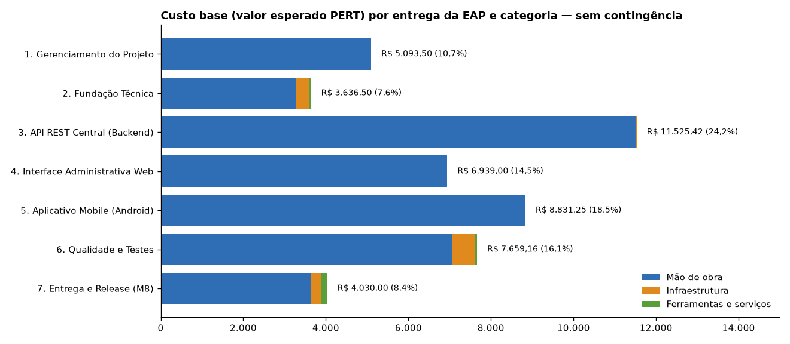
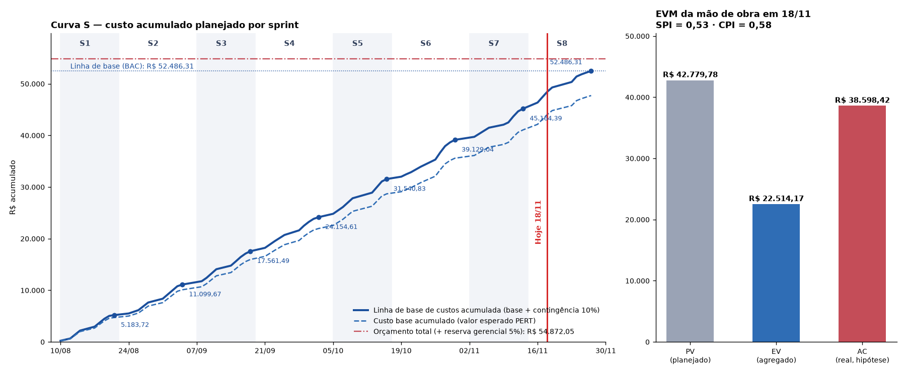

# 💰 Orçamento do Projeto — FieldOps

> Atividade da Aula 05 (Custos e Qualidade) — Gestão de Projetos, Prof. Me. Deivison S. Takatu. As horas por pessoa vêm do cronograma (`../aula-04-tempo/cronograma-fieldops.md`) e as linhas de custo direto da tabela de aquisições (`../aula-08-aquisicoes-partes-interessadas/aquisicoes-fieldops.md`): os três documentos saem do mesmo dicionário de dados e todas as contas foram conferidas por script.

---

## 📌 Identificação

| Campo | Informação |
|---|---|
| **Projeto** | FieldOps — Plataforma de Inspeção em Campo (MVP) |
| **Gerente do projeto** | Felipe Marques (FM) |
| **Integrantes** | Felipe Marques; Gabriel Ribeiro Camargo Miranda; Pedro Henrique Dias de Paula; André dos Santos Fernandes; João Victor de Souza Santos |
| **Data de elaboração** | 18/11/2026 |
| **Versão** | 1.0 |
| **Moeda / formato** | R$, duas casas decimais; ponto de milhar e vírgula decimal |
| **Itens do orçamento** | **52** (36 linhas de mão de obra, uma por pacote da EAP; 14 linhas de custo direto; 2 reservas) |
| **Horas planejadas (cronograma)** | 967 h |
| **Custo base (valor esperado PERT)** | R$ 47.714,83 |
| **Linha de base de custos (BAC)** | R$ 52.486,31 |
| **Orçamento total** | **R$ 54.872,05** |

> **Valores hipotéticos.** O TAP declara “sem investimento financeiro direto”. As taxas horárias são um custo de oportunidade de aluno de ADS e os preços de serviços são referências plausíveis de 2026 (confirmar antes de contratar). Nada aqui representa desembolso já realizado.

---

## 🧭 (a) Premissas

| # | Premissa | Valor |
|---|---|---|
| P1 | Capacidade | 5 pessoas × 16 semanas × 12 h = **960 h** (≈ 192 h por pessoa). O cronograma fecha em 967 h (+0,7%), dentro de ±10%; por pessoa, FM 202, JV 190, GR 192, PD 191, AF 192 (todas dentro de ±15% de 192 h). |
| P2 | Taxa de desenvolvedor | **R$ 45,00/h** (JV, GR, PD, AF e FM quando atua como desenvolvedor mobile, pacotes 5.x, 6.x e 7.x) |
| P3 | Taxa de gerente de projeto | **R$ 60,00/h**, só nas horas de gestão do FM (pacotes 1.x). As horas de gestão do FM contam dentro das 192 h dele |
| P4 | Mentoria e revisão docente | **Não entram** no orçamento financeiro (contrapartida institucional); ver seção (g) |
| P5 | Câmbio | US$ 1,00 = R$ 5,50 para preços de serviços em dólar (hipótese) |
| P6 | Custos de caixa | Plano gratuito no cenário mais provável sempre que existir; plano pago só na janela de pico (hospedagem, banco, EAS). Caixa mais provável baixo; o pessimista cobre upgrades |
| P7 | Estimativa de três pontos | **cO** otimista, **cM** mais provável, **cP** pessimista. Valor esperado **PERT = (cO + 4·cM + cP) / 6**; desvio **σ = (cP − cO) / 6** |
| P8 | Reservas | **Contingência 10%** sobre o custo base (riscos identificados) e **reserva gerencial 5%** (desconhecidos), ambas sobre o custo base PERT; contingência entra na linha de base, reserva gerencial fica fora dela |
| P9 | Mão de obra por três pontos | cM = horas do cronograma × taxa. cO e cP aplicam um fator por classe de risco do pacote às horas (tabela abaixo) |

**Fatores de três pontos para mão de obra (premissa do gerente, justificada pela incerteza técnica de cada tipo de trabalho):**

| Classe | Tipo de trabalho | cO (fator) | cP (fator) | PERT ÷ cM | Pacotes |
|---|---|---:|---:|---:|---|
| A | Documentação e gestão (escopo conhecido) | 0,90 | 1,20 | 1,0167 | 1.1, 1.2, 1.3, 1.4, 2.1, 6.1, 7.3, 7.4 |
| B | Padrão conhecido (CRUD, autenticação, base de projeto) | 0,85 | 1,30 | 1,025 | 2.2, 2.3, 2.4, 3.1, 3.2, 4.1, 4.2, 5.1, 5.2, 7.1 |
| C | Integração, UI complexa e recursos nativos | 0,85 | 1,45 | 1,05 | 3.3, 3.4, 3.5, 3.7, 4.3, 4.4, 4.5, 4.6, 5.3, 5.4, 5.5, 6.2, 6.3, 6.4, 7.2 |
| D | Offline e sincronização (maior incerteza técnica) | 0,85 | 1,60 | 1,075 | 3.6, 5.6, 5.7 |

A classe D (offline e sincronização) tem a cauda pessimista mais pesada por ser o item de maior incerteza técnica do projeto. O atraso real de S6 confirma a escolha.

---

## 📋 (b) Orçamento detalhado — formato do exemplo da aula (valores mais prováveis, cM)

Horas por profissional por pacote da EAP (soma das atividades do cronograma), custo de mão de obra à taxa de cada coluna, custos adicionais e origem. Totais em R$ do cenário mais provável. A base PERT, usada na linha de base, está na tabela seguinte.

| Item / Atividade | WBS | FM (ger.) R$ 60 | FM (dev.) R$ 45 | JV R$ 45 | GR R$ 45 | PD R$ 45 | AF R$ 45 | Horas | Mão de obra (R$) | Custos adicionais (R$) | Origem | **Total (R$)** |
|---|---|---:|---:|---:|---:|---:|---:|---:|---:|---:|---|---:|
| **1 GERENCIAMENTO DO PROJETO** | | | | | | | | | | | | |
| O01 · 1.1 Termo de Abertura e Declaração de Escopo aprovados | 1.1 | 10 |  |  |  | 4 |  | 14 | R$ 780,00 | R$ 0,00 | — | R$ 780,00 |
| O02 · 1.2 Plano de Gerenciamento do Projeto | 1.2 | 32 |  | 2 | 6 | 8 | 6 | 54 | R$ 2.910,00 | R$ 0,00 | — | R$ 2.910,00 |
| O03 · 1.3 Relatórios de status e demonstrações dos marcos M1–M8 | 1.3 | 14 |  |  |  |  |  | 14 | R$ 840,00 | R$ 0,00 | — | R$ 840,00 |
| O04 · 1.4 Encerramento do projeto | 1.4 | 8 |  |  |  |  |  | 8 | R$ 480,00 | R$ 0,00 | — | R$ 480,00 |
| *Totais (1)* | | *64* |  | *2* | *6* | *12* | *6* | *90* | *R$ 5.010,00* | *R$ 0,00* | | *R$ 5.010,00* |
| **2 FUNDAÇÃO TÉCNICA** | | | | | | | | | | | | |
| O05 · 2.1 Repositórios e convenções Git/PR definidos | 2.1 |  | 1 | 8 |  |  |  | 9 | R$ 405,00 | R$ 0,00 | — | R$ 405,00 |
| O06 · P06 Organização GitHub FieldOps-Project (4 repositórios, Actions e Projects) | 2.1 | | | | | | | | R$ 0,00 | R$ 0,00 | GitHub (plano gratuito) | R$ 0,00 |
| O07 · 2.2 Contrato OpenAPI e padrões compartilhados | 2.2 |  |  | 32 | 2 |  |  | 34 | R$ 1.530,00 | R$ 0,00 | — | R$ 1.530,00 |
| O08 · 2.3 Pipelines de integração contínua | 2.3 |  |  |  |  | 14 |  | 14 | R$ 630,00 | R$ 0,00 | — | R$ 630,00 |
| O09 · 2.4 Ambiente de desenvolvimento padronizado | 2.4 |  |  |  | 14 |  |  | 14 | R$ 630,00 | R$ 0,00 | — | R$ 630,00 |
| O10 · P13 Ferramentas de desenvolvimento e design (VS Code, Android Studio, Docker Desktop, IntelliJ, Postman, Figma Education) | 2.4 | | | | | | | | R$ 0,00 | R$ 0,00 | Licenças educacionais/gratuitas | R$ 0,00 |
| O11 · P14 Internet e energia (rateio do ambiente de trabalho dos integrantes) | 2.4 | | | | | | | | R$ 0,00 | R$ 300,00 | Rateio doméstico (não-caixa) | R$ 300,00 |
| *Totais (2)* | |  | *1* | *40* | *16* | *14* |  | *71* | *R$ 3.195,00* | *R$ 300,00* | | *R$ 3.495,00* |
| **3 API REST CENTRAL (BACKEND)** | | | | | | | | | | | | |
| O12 · 3.1 Identidade e acesso (JWT, perfis, autorização) | 3.1 |  |  | 26 |  |  |  | 26 | R$ 1.170,00 | R$ 0,00 | — | R$ 1.170,00 |
| O13 · 3.2 Cadastros operacionais | 3.2 |  |  |  | 28 | 4 |  | 32 | R$ 1.440,00 | R$ 0,00 | — | R$ 1.440,00 |
| O14 · 3.3 Modelos de inspeção versionados com snapshot | 3.3 |  |  |  | 30 |  |  | 30 | R$ 1.350,00 | R$ 0,00 | — | R$ 1.350,00 |
| O15 · 3.4 Planejamento e atribuição de inspeções | 3.4 |  |  |  |  | 38 |  | 38 | R$ 1.710,00 | R$ 0,00 | — | R$ 1.710,00 |
| O16 · 3.5 Execução, respostas e evidências | 3.5 |  |  | 56 |  |  |  | 56 | R$ 2.520,00 | R$ 0,00 | — | R$ 2.520,00 |
| O17 · P04 Armazenamento de evidências compatível com S3 (3 meses) | 3.5 | | | | | | | | R$ 0,00 | R$ 15,00 | AWS S3 | R$ 15,00 |
| O18 · 3.6 Sincronização idempotente | 3.6 |  |  | 40 |  |  |  | 40 | R$ 1.800,00 | R$ 0,00 | — | R$ 1.800,00 |
| O19 · 3.7 Revisão, aprovação e trilha de auditoria | 3.7 |  |  | 6 |  | 16 |  | 22 | R$ 990,00 | R$ 0,00 | — | R$ 990,00 |
| *Totais (3)* | |  |  | *128* | *58* | *58* |  | *244* | *R$ 10.980,00* | *R$ 15,00* | | *R$ 10.995,00* |
| **4 INTERFACE ADMINISTRATIVA WEB** | | | | | | | | | | | | |
| O20 · 4.1 Shell administrativo, autenticação e navegação | 4.1 |  |  |  |  |  | 34 | 34 | R$ 1.530,00 | R$ 0,00 | — | R$ 1.530,00 |
| O21 · 4.2 Gestão de usuários e cadastros | 4.2 |  |  |  |  |  | 14 | 14 | R$ 630,00 | R$ 0,00 | — | R$ 630,00 |
| O22 · 4.3 Construtor e publicação de modelos de inspeção | 4.3 |  |  |  |  |  | 24 | 24 | R$ 1.080,00 | R$ 0,00 | — | R$ 1.080,00 |
| O23 · 4.4 Agendamento, atribuição e acompanhamento | 4.4 |  |  |  |  |  | 28 | 28 | R$ 1.260,00 | R$ 0,00 | — | R$ 1.260,00 |
| O24 · 4.5 Visualização de evidências e não conformidades | 4.5 |  |  |  |  |  | 14 | 14 | R$ 630,00 | R$ 0,00 | — | R$ 630,00 |
| O25 · 4.6 Revisão: aprovação, reprovação e histórico | 4.6 |  |  |  |  |  | 34 | 34 | R$ 1.530,00 | R$ 0,00 | — | R$ 1.530,00 |
| *Totais (4)* | |  |  |  |  |  | *148* | *148* | *R$ 6.660,00* | *R$ 0,00* | | *R$ 6.660,00* |
| **5 APLICATIVO MOBILE (ANDROID)** | | | | | | | | | | | | |
| O26 · 5.1 Base do app, navegação e design system | 5.1 |  | 12 |  |  |  |  | 12 | R$ 540,00 | R$ 0,00 | — | R$ 540,00 |
| O27 · 5.2 Login e sessão segura | 5.2 |  | 12 |  |  | 6 |  | 18 | R$ 810,00 | R$ 0,00 | — | R$ 810,00 |
| O28 · 5.3 Lista, filtros e detalhes das inspeções | 5.3 |  | 12 |  |  |  |  | 12 | R$ 540,00 | R$ 0,00 | — | R$ 540,00 |
| O29 · 5.4 Checklist dinâmico, respostas e progresso | 5.4 |  | 26 |  |  | 8 |  | 34 | R$ 1.530,00 | R$ 0,00 | — | R$ 1.530,00 |
| O30 · 5.5 Recursos nativos e evidências | 5.5 |  | 42 |  |  |  |  | 42 | R$ 1.890,00 | R$ 0,00 | — | R$ 1.890,00 |
| O31 · 5.6 Persistência offline (SQLite) e fila outbox | 5.6 |  |  |  | 10 | 34 |  | 44 | R$ 1.980,00 | R$ 0,00 | — | R$ 1.980,00 |
| O32 · 5.7 Sincronização, tela de pendências e fluxo de correção | 5.7 |  |  | 4 |  | 20 |  | 24 | R$ 1.080,00 | R$ 0,00 | — | R$ 1.080,00 |
| *Totais (5)* | |  | *104* | *4* | *10* | *68* |  | *186* | *R$ 8.370,00* | *R$ 0,00* | | *R$ 8.370,00* |
| **6 QUALIDADE E TESTES** | | | | | | | | | | | | |
| O33 · 6.1 Plano de testes e critérios de aceitação | 6.1 |  |  |  | 22 |  |  | 22 | R$ 990,00 | R$ 0,00 | — | R$ 990,00 |
| O34 · 6.2 Testes automatizados dos fluxos críticos | 6.2 |  | 5 |  | 62 |  | 10 | 77 | R$ 3.465,00 | R$ 0,00 | — | R$ 3.465,00 |
| O35 · 6.3 Testes de integração e validação em dispositivos Android | 6.3 |  | 4 | 2 |  | 21 |  | 27 | R$ 1.215,00 | R$ 0,00 | — | R$ 1.215,00 |
| O36 · P09 Dispositivos Android da equipe para teste (uso e depreciação) | 6.3 | | | | | | | | R$ 0,00 | R$ 396,00 | Aparelhos próprios (não-caixa) | R$ 396,00 |
| O37 · P10 Aparelho Android de entrada para teste de desempenho (contingente) | 6.3 | | | | | | | | R$ 0,00 | R$ 0,00 | Mercado Livre (plano gratuito) | R$ 0,00 |
| O38 · P12 Teste em dispositivos Android em nuvem (contingente) | 6.3 | | | | | | | | R$ 0,00 | R$ 0,00 | Firebase Test Lab (plano gratuito) | R$ 0,00 |
| O39 · 6.4 Acessibilidade, desempenho e correção de falhas | 6.4 |  | 2 |  |  |  | 22 | 24 | R$ 1.080,00 | R$ 0,00 | — | R$ 1.080,00 |
| O40 · P08 Monitoramento de erros e logs (web, app e API) | 6.4 | | | | | | | | R$ 0,00 | R$ 0,00 | Sentry (plano gratuito) | R$ 0,00 |
| *Totais (6)* | |  | *11* | *2* | *84* | *21* | *32* | *150* | *R$ 6.750,00* | *R$ 396,00* | | *R$ 7.146,00* |
| **7 ENTREGA E RELEASE (M8)** | | | | | | | | | | | | |
| O41 · 7.1 Dados de demonstração reproduzíveis | 7.1 |  |  | 14 |  |  |  | 14 | R$ 630,00 | R$ 0,00 | — | R$ 630,00 |
| O42 · 7.2 Build Android (EAS), painel web e API publicados | 7.2 |  | 14 |  | 14 |  | 6 | 34 | R$ 1.530,00 | R$ 0,00 | — | R$ 1.530,00 |
| O43 · P01 Registro de domínio .com.br (1 ano) | 7.2 | | | | | | | | R$ 0,00 | R$ 40,00 | Registro.br | R$ 40,00 |
| O44 · P02 Hospedagem da API Spring Boot em contêiner (2 meses) | 7.2 | | | | | | | | R$ 0,00 | R$ 77,00 | Render | R$ 77,00 |
| O45 · P03 PostgreSQL gerenciado para o ambiente de demonstração (1 mês) | 7.2 | | | | | | | | R$ 0,00 | R$ 137,50 | Neon | R$ 137,50 |
| O46 · P05 EAS Build (Expo) — plano pago em semana de pico (1 mês) | 7.2 | | | | | | | | R$ 0,00 | R$ 104,50 | Expo EAS | R$ 104,50 |
| O47 · P07 Hospedagem do painel web Next.js | 7.2 | | | | | | | | R$ 0,00 | R$ 0,00 | Vercel (plano gratuito) | R$ 0,00 |
| O48 · P11 Conta Google Play Console (taxa única, contingente) | 7.2 | | | | | | | | R$ 0,00 | R$ 0,00 | Google Play Console (plano gratuito) | R$ 0,00 |
| O49 · 7.3 Documentação final (README, OpenAPI, diagramas) | 7.3 |  |  |  | 4 | 18 |  | 22 | R$ 990,00 | R$ 0,00 | — | R$ 990,00 |
| O50 · 7.4 Demonstração ponta a ponta e apresentação final | 7.4 |  | 8 |  |  |  |  | 8 | R$ 360,00 | R$ 0,00 | — | R$ 360,00 |
| *Totais (7)* | |  | *22* | *14* | *18* | *18* | *6* | *78* | *R$ 3.510,00* | *R$ 359,00* | | *R$ 3.869,00* |
| **TOTAIS — FieldOps (cM)** | | **64** | **138** | **190** | **192** | **191** | **192** | **967** | **R$ 44.475,00** | **R$ 1.070,00** | | **R$ 45.545,00** |
| Custo por coluna (R$) | | R$ 3.840,00 | R$ 6.210,00 | R$ 8.550,00 | R$ 8.640,00 | R$ 8.595,00 | R$ 8.640,00 | | | | | |

Soma das horas de FM (gerente + dev.): 64 + 138 = 202 h. As linhas de custo direto com R$ 0,00 usam plano gratuito no cenário provável; seu efeito está no pessimista (próxima tabela).

### Estimativa de três pontos por item (cO, cM, cP), valor esperado e desvio

Quantidade: horas (h) nas linhas de mão de obra; unidade própria nas de custo direto. **Esperado = (cO + 4·cM + cP)/6**; **σ = (cP − cO)/6**. Responsável: R do pacote (mão de obra) ou quem contrata o serviço.

| ID | WBS | Item | Categoria | Qtd | Un. | Resp. | cO (R$) | cM (R$) | cP (R$) | **Esperado PERT (R$)** | σ (R$) |
|---|---|---|---|---:|---|---|---:|---:|---:|---:|---:|
| O01 | 1.1 | 1.1 Termo de Abertura e Declaração de Escopo aprovados | Mão de obra | 14 | h | FM | R$ 702,00 | R$ 780,00 | R$ 936,00 | **R$ 793,00** | R$ 39,00 |
| O02 | 1.2 | 1.2 Plano de Gerenciamento do Projeto | Mão de obra | 54 | h | FM | R$ 2.619,00 | R$ 2.910,00 | R$ 3.492,00 | **R$ 2.958,50** | R$ 145,50 |
| O03 | 1.3 | 1.3 Relatórios de status e demonstrações dos marcos M1–M8 | Mão de obra | 14 | h | FM | R$ 756,00 | R$ 840,00 | R$ 1.008,00 | **R$ 854,00** | R$ 42,00 |
| O04 | 1.4 | 1.4 Encerramento do projeto | Mão de obra | 8 | h | FM | R$ 432,00 | R$ 480,00 | R$ 576,00 | **R$ 488,00** | R$ 24,00 |
| O05 | 2.1 | 2.1 Repositórios e convenções Git/PR definidos | Mão de obra | 9 | h | JV | R$ 364,50 | R$ 405,00 | R$ 486,00 | **R$ 411,75** | R$ 20,25 |
| O06 | 2.1 | P06 Organização GitHub FieldOps-Project (4 repositórios, Actions e Projects) | Ferramentas e serviços | 0 | usuário-mês | JV | R$ 0,00 | R$ 0,00 | R$ 330,00 | **R$ 55,00** | R$ 55,00 |
| O07 | 2.2 | 2.2 Contrato OpenAPI e padrões compartilhados | Mão de obra | 34 | h | JV | R$ 1.300,50 | R$ 1.530,00 | R$ 1.989,00 | **R$ 1.568,25** | R$ 114,75 |
| O08 | 2.3 | 2.3 Pipelines de integração contínua | Mão de obra | 14 | h | PD | R$ 535,50 | R$ 630,00 | R$ 819,00 | **R$ 645,75** | R$ 47,25 |
| O09 | 2.4 | 2.4 Ambiente de desenvolvimento padronizado | Mão de obra | 14 | h | GR | R$ 535,50 | R$ 630,00 | R$ 819,00 | **R$ 645,75** | R$ 47,25 |
| O10 | 2.4 | P13 Ferramentas de desenvolvimento e design (VS Code, Android Studio, Docker Desktop, IntelliJ, Postman, Figma Education) | Ferramentas e serviços | 5 | licença | JV | R$ 0,00 | R$ 0,00 | R$ 0,00 | **R$ 0,00** | R$ 0,00 |
| O11 | 2.4 | P14 Internet e energia (rateio do ambiente de trabalho dos integrantes) | Infraestrutura | 20 | pessoa-mês | FM | R$ 300,00 | R$ 300,00 | R$ 360,00 | **R$ 310,00** | R$ 10,00 |
| O12 | 3.1 | 3.1 Identidade e acesso (JWT, perfis, autorização) | Mão de obra | 26 | h | JV | R$ 994,50 | R$ 1.170,00 | R$ 1.521,00 | **R$ 1.199,25** | R$ 87,75 |
| O13 | 3.2 | 3.2 Cadastros operacionais | Mão de obra | 32 | h | GR | R$ 1.224,00 | R$ 1.440,00 | R$ 1.872,00 | **R$ 1.476,00** | R$ 108,00 |
| O14 | 3.3 | 3.3 Modelos de inspeção versionados com snapshot | Mão de obra | 30 | h | GR | R$ 1.147,50 | R$ 1.350,00 | R$ 1.957,50 | **R$ 1.417,50** | R$ 135,00 |
| O15 | 3.4 | 3.4 Planejamento e atribuição de inspeções | Mão de obra | 38 | h | PD | R$ 1.453,50 | R$ 1.710,00 | R$ 2.479,50 | **R$ 1.795,50** | R$ 171,00 |
| O16 | 3.5 | 3.5 Execução, respostas e evidências | Mão de obra | 56 | h | JV | R$ 2.142,00 | R$ 2.520,00 | R$ 3.654,00 | **R$ 2.646,00** | R$ 252,00 |
| O17 | 3.5 | P04 Armazenamento de evidências compatível com S3 (3 meses) | Infraestrutura | 3 | mês | JV | R$ 0,00 | R$ 15,00 | R$ 40,00 | **R$ 16,67** | R$ 6,67 |
| O18 | 3.6 | 3.6 Sincronização idempotente | Mão de obra | 40 | h | JV | R$ 1.530,00 | R$ 1.800,00 | R$ 2.880,00 | **R$ 1.935,00** | R$ 225,00 |
| O19 | 3.7 | 3.7 Revisão, aprovação e trilha de auditoria | Mão de obra | 22 | h | PD | R$ 841,50 | R$ 990,00 | R$ 1.435,50 | **R$ 1.039,50** | R$ 99,00 |
| O20 | 4.1 | 4.1 Shell administrativo, autenticação e navegação | Mão de obra | 34 | h | AF | R$ 1.300,50 | R$ 1.530,00 | R$ 1.989,00 | **R$ 1.568,25** | R$ 114,75 |
| O21 | 4.2 | 4.2 Gestão de usuários e cadastros | Mão de obra | 14 | h | AF | R$ 535,50 | R$ 630,00 | R$ 819,00 | **R$ 645,75** | R$ 47,25 |
| O22 | 4.3 | 4.3 Construtor e publicação de modelos de inspeção | Mão de obra | 24 | h | AF | R$ 918,00 | R$ 1.080,00 | R$ 1.566,00 | **R$ 1.134,00** | R$ 108,00 |
| O23 | 4.4 | 4.4 Agendamento, atribuição e acompanhamento | Mão de obra | 28 | h | AF | R$ 1.071,00 | R$ 1.260,00 | R$ 1.827,00 | **R$ 1.323,00** | R$ 126,00 |
| O24 | 4.5 | 4.5 Visualização de evidências e não conformidades | Mão de obra | 14 | h | AF | R$ 535,50 | R$ 630,00 | R$ 913,50 | **R$ 661,50** | R$ 63,00 |
| O25 | 4.6 | 4.6 Revisão: aprovação, reprovação e histórico | Mão de obra | 34 | h | AF | R$ 1.300,50 | R$ 1.530,00 | R$ 2.218,50 | **R$ 1.606,50** | R$ 153,00 |
| O26 | 5.1 | 5.1 Base do app, navegação e design system | Mão de obra | 12 | h | FM | R$ 459,00 | R$ 540,00 | R$ 702,00 | **R$ 553,50** | R$ 40,50 |
| O27 | 5.2 | 5.2 Login e sessão segura | Mão de obra | 18 | h | FM | R$ 688,50 | R$ 810,00 | R$ 1.053,00 | **R$ 830,25** | R$ 60,75 |
| O28 | 5.3 | 5.3 Lista, filtros e detalhes das inspeções | Mão de obra | 12 | h | FM | R$ 459,00 | R$ 540,00 | R$ 783,00 | **R$ 567,00** | R$ 54,00 |
| O29 | 5.4 | 5.4 Checklist dinâmico, respostas e progresso | Mão de obra | 34 | h | FM | R$ 1.300,50 | R$ 1.530,00 | R$ 2.218,50 | **R$ 1.606,50** | R$ 153,00 |
| O30 | 5.5 | 5.5 Recursos nativos e evidências | Mão de obra | 42 | h | FM | R$ 1.606,50 | R$ 1.890,00 | R$ 2.740,50 | **R$ 1.984,50** | R$ 189,00 |
| O31 | 5.6 | 5.6 Persistência offline (SQLite) e fila outbox | Mão de obra | 44 | h | PD | R$ 1.683,00 | R$ 1.980,00 | R$ 3.168,00 | **R$ 2.128,50** | R$ 247,50 |
| O32 | 5.7 | 5.7 Sincronização, tela de pendências e fluxo de correção | Mão de obra | 24 | h | PD | R$ 918,00 | R$ 1.080,00 | R$ 1.728,00 | **R$ 1.161,00** | R$ 135,00 |
| O33 | 6.1 | 6.1 Plano de testes e critérios de aceitação | Mão de obra | 22 | h | GR | R$ 891,00 | R$ 990,00 | R$ 1.188,00 | **R$ 1.006,50** | R$ 49,50 |
| O34 | 6.2 | 6.2 Testes automatizados dos fluxos críticos | Mão de obra | 77 | h | GR | R$ 2.945,25 | R$ 3.465,00 | R$ 5.024,25 | **R$ 3.638,25** | R$ 346,50 |
| O35 | 6.3 | 6.3 Testes de integração e validação em dispositivos Android | Mão de obra | 27 | h | PD | R$ 1.032,75 | R$ 1.215,00 | R$ 1.761,75 | **R$ 1.275,75** | R$ 121,50 |
| O36 | 6.3 | P09 Dispositivos Android da equipe para teste (uso e depreciação) | Infraestrutura | 12 | aparelho-mês | PD | R$ 396,00 | R$ 396,00 | R$ 495,00 | **R$ 412,50** | R$ 16,50 |
| O37 | 6.3 | P10 Aparelho Android de entrada para teste de desempenho (contingente) | Infraestrutura | 0 | unidade | PD | R$ 0,00 | R$ 0,00 | R$ 900,00 | **R$ 150,00** | R$ 150,00 |
| O38 | 6.3 | P12 Teste em dispositivos Android em nuvem (contingente) | Ferramentas e serviços | 0 | mês | PD | R$ 0,00 | R$ 0,00 | R$ 110,00 | **R$ 18,33** | R$ 18,33 |
| O39 | 6.4 | 6.4 Acessibilidade, desempenho e correção de falhas | Mão de obra | 24 | h | AF | R$ 918,00 | R$ 1.080,00 | R$ 1.566,00 | **R$ 1.134,00** | R$ 108,00 |
| O40 | 6.4 | P08 Monitoramento de erros e logs (web, app e API) | Ferramentas e serviços | 0 | mês | AF | R$ 0,00 | R$ 0,00 | R$ 143,00 | **R$ 23,83** | R$ 23,83 |
| O41 | 7.1 | 7.1 Dados de demonstração reproduzíveis | Mão de obra | 14 | h | JV | R$ 535,50 | R$ 630,00 | R$ 819,00 | **R$ 645,75** | R$ 47,25 |
| O42 | 7.2 | 7.2 Build Android (EAS), painel web e API publicados | Mão de obra | 34 | h | FM | R$ 1.300,50 | R$ 1.530,00 | R$ 2.218,50 | **R$ 1.606,50** | R$ 153,00 |
| O43 | 7.2 | P01 Registro de domínio .com.br (1 ano) | Infraestrutura | 1 | ano | FM | R$ 40,00 | R$ 40,00 | R$ 70,00 | **R$ 45,00** | R$ 5,00 |
| O44 | 7.2 | P02 Hospedagem da API Spring Boot em contêiner (2 meses) | Infraestrutura | 2 | mês | GR | R$ 0,00 | R$ 77,00 | R$ 154,00 | **R$ 77,00** | R$ 25,67 |
| O45 | 7.2 | P03 PostgreSQL gerenciado para o ambiente de demonstração (1 mês) | Infraestrutura | 1 | mês | GR | R$ 0,00 | R$ 137,50 | R$ 275,00 | **R$ 137,50** | R$ 45,83 |
| O46 | 7.2 | P05 EAS Build (Expo) — plano pago em semana de pico (1 mês) | Ferramentas e serviços | 1 | mês | FM | R$ 0,00 | R$ 104,50 | R$ 209,00 | **R$ 104,50** | R$ 34,83 |
| O47 | 7.2 | P07 Hospedagem do painel web Next.js | Ferramentas e serviços | 0 | mês | AF | R$ 0,00 | R$ 0,00 | R$ 110,00 | **R$ 18,33** | R$ 18,33 |
| O48 | 7.2 | P11 Conta Google Play Console (taxa única, contingente) | Ferramentas e serviços | 0 | conta | FM | R$ 0,00 | R$ 0,00 | R$ 137,50 | **R$ 22,92** | R$ 22,92 |
| O49 | 7.3 | 7.3 Documentação final (README, OpenAPI, diagramas) | Mão de obra | 22 | h | PD | R$ 891,00 | R$ 990,00 | R$ 1.188,00 | **R$ 1.006,50** | R$ 49,50 |
| O50 | 7.4 | 7.4 Demonstração ponta a ponta e apresentação final | Mão de obra | 8 | h | FM | R$ 324,00 | R$ 360,00 | R$ 432,00 | **R$ 366,00** | R$ 18,00 |
| O51 | 1.2 | Reserva de contingência (10% do custo base) | Contingência | 10 | % | FM | — | R$ 4.771,48 | — | **R$ 4.771,48** | — |
| O52 | 1.2 | Reserva gerencial (5% do custo base) | Contingência | 5 | % | PI-01 | — | R$ 2.385,74 | — | **R$ 2.385,74** | — |
| | | **Soma das 50 linhas de custo + reservas** | | | | | R$ 38.927,50 | R$ 45.545,00 | R$ 65.181,50 | **R$ 54.872,05** | R$ 812,45 |

O σ da última linha é o desvio do custo total, supondo itens independentes: √(Σσ²) = R$ 812,45. A soma de cM (R$ 45.545,00) é menor que o esperado base (R$ 47.714,83) porque as estimativas são assimétricas (cP está mais longe de cM que cO), e é por isso que se orça pelo PERT e não pelo mais provável.

---

## 📊 (c) Resumo por entrega da EAP e por categoria

Valores esperados (PERT), sem as reservas.

### Por entrega da EAP

| Entrega | Mão de obra | Infraestrutura | Ferramentas e serviços | **Total** | % do custo base | Horas (cM) |
|---|---:|---:|---:|---:|---:|---:|
| 1. Gerenciamento do Projeto | R$ 5.093,50 | R$ 0,00 | R$ 0,00 | **R$ 5.093,50** | 10,7% | 90 |
| 2. Fundação Técnica | R$ 3.271,50 | R$ 310,00 | R$ 55,00 | **R$ 3.636,50** | 7,6% | 71 |
| 3. API REST Central (Backend) | R$ 11.508,75 | R$ 16,67 | R$ 0,00 | **R$ 11.525,42** | 24,2% | 244 |
| 4. Interface Administrativa Web | R$ 6.939,00 | R$ 0,00 | R$ 0,00 | **R$ 6.939,00** | 14,5% | 148 |
| 5. Aplicativo Mobile (Android) | R$ 8.831,25 | R$ 0,00 | R$ 0,00 | **R$ 8.831,25** | 18,5% | 186 |
| 6. Qualidade e Testes | R$ 7.054,50 | R$ 562,50 | R$ 42,16 | **R$ 7.659,16** | 16,1% | 150 |
| 7. Entrega e Release (M8) | R$ 3.624,75 | R$ 259,50 | R$ 145,75 | **R$ 4.030,00** | 8,4% | 78 |
| **Custo base** | **R$ 46.323,25** | **R$ 1.148,67** | **R$ 242,91** | **R$ 47.714,83** | 100,0% | **967** |

### Por categoria

| Categoria | Valor (R$) | % do orçamento total |
|---|---:|---:|
| Mão de obra | R$ 46.323,25 | 84,4% |
| Infraestrutura | R$ 1.148,67 | 2,1% |
| Ferramentas e serviços | R$ 242,91 | 0,4% |
| Contingência | R$ 7.157,22 | 13,0% |
| **Total** | **R$ 54.872,05** | 100,0% |

- **Mão de obra** = custo de oportunidade das horas (valor, não desembolso). **Infraestrutura** e **Ferramentas e serviços** reúnem os custos diretos (alguns de caixa, alguns não-caixa: depreciação dos aparelhos e rateio de internet/energia). **Contingência** = reserva de 10% + reserva gerencial de 5%.
- **Caixa (desembolso real):** valor esperado R$ 669,08; cenário mais provável R$ 374,00; pior caso R$ 2.478,50. **Não-caixa** (aparelhos próprios e internet): R$ 722,50. Se todos os itens de caixa fossem ao pior caso, o desembolso seria R$ 2.478,50; sem os dois itens contingentes (aparelho de entrada e Play Console, que só ocorrem se um gatilho for disparado) seriam R$ 1.441,00, abaixo do teto de R$ 1.500 admitido nas premissas do projeto.

### Por profissional (horas × taxa, cenário mais provável)

| Pessoa | Horas | Custo de M.O. (R$) | Taxa média (R$/h) |
|---|---:|---:|---:|
| FM — Felipe Marques | 202 | R$ 10.050,00 | 49,75 |
| JV — João Victor Souza | 190 | R$ 8.550,00 | 45,00 |
| GR — Gabriel Ribeiro | 192 | R$ 8.640,00 | 45,00 |
| PD — Pedro Dias | 191 | R$ 8.595,00 | 45,00 |
| AF — André Fernandes | 192 | R$ 8.640,00 | 45,00 |
| **Total** | **967** | **R$ 44.475,00** | 45,99 |

---

## 🧱 (d) Linha de base de custos e orçamento total

| Componente | Valor (R$) | Observação |
|---|---:|---|
| Custo base — mão de obra (PERT) | R$ 46.323,25 | 967 h pelo cronograma; 1008 h esperadas pelo PERT |
| Custo base — custos diretos (PERT) | R$ 1.391,58 | 14 linhas de aquisições |
| **Custo base (A)** | **R$ 47.714,83** | soma dos valores esperados |
| Reserva de contingência 10% (B) | R$ 4.771,48 | para riscos identificados; **liberada pelo gerente** com registro |
| **Linha de base de custos — BAC (A + B)** | **R$ 52.486,31** | referência para o EVM |
| Reserva gerencial 5% (C) | R$ 2.385,74 | desconhecidos; **liberada só pelo patrocinador** (PI-01) |
| **Orçamento total (A + B + C)** | **R$ 54.872,05** | |

**Leitura estatística.** Com σ total de R$ 812,45, a contingência de R$ 4.771,48 equivale a 5,9 σ. Se os desvios fossem independentes e normais, a probabilidade de o custo ficar abaixo de A + B seria praticamente 100%. A premissa de independência é otimista: os itens de offline, sincronização e revisão atrasam juntos. O cenário pessimista conjunto (todos os cP ao mesmo tempo) soma R$ 65.181,50, ou seja, R$ 10.309,45 acima do orçamento total de R$ 54.872,05. É um cenário de probabilidade muito baixa, mas é exatamente o que o atraso de S6 e S7 se aproxima de ser em horas: o orçamento cobre desvios isolados, não um atraso generalizado, e nesse caso a resposta é de escopo e prazo (ordem de corte), não de reserva financeira.

---

## 📈 (e) Distribuição por sprint (curva S)

Mão de obra distribuída pelos dias úteis de cada atividade (valor esperado do pacote repartido pelo cronograma); custos diretos na sprint da data de aquisição (itens recorrentes diluídos em S5–S8, S1–S8 ou S5–S8). A contingência acompanha o custo base de cada sprint. A reserva gerencial não entra na curva.

| Sprint | Marco | Horas (cM) | Mão de obra | Custos diretos | Base | Contingência | **LB da sprint** | **LB acumulada** | % acum. |
|---|---|---:|---:|---:|---:|---:|---:|---:|---:|
| S1 | M1 · Fundação | 99 | R$ 4.664,44 | R$ 48,03 | R$ 4.712,47 | R$ 471,25 | **R$ 5.183,72** | R$ 5.183,72 | 9,9% |
| S2 | M2 · Autenticação | 112 | R$ 5.330,11 | R$ 48,03 | R$ 5.378,14 | R$ 537,81 | **R$ 5.915,95** | R$ 11.099,67 | 21,1% |
| S3 | M3 · Planejamento | 122 | R$ 5.831,16 | R$ 43,22 | R$ 5.874,38 | R$ 587,44 | **R$ 6.461,82** | R$ 17.561,49 | 33,5% |
| S4 | M4 · Execução online | 123 | R$ 5.945,72 | R$ 48,03 | R$ 5.993,75 | R$ 599,37 | **R$ 6.593,12** | R$ 24.154,61 | 46,0% |
| S5 | M5 · Recursos nativos | 137 | R$ 6.567,13 | R$ 147,62 | R$ 6.714,75 | R$ 671,47 | **R$ 7.386,22** | R$ 31.540,83 | 60,1% |
| S6 | M6 · Offline | 139 | R$ 6.734,35 | R$ 164,02 | R$ 6.898,37 | R$ 689,84 | **R$ 7.588,21** | R$ 39.129,04 | 74,6% |
| S7 | M7 · Revisão | 108 | R$ 5.144,07 | R$ 342,61 | R$ 5.486,68 | R$ 548,67 | **R$ 6.035,35** | R$ 45.164,39 | 86,0% |
| S8 | M8 · Release | 128 | R$ 6.106,27 | R$ 550,02 | R$ 6.656,29 | R$ 665,63 | **R$ 7.321,92** | R$ 52.486,31 | 100,0% |
| **Total** | | **967** | **R$ 46.323,25** | **R$ 1.391,58** | **R$ 47.714,83** | **R$ 4.771,48** | **R$ 52.486,31** | | 100,0% |

Os custos das sprints S5 e S6 são os mais altos porque concentram recursos nativos, offline e sincronização (classes C e D), que também são as que mais estouram.

---

## 🎯 (f) Controle de custos: EVM, desvios e alçadas

### Fórmulas e limiares

| Indicador | Fórmula | Leitura | 🟢 | 🟡 | 🔴 |
|---|---|---|---|---|---|
| PV (valor planejado) | custo da linha de base planejado até a data | quanto deveria estar feito | — | — | — |
| EV (valor agregado) | Σ (% concluído da atividade × custo da atividade na linha de base) | quanto o trabalho concluído vale | — | — | — |
| AC (custo real) | horas apontadas × taxa da pessoa + caixa pago | quanto se gastou | — | — | — |
| SV | EV − PV | em R$, adiantado (+) ou atrasado (−) | | | |
| **SPI** | EV ÷ PV | ritmo de entrega | ≥ 0,95 | 0,70 a 0,94 | < 0,70 |
| CV | EV − AC | economia (+) ou estouro (−) | | | |
| **CPI** | EV ÷ AC | eficiência do gasto | ≥ 0,95 | 0,85 a 0,94 | < 0,85 |
| EAC | BAC ÷ CPI | custo final projetado | | | |
| ETC | EAC − AC | custo para terminar | | | |
| VAC | BAC − EAC | variação no término | | | |
| TCPI | (BAC − EV) ÷ (BAC − AC) | eficiência necessária daqui em diante | ≤ 1,00 | 1,01 a 1,10 | > 1,10 |

Os limiares de custo são mais estreitos que os de prazo porque, em um projeto sem caixa relevante, a hora é o único recurso e não se recupera. O SPI usa a mesma faixa do semáforo do cronograma.

**Rotina de apontamento (a implantar):** cada integrante registra horas por atividade (ID do cronograma) em uma planilha ou no quadro do GitHub Projects até sexta-feira; o gerente consolida AC e EV antes de cada marco e envia o relatório de status.

### Situação em 18/11/2026 (somente mão de obra)

Escopo do cálculo: mão de obra (R$ 46.323,25 na linha de base, sem contingência). Os custos diretos ficam fora porque o AC de caixa ainda não foi apontado e pesam menos de 3% do base. **AC é hipótese**: não há apontamento de horas; assume-se que cada pessoa cumpriu 12 h/semana, isto é, 168,0 h em 70 dias úteis (2,4 h por dia útil), ao custo médio por hora da pessoa. EV usa o % realizado estimado das atividades (premissa P7 do cronograma).

| Indicador | Valor | Situação |
|---|---:|---|
| BAC (mão de obra) | R$ 46.323,25 | |
| PV | R$ 42.779,78 | 92,4% do BAC deveria estar executado |
| EV | R$ 22.514,18 | 48,6% do BAC realizado |
| AC (hipótese) | R$ 38.598,42 | 840 h consumidas de 967 h |
| SV | R$ -20.265,60 | |
| **SPI** | **0,53** | 🔴 |
| CV | R$ -16.084,24 | |
| **CPI** | **0,58** | 🔴 |
| EAC = BAC ÷ CPI | R$ 79.416,81 | |
| ETC = EAC − AC | R$ 40.818,40 | |
| VAC = BAC − EAC | R$ -33.093,56 | |
| TCPI = (BAC − EV) ÷ (BAC − AC) | 3,08 | 🔴 (acima de 1,10: precisa render mais que o planejado) |

**Interpretação.** A equipe consumiu cerca de 840 h de capacidade (87% das 967 h planejadas) e entregou 49% do trabalho em valor. CPI de 0,58 significa cerca de 58 centavos de entrega por real de esforço, e o SPI de 0,53 confirma o atraso do cronograma. Como a capacidade é fixa (não há mais horas a comprar), o EAC de R$ 79.416,81 não é gasto novo: é o esforço total que o projeto exigiria se o ritmo atual continuasse, e serve para dimensionar a decisão de escopo e prazo do cronograma (seção *Atrasos e Ações*).

### Como os desvios são tratados e quem aprova (alçadas)

| Situação | Gatilho | Tratamento | Quem aprova |
|---|---|---|---|
| Desvio pequeno de item | até 10% do cM do item e até R$ 50,00 de caixa | Ajustar a estimativa e registrar no relatório de status | FM (gerente) |
| Uso da contingência | até 5% do BAC acumulado | Usar a reserva, registrar o risco que se concretizou | FM, com ciência da equipe |
| Uso da contingência | de 5% a 10% do BAC | Registrar a mudança e reavaliar a linha de base | FM + Prof. Glauco Todesco (PI-02, A do plano de gerenciamento) |
| Novo gasto de caixa ou upgrade de plano pago | até R$ 150,00 por item | Decidir com a equipe; priorizar plano gratuito, build local ou empréstimo de laboratório | FM com anuência dos 5 integrantes |
| Novo gasto de caixa | acima de R$ 150,00 por item | O TAP prevê “sem investimento financeiro direto”; exige exceção formal | PI-02 e PI-01 (coordenação do curso) |
| Uso da reserva gerencial | qualquer valor | Pedido formal com justificativa e impacto | Coordenação do curso (PI-01) |
| CPI ou SPI em 🔴 em um marco | CPI < 0,85 ou SPI < 0,70 | Plano de recuperação: ordem de corte de escopo (RJ07), replanejamento, reforço de capacidade | FM propõe; comitê (PI-02 e PI-03) aprova |
| Mudança na linha de base de custos | corte ou inclusão de escopo | Pedido de mudança com impacto em horas e R$; nova versão do orçamento | PI-02 (escopo) e PI-01 (se alterar prazo final) |

Os relatórios de status incluem PV, EV, AC, CPI e SPI por marco; os desvios acima dos limiares viram ação no cronograma.

---

## 🎓 (g) Horas não valoradas (contrapartida institucional)

Não entram no orçamento financeiro nem no total de horas da equipe. As quantidades são **estimativas** para dimensionar a contrapartida, e não horas apontadas.

| Contrapartida | Natureza | Base da estimativa | Horas estimadas |
|---|---|---|---:|
| Prof. Glauco Todesco (PI-02) | Autor da especificação e product owner acadêmico: validação de regras de negócio, orientação semanal e aceite dos marcos | 16 semanas × 1 h + 8 marcos × 1,5 h | 28 |
| Professores de Expo, Spring Boot e Web (PI-03) | Avaliação dos marcos M1–M8 e orientação técnica nas aulas de projeto | 3 docentes × 8 marcos × 1 h | 24 |
| Prof. Deivison S. Takatu (PI-04) | Orientação e correção dos artefatos de gestão (TAP, EAP, cronograma, orçamento, riscos, aquisições) | 8 aulas × 1 h + correção de 10 artefatos × 1 h | 18 |
| Coordenação do curso (PI-01) | Aprovação do TAP/Declaração de Escopo, decisões de escopo e de prazo | 2 aprovações × 1 h + 2 reuniões × 1 h | 4 |
| UniSENAI-SP, infraestrutura (PI-13) | Laboratórios, rede, equipamentos de empréstimo para teste | uso eventual (não mensurado) | — |
| **Total estimado** | | | **74 h** |

Se fossem valoradas, esse tempo mudaria o orçamento total; por isso é listado à parte e declarado como não valorado. A taxa de docente não foi arbitrada.

---

## ✅ Verificações automáticas realizadas

| Verificação | Resultado |
|---|---|
| Itens do orçamento (mínimo 30) | 52 |
| Cada item amarrado a pacote da EAP | OK (36 pacotes distintos usados, 36 com mão de obra) |
| Horas por pessoa do orçamento = horas do cronograma | OK (FM 202, JV 190, GR 192, PD 191, AF 192; total 967) |
| Σ (horas × taxa) por coluna = custo de mão de obra cM | OK (R$ 44.475,00) |
| Soma das linhas PERT = custo base | OK (R$ 47.714,83) |
| Base + contingência + reserva = orçamento total | OK (R$ 47.714,83 + R$ 4.771,48 + R$ 2.385,74 = R$ 54.872,05) |
| Soma por categoria = orçamento total | OK (R$ 54.872,05) |
| Soma por entrega = custo base | OK |
| Distribuição por sprint soma exatamente o custo base e o BAC | OK (R$ 47.714,83; R$ 52.486,31) |
| cO ≤ cM ≤ cP em todas as linhas | OK |
| Horas esperadas PERT dentro de ±10% de 960 h | 1008 h (+5,0%) |
| Pessimista conjunto (Σ cP) comparado ao orçamento total | R$ 65.181,50 contra R$ 54.872,05: excede em R$ 10.309,45 (declarado no texto) |
