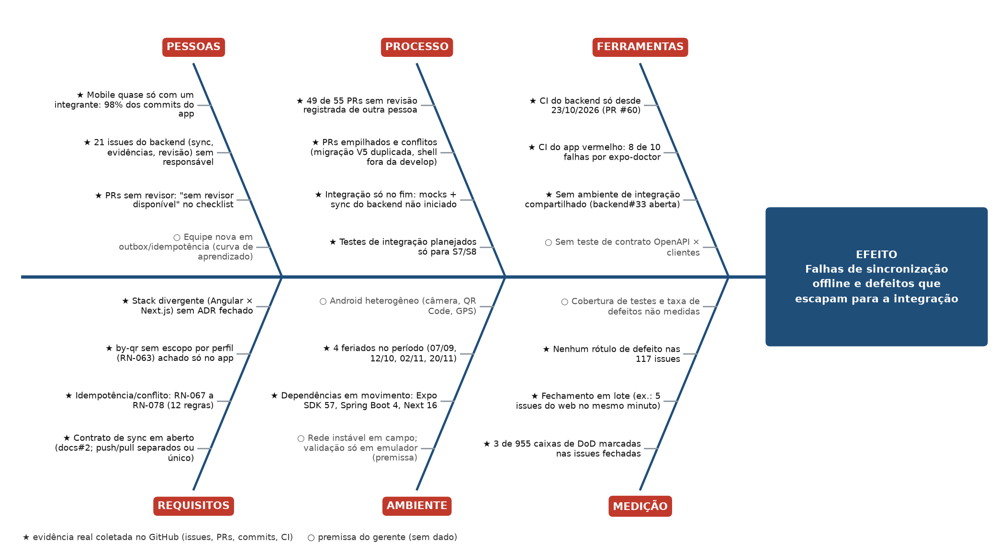
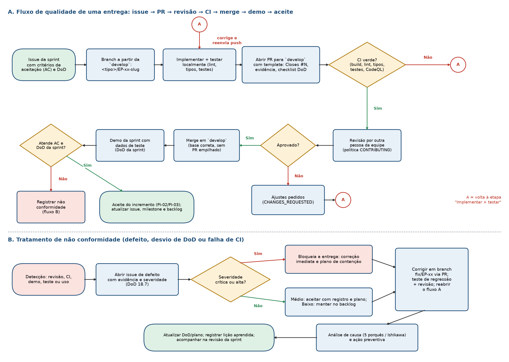
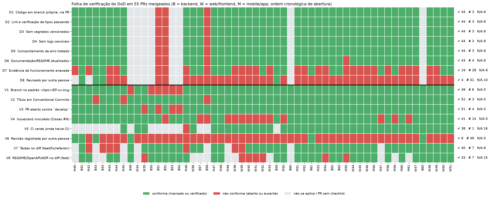
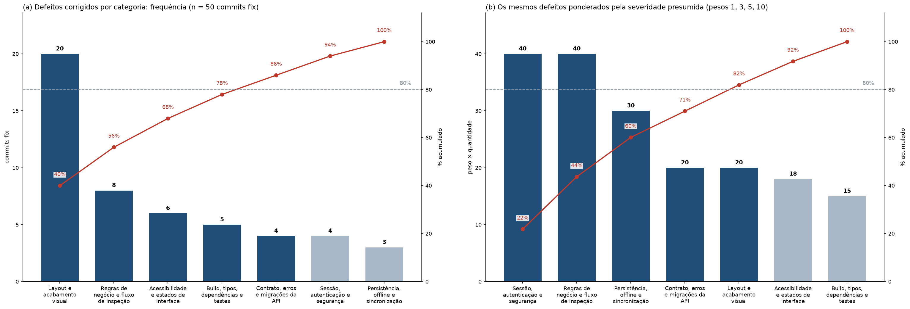
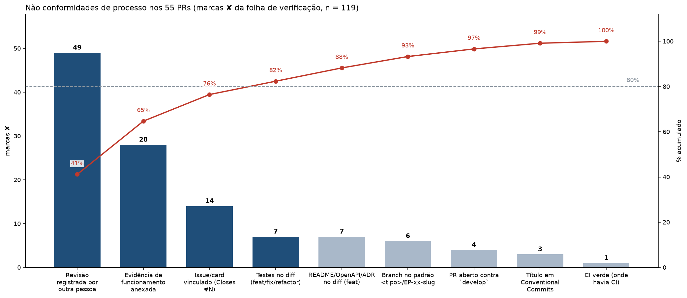
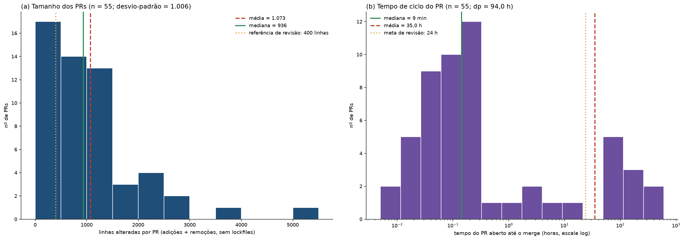
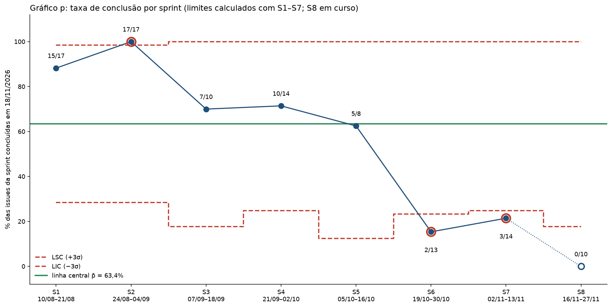
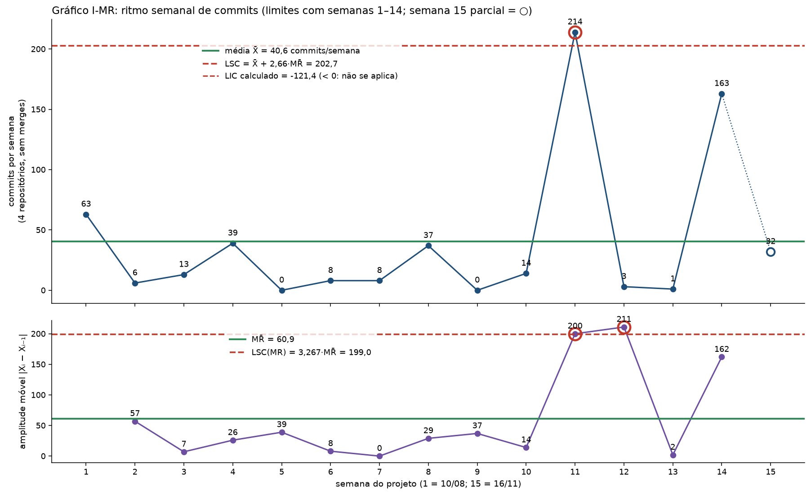
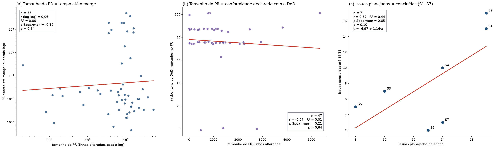

# Análise da Qualidade do FieldOps com as Sete Ferramentas Básicas

| Campo | Informação |
|---|---|
| Projeto | FieldOps — Plataforma de Inspeção em Campo (MVP) |
| Instituição / curso | UniSENAI-SP Campus Sorocaba — Análise e Desenvolvimento de Sistemas |
| Disciplina / orientador | Gestão de Projetos — Prof. Me. Deivison S. Takatu |
| Atividade | Aula 05 — Custos e Qualidade (atividade de Qualidade) |
| Gerente do projeto | Felipe Marques (FM) |
| Integrantes | Felipe Marques; Gabriel Ribeiro Camargo Miranda; Pedro Henrique Dias de Paula; André dos Santos Fernandes; João Victor de Souza Santos |
| Data-base da análise | 18/11/2026 (semana 15, sprint S8) |
| Versão | 1.0 |
| Coleta dos dados | `2026-11-18T14:56:20+00:00` (UTC), org `FieldOps-Project`: repositórios `backend`, `frontend`, `app` e `docs` |

> **Como ler este documento.** Os números vêm de dados reais do GitHub (issues, pull requests, commits e execuções de CI), coletados e calculados por script. Onde o dado não existe, a ferramenta usa uma **premissa**, e ela aparece rotulada (○ ou "premissa"). Os scripts e os CSVs ficam em `scripts/` e `dados/`, na mesma pasta deste arquivo, e qualquer pessoa consegue refazer as contas.

## 1. Resumo

O FieldOps tem 117 issues, 69 pull requests e 601 commits (sem merges) em 15 semanas. A qualidade do **processo** é o ponto fraco, mais do que a do código: dos 55 PRs mergeados analisados, **49 (89%) não têm revisão registrada de outra pessoa no GitHub** (a medida enxerga apenas a revisão registrada na plataforma: revisões por chat ou presenciais não aparecem, e o número não é um juízo sobre as pessoas), embora o `CONTRIBUTING.md` peça uma; só 40% anexaram a evidência de funcionamento que o DoD pede; e as issues fechadas quase nunca têm os critérios de aceitação marcados (0 de 518). O CI, quando existe, funciona (taxa de sucesso de 89%), e a maioria dos defeitos que apareceram foi pequena e corrigida logo. O risco está no que ainda não foi construído: a sincronização offline (RP03; o marco M6 é o de maior peso, 20%) ainda não tem endpoint no backend nem motor no app, e as 21 issues do backend dessa trilha estão **sem responsável**. As sete ferramentas apontam, por caminhos diferentes, para o mesmo ponto: o DoD hoje é autodeclarado, e não verificado. A seção 6 reúne cinco ações para a sprint S8.

## 2. Plano de qualidade resumido (processo 8.1)

Esta seção define *o que é qualidade* no FieldOps, como ela será medida e quem faz o quê. Segue os três processos da Aula 05: **8.1** planejar, **8.2** garantir (auditar processos) e **8.3** controlar (medir resultados e recomendar mudanças).

### 2.1 Padrões e requisitos de qualidade aplicáveis

| Padrão / requisito | Fonte | O que exige | Onde é verificado |
|---|---|---|---|
| Definição de Pronto (DoD) de história | `18-definicao-de-pronto` §18.1 | critérios de aceitação claros; código em branch própria via PR; lint e tipos; sem segredos nem logs sensíveis; testes dos critérios; estados de tela; contrato de API; evidência de funcionamento | checklist do template de PR; folha de verificação (ferramenta iii) |
| DoD específico por camada | §18.2 mobile, §18.3 web, §18.4 API | teste em Android; persistência após reinício; permissões negadas; paginação; erros 401/403/404/409/422; DTO ≠ entidade; autorização no backend; sincronização testada para repetição | revisão do PR + testes automatizados |
| DoD da sprint e do MVP | §18.5 e §18.6 | incremento integrado e demonstrável; PRs revisados; riscos registrados; MVP com fluxo ponta a ponta, build Android, migrações, sem defeito crítico sem contenção | demonstração e revisão da sprint |
| Severidade de defeitos | §18.7 | crítico (bloqueia), alto (corrigir antes da release), médio (aceitar com plano), baixo (backlog) | fluxo de não conformidade (ferramenta ii) |
| Critérios de aceitação por entrega | `17-criterios-de-aceitacao` | cenários dado/quando/então, por marco (tabela 2.2) | demonstração do marco |
| Regras de negócio críticas | `09-regras-de-negocio` | RN-003 (autorização na API), RN-007 (sem credenciais em logs), RN-041/066 (dados locais sobrevivem ao reinício), **RN-067/068 (idempotência, sem duplicidade)**, RN-070 (falha parcial não apaga fila), RN-075/076 (conflito detectado, aprovado prevalece), RN-082/084 (aprovada protegida; revisor não altera resposta) | testes de regra + AC-SYNC, AC-REVIEW |
| Requisitos de projeto | Declaração de Escopo | RJ01 OpenAPI desde M1; RJ03 Git/PR/**revisão de código**; RJ05 validação em Android; RJ06 sem segredos e autorização no backend | folha de verificação, CI, revisão de segurança (backend #35) |
| Requisitos não funcionais | `11-arquitetura` §11.14 | RNF-001 (dados pendentes após reinício), RNF-002 (erros padronizados), RNF-005 (sync idempotente), RNF-009 (tipos e lint), RNF-010 (sem dados sensíveis no repo) | CI e testes |

### 2.2 Critérios de aceitação por marco (resumo)

| Marco | Critério principal (rubrica 19.6) | Critérios de aceitação (doc. 17) | Pacotes da EAP |
|---|---|---|---|
| M1 Fundação (21/08) | três aplicações executáveis e contrato OpenAPI inicial | 17.1 gerais; RJ01 | 2.1–2.4 |
| M2 Autenticação (04/09) | sessão integrada e autorização | AC-AUTH, AC-USERS, AC-MASTER, AC-SECURITY | 3.1, 3.2, 4.1, 4.2, 5.2 |
| M3 Planejamento (18/09) | modelo e inspeção criados pela web | AC-TEMPLATE, AC-SCHEDULING | 3.3, 3.4, 4.3, 4.4 |
| M4 Execução online (02/10) | checklist dinâmico e respostas | AC-MOBILE-LIST, AC-START, AC-CHECKLIST, AC-ADMIN-MONITOR | 3.5, 5.3, 5.4 |
| M5 Recursos nativos (16/10) | foto, QR Code e localização | AC-EVIDENCE, AC-QR, AC-LOCATION, AC-NONCONFORMITY | 3.5, 4.5, 5.5 |
| M6 Offline (30/10) | persistência e sincronização confiável | AC-COMPLETE, **AC-SYNC** (envio, reenvio sem duplicidade, falha parcial, conflito) | 3.6, 5.6, 5.7 |
| M7 Revisão (13/11) | aprovação, reprovação e correção | AC-REVIEW; RN-079 a RN-085 | 3.7, 4.6, 6.2, 6.3 |
| M8 Release (27/11) | integração final, build, documentação e defesa | **AC-RELEASE** (19 passos sem editar o banco); DoD do MVP (§18.6) | 7.1–7.4 |

### 2.3 Métricas, linha de base e metas

A coluna "linha de base" foi **calculada por script** com os dados de 18/11/2026. As metas são **propostas** do gerente (premissa a confirmar com o grupo); a coluna "ferramenta" diz onde a métrica é acompanhada.

| Métrica | Linha de base (18/11) | Meta proposta | Ferramenta |
|---|---|---|---|
| PRs com revisão registrada de outra pessoa | 11% (6 de 55) | 100% nos PRs do núcleo (sync, auth, revisão) e ≥ 80% nos demais | folha (iii) |
| PRs com evidência de funcionamento anexada | 40% | ≥ 90% | folha (iii) |
| PRs com issue vinculada (`Closes #N`) | 75% | 100% | folha (iii) |
| CI verde no momento do merge | 97% (onde havia CI) | 100% | folha (iii) |
| Taxa de sucesso das execuções de CI | 89% | ≥ 90% | Pareto (iv) |
| Tamanho mediano do PR | 936 linhas | ≤ 400 linhas (referência de revisão) | histograma (v) |
| Taxa de conclusão por sprint | 63% (média S1–S7) | ≥ 80%, sem pontos abaixo do LIC | gráfico p (vi) |
| Issues fechadas dentro da sprint prevista | 20% (12 de 59) | ≥ 70% | gráfico p (vi) |
| Commits por semana | média 41; 36% dos commits só na semana 11 | sem semana acima do LSC; sem semana zerada | I-MR (vi) |
| Critérios de aceitação marcados ao fechar issue | 0 de 518 | 100% | folha (iii) |
| Defeitos críticos abertos no M8 | não medido (sem rótulo de defeito) | 0 (DoD do MVP) | Pareto (iv) |

### 2.4 Atividades de garantia (8.2) e de controle (8.3), com responsáveis

Responsáveis seguem a proposta da base do projeto (FM, JV, GR, PD, AF); são **premissas a confirmar**.

| Processo | Atividade | Frequência | Responsável | Evidência |
|---|---|---|---|---|
| 8.2 Garantia | Auditar PRs contra o DoD (folha de verificação) | a cada sprint | FM | folha e resultados desta análise, atualizados |
| 8.2 Garantia | Revisão de código cruzada (backend ↔ app ↔ web) | todo PR | autor ≠ revisor; PD revisa JV/GR, JV revisa AF, GR revisa FM | review `APPROVED` no GitHub |
| 8.2 Garantia | Revisão do contrato OpenAPI antes de integrar | por épico | JV (A: FM) | `docs`, OpenAPI regenerado |
| 8.2 Garantia | Retrospectiva com ação de melhoria (DoD da sprint) | fim de sprint | FM | issue de melhoria |
| 8.3 Controle | CI obrigatório e verde para merge (build, lint, tipos, testes, CodeQL) | todo PR | PD (CI backend), AF (web), FM (app) | status checks |
| 8.3 Controle | Testes automatizados dos fluxos críticos (sync, auth, revisão) | por épico | GR (6.2), PD (6.3) | relatório de testes |
| 8.3 Controle | Gráficos de controle (p e I-MR) e Pareto atualizados | semanal | FM | figuras 4, 6a e 6b |
| 8.3 Controle | Revisão de segurança (AC-SECURITY) antes da release | M8 | JV | issue backend #35 |

### 2.5 Tratamento de não conformidades

Não conformidade (NC) é qualquer desvio do DoD, defeito, falha de CI ou critério de aceitação não atendido. O fluxo está desenhado na figura 2 (painel B). Regras:

| Severidade (DoD §18.7) | Prazo de tratamento | Quem decide | Registro |
|---|---|---|---|
| Crítica (perda de dados, falha de segurança, duplicidade grave, fluxo principal impossível) | imediato; bloqueia a entrega | FM + dono do pacote | issue de defeito + plano de contenção + análise de causa |
| Alta (P0 indisponível sem alternativa) | antes da release | dono do pacote | issue de defeito |
| Média (há alternativa, sem perda de dados) | aceitar com plano | FM | issue + nota na revisão da sprint |
| Baixa (visual, melhoria) | backlog | dono do pacote | issue |

Todo defeito vira issue com **rótulo de defeito e severidade**. Hoje isso não acontece: nenhuma das 117 issues tem rótulo de defeito (achado da ferramenta iii).

## 3. Dados e método

| Fonte | Como foi coletada | O que alimenta |
|---|---|---|
| Issues (117) | `gh issue list --json` nos 4 repositórios; milestones = sprints; caixas de critérios de aceitação e DoD contadas no texto do card | folha de issues, gráfico p, dispersão (c) |
| Pull requests (69) | `gh pr list/view --json` (tamanho, datas, revisões, checks, arquivos) e API de comentários | folha, histograma, dispersão (a, b) |
| Commits (601 sem merges) | API `commits` em todas as branches; mensagens no padrão Conventional Commits | Pareto (a), gráfico I-MR |
| Execuções de CI (99) | `gh run list` e passo que falhou (`gh run view`) | Pareto, Ishikawa |
| Documentação | `fieldops-src/docs/notion` (17, 18, 09, 11, 12), TAP e Declaração de Escopo | plano de qualidade, Ishikawa |

**Amostra de PRs.** Dos 69 PRs, 61 foram mergeados. Retirei 6 PRs que só carregam os templates de PR/issue (corpo vazio; o template ainda não existia), 5 fechados sem merge (retrabalho, tratado no Pareto) e 3 abertos. Sobram **55 PRs mergeados** (backend 17, frontend 17, app 21).

**Tamanho do PR** = adições + remoções, sem `package-lock.json`, `pnpm-lock.yaml` e similares (que inflavam dois PRs do app em milhares de linhas).

**Limitações que o leitor deve ter em mente.**
- Revisão feita fora do GitHub (conversa, reunião presencial) não aparece nos dados. Os números dizem "sem revisão **registrada**".
- Vários PRs são abertos pouco antes do merge (o `createdAt` é do PR, não do início do trabalho). Por isso o "tempo de ciclo do PR" mede o tempo de fila de revisão e integração, não o tempo de desenvolvimento. O tempo do primeiro commit ao merge também está no CSV.
- Algumas issues foram fechadas em lote (por exemplo, as 7 issues de web do S2 em um único minuto, em 19/10). A data de fechamento dessas issues é de organização do quadro, e não da entrega.
- Os logins do GitHub foram trocados por siglas na base de dados, e duas identidades de commit da mesma pessoa foram unificadas (premissa). Os gráficos e tabelas não identificam quem concentra commits.
- Instantâneo do GitHub coletado em 18/11/2026 às 14h56 UTC (11h56 em Brasília; ver `dados/coleta_meta.json`). A base do projeto (§9) registra 57/103 issues concluídas, levantadas antes da coleta; esta análise mostra 59/103 porque as issues `frontend#19` e `frontend#21` foram fechadas às 14h30 UTC de 18/11, depois desse levantamento. Os dois documentos de gestão (riscos e demais) usam 57/103; aqui vale a coleta. A diferença é só essa, de duas issues.

## 4. As sete ferramentas

### 4.1 Diagrama de causa e efeito (Ishikawa)

**Objetivo no projeto.** Organizar as causas do problema que mais ameaça o MVP: *falhas de sincronização offline e defeitos que escapam para a integração*. O problema é relevante porque o núcleo do produto (RP02/RP03, offline e sincronização) vale 15 pontos da rubrica do produto e 20% do peso do marco M6, e porque o TAP o lista entre os principais riscos.

**Dados usados.** As causas vêm de (★) evidência coletada no GitHub e (○) premissas do gerente quando não há dado. As evidências são calculadas pelo script: concentração de commits por pessoa, PRs sem revisão, falhas de CI por passo, data de início do CI do backend, caixas de DoD marcadas.

*Figura 1. Diagrama de Ishikawa (6M adaptado a software: pessoas, processo, ferramentas, requisitos, ambiente e medição).*

**Análise.**
- **Pessoas.** Em cada repositório, um único integrante concentra a maior parte dos commits: 98% no app, 88% no backend e 75% no frontend. A trilha de sincronização do backend (issues #24 a #27) não tem responsável.
- **Processo.** 49 de 55 PRs sem revisão registrada; PRs empilhados (merge em branch que não é a `develop`) deixaram código fora da `develop`, como no `frontend#36` ("restaurar o shell que ficou fora da develop"); a migração Flyway V5 saiu duplicada (`backend#57`).
- **Ferramentas.** O CI do backend só entrou em 23/10/2026 (PR #60), então os PRs anteriores foram mergeados sem verificação automática. No app, 8 das 10 falhas de CI vieram do mesmo passo (`expo-doctor`, por patches novos do Expo SDK 57).
- **Requisitos.** O contrato de sincronização ainda não está fechado (`docs#2` aberta); RN-067 a RN-078 são 12 regras de idempotência e conflito. O app descobriu, em `app#60`, que `by-qr` devolve qualquer equipamento a qualquer usuário autenticado (RN-063).
- **Medição.** 3 de 955 caixas de DoD e 0 de 518 caixas de critérios de aceitação estão marcadas nas issues fechadas. Sem rótulo de defeito, não existe taxa de defeitos.

**Cinco porquês (causa-raiz provável).** (1) Por que o defeito de integração aparece tarde? Porque mobile, web e API só se encontram no fim; o login real do app foi integrado em 18/09 e a sincronização ainda não. (2) Por que só no fim? Porque cada frente trabalha com mocks e o backend atrasou: 21 issues sem dono. (3) Por que o backend atrasou? Porque a capacidade ficou concentrada em poucas pessoas e a ordem das issues não priorizou o núcleo (o dashboard P1 do web, `frontend#28`, foi entregue em 09/11 enquanto a sincronização não começou). (4) Por que ninguém percebeu a tempo? Porque o quadro de issues não reflete o estado real (fechamento em lote, caixas sem marcar). (5) Por que o quadro e o DoD não alertaram? Porque o DoD é **autodeclarado**: o PR diz "revisado" ou "CI passando" e nada verifica.

**Conclusão e ação.** A causa-raiz é de processo (DoD sem verificação) somada a uma concentração de pessoas, e não uma falha técnica isolada. **Ação:** transformar o DoD em verificação automática e obrigatória (ação 1 da seção 6) e fechar o contrato de sincronização antes de escrever o motor (ação 3).

### 4.2 Fluxograma

**Objetivo no projeto.** Tornar explícito o caminho de uma entrega até o aceite e o caminho de uma não conformidade, para que cada etapa tenha dono e critério. Dá o desenho do que a folha de verificação mede.

**Dados usados.** Não há dados numéricos; o desenho vem do `CONTRIBUTING.md` (fluxo de PR e revisão), do DoD (§18.1 e §18.5), da severidade de defeitos (§18.7) e do template de PR, que existe nos três repositórios.

*Figura 2. Painel A: issue, branch, implementação, PR, CI, revisão, merge, demo e aceite. Painel B: tratamento de não conformidade.*

**Análise.** O fluxo A tem três portões de qualidade: **CI verde**, **revisão por outra pessoa** e **demo contra os critérios de aceitação e o DoD**. Confrontado com os dados: o portão de CI funcionou (apenas 1 PR, `app#46`, foi mergeado com CI vermelho, entre 39 PRs com CI aplicável); o portão da revisão quase não deixa registro (só 11% dos PRs têm revisão registrada); o portão da demo não deixa rastro (as issues fechadas não registram os critérios marcados). No fluxo B, o passo "abrir issue de defeito com severidade" não é praticado, e por isso não existe taxa de defeitos.

**Conclusão e ação.** O fluxo está correto no papel e quebrado em dois portões. **Ação:** ativar a proteção da branch `develop` no GitHub (exigir 1 aprovação e CI verde) e adotar o rótulo `defeito` mais severidade para alimentar o fluxo B (ações 1 e 5 da seção 6).

### 4.3 Folha de verificação

**Objetivo no projeto.** Registrar, com marcas contáveis, se cada PR cumpre o DoD que o próprio grupo definiu, e comparar o que o autor **declara** com o que os metadados do GitHub **comprovam**.

**Dados usados.** 55 PRs mergeados (amostra descrita na seção 3). Dois tipos de marca: **D1 a D8**, as caixas do "Checklist de DoD" do template de PR (autodeclaradas pelo autor; 47 PRs têm o checklist e 8 não); e **V1 a V8**, verificações feitas por script nos metadados (nome da branch, título, base, issue citada, status de CI, revisão por outra pessoa, arquivos de teste e de documentação no diff). Itens que o GitHub não permite auditar (ausência de segredos, acessibilidade, teste manual) ficam fora e dependem da revisão humana. Os dados brutos estão em `dados/prs.csv`.

*Figura 3. Matriz de marcas: verde = conforme, vermelho = não conforme, cinza = não se aplica ou PR sem checklist. Colunas em ordem cronológica de abertura.*

| Item | Origem da marca | Aplicáveis | ✔ Conforme | ✘ Não conforme | N/A ou sem checklist | % conforme |
| --- | --- | ---: | ---: | ---: | ---: | ---: |
| D1 – Código em branch própria, via PR | autodeclarado | 47 | 44 | 3 | 8 | 94% |
| D2 – Lint e verificação de tipos passando | autodeclarado | 47 | 44 | 3 | 8 | 94% |
| D3 – Sem segredos versionados | autodeclarado | 47 | 44 | 3 | 8 | 94% |
| D4 – Sem logs sensíveis | autodeclarado | 47 | 44 | 3 | 8 | 94% |
| D5 – Comportamento de erro tratado | autodeclarado | 47 | 44 | 3 | 8 | 94% |
| D6 – Documentação/README atualizados | autodeclarado | 47 | 43 | 4 | 8 | 91% |
| D7 – Evidência de funcionamento anexada | autodeclarado | 47 | 19 | 28 | 8 | 40% |
| D8 – Revisado por outra pessoa | autodeclarado | 45 | 4 | 41 | 10 | 9% |
| V1 – Branch no padrão <tipo>/EP-xx-slug | verificado | 55 | 49 | 6 | 0 | 89% |
| V2 – Título em Conventional Commits | verificado | 55 | 52 | 3 | 0 | 95% |
| V3 – PR aberto contra `develop` | verificado | 55 | 51 | 4 | 0 | 93% |
| V4 – Issue/card vinculado (Closes #N) | verificado | 55 | 41 | 14 | 0 | 75% |
| V5 – CI verde (onde havia CI) | verificado | 39 | 38 | 1 | 16 | 97% |
| V6 – Revisão registrada por outra pessoa | verificado | 55 | 6 | 49 | 0 | 11% |
| V7 – Testes no diff (feat/fix/refactor) | verificado | 47 | 40 | 7 | 8 | 85% |
| V8 – README/OpenAPI/ADR no diff (feat) | verificado | 40 | 33 | 7 | 15 | 82% |

**Issues fechadas.** A mesma lógica aplicada às 60 issues fechadas:

| Verificação (issue fechada) | Aplicáveis | ✔ | ✘ | % conforme |
| --- | ---: | ---: | ---: | ---: |
| Tem responsável designado | 60 | 47 | 13 | 78% |
| Vinculada a milestone (sprint) | 60 | 59 | 1 | 98% |
| Citada por PR mergeado (Closes/ref) | 60 | 41 | 19 | 68% |
| Fechada até o fim da sprint prevista | 60 | 12 | 48 | 20% |
| Critérios de aceitação marcados (≥1 caixa) | 60 | 0 | 60 | 0% |
| Checklist de DoD marcado (≥1 caixa) | 60 | 1 | 59 | 2% |

**Análise.**
- **Revisão.** O autor marcou "revisado por outra pessoa" em apenas 4 PRs, e só 2 delas têm revisão registrada. Nos demais, o checklist traz notas como "Sem revisor disponível". Pelos metadados, 6 PRs foram revisados (5 aprovados e 1 com mudanças pedidas, `app#40`).
- **Evidência.** Dos 47 PRs com checklist, 19 marcaram a evidência de funcionamento e 28 deixaram a caixa aberta, em geral com a nota "falta anexar os prints" ou "print a anexar" (web) e "pendente: simulador" (app). É o segundo maior problema de processo do projeto.
- **Declarado × verificado.** Dos 44 PRs que marcaram "lint e tipos passando", 34 (77%) têm CI verde, 1 tem CI vermelho (`app#46`) e 9 foram mergeados antes de existir CI. Dos 43 que marcaram "documentação atualizada", 28 têm arquivo de documentação no diff.
- **Padronização.** Branch fora do padrão (6 PRs, entre eles os do backend com nome `issue-N-...` e os criados por agentes), PRs empilhados (4: mergeados em base diferente da `develop`) e 14 PRs sem issue citada. Os três PRs com o checklist inteiro em branco são de backend.
- **Issues.** Nenhuma issue fechada tem critério de aceitação marcado e só 3 de 955 caixas de DoD estão marcadas. Apenas 12 de 59 issues com sprint foram fechadas até o fim da sprint prevista.

**Conclusão e ação.** O grupo preenche o checklist (94% nos itens D1–D5), mas as duas barreiras que mais protegem a integração (**revisão por outra pessoa** e **evidência anexada**) são as menos cumpridas. **Ação:** tornar V4, V5 e V6 requisitos de merge (proteção de branch) e marcar os critérios de aceitação na issue no momento do fechamento (ações 1 e 4).

### 4.4 Diagrama de Pareto

**Objetivo no projeto.** Separar os poucos tipos de defeito e de não conformidade que respondem pela maior parte do retrabalho, para decidir onde agir primeiro.

**Dados usados.** (1) **50 commits `fix`** (sem merges) dos quatro repositórios, classificados por script em 7 categorias de causa com regras de palavra-chave (a lista commit a commit está em `dados/fixes_classificados.csv`, para auditoria). Como o projeto não usa rótulo de defeito, o commit `fix` é o melhor indicador de defeito corrigido; **limitação:** ele só conta o que foi corrigido, não o que escapou. Para mostrar que a frequência não é tudo, o painel (b) da figura 4a pondera cada categoria por um peso de severidade presumido (**premissa**: baixo = 1, médio = 3, alto = 5, crítico potencial = 10, com base no §18.7). (2) As marcas ✘ da folha de verificação, como não conformidades de processo (itens D1–D6 e D8 ficam de fora para não duplicar V1, V5, V6 e V8).

*Figura 4a. Pareto dos defeitos (commits `fix`).*

| Categoria de defeito (commits `fix`) | Peso (sev.) | Qtd. | % | % acum. | Peso×Qtd. | % acum. ponderado |
| --- | ---: | ---: | ---: | ---: | ---: | ---: |
| Layout e acabamento visual | 1 | 20 | 40,0% | 40,0% | 20 | 82,0% |
| Regras de negócio e fluxo de inspeção | 5 | 8 | 16,0% | 56,0% | 40 | 43,7% |
| Acessibilidade e estados de interface | 3 | 6 | 12,0% | 68,0% | 18 | 91,8% |
| Build, tipos, dependências e testes | 3 | 5 | 10,0% | 78,0% | 15 | 100,0% |
| Contrato, erros e migrações da API | 5 | 4 | 8,0% | 86,0% | 20 | 71,0% |
| Sessão, autenticação e segurança | 10 | 4 | 8,0% | 94,0% | 40 | 21,9% |
| Persistência, offline e sincronização | 10 | 3 | 6,0% | 100,0% | 30 | 60,1% |

*Figura 4b. Pareto das não conformidades do DoD nos PRs.*

| Não conformidade de processo (folha de verificação) | Qtd. de marcas ✘ | % | % acum. |
| --- | ---: | ---: | ---: |
| Revisão registrada por outra pessoa | 49 | 41,2% | 41,2% |
| Evidência de funcionamento anexada | 28 | 23,5% | 64,7% |
| Issue/card vinculado (Closes #N) | 14 | 11,8% | 76,5% |
| Testes no diff (feat/fix/refactor) | 7 | 5,9% | 82,4% |
| README/OpenAPI/ADR no diff (feat) | 7 | 5,9% | 88,2% |
| Branch no padrão <tipo>/EP-xx-slug | 6 | 5,0% | 93,3% |
| PR aberto contra `develop` | 4 | 3,4% | 96,6% |
| Título em Conventional Commits | 3 | 2,5% | 99,2% |
| CI verde (onde havia CI) | 1 | 0,8% | 100,0% |

**Análise.**
- **Defeitos por frequência.** 43 de 50 commits (cerca de 86%) estão nas 5 primeiras categorias; a maior, de longe, é **layout e acabamento visual** (40%), concentrada no frontend e em duas rajadas de ajustes (09/11 e 18/11). É retrabalho barato e de baixa severidade.
- **Defeitos ponderados.** Com o peso de severidade, a ordem muda: **sessão/segurança** e **regras de negócio** passam à frente, e persistência/sincronização sobe para o terceiro lugar. Ou seja, o que dói pouco aparece muito e o que dói muito aparece pouco. Apesar de raros, os defeitos de sessão, segurança, offline e sincronização (7 commits) merecem prioridade nos testes.
- **Processo.** Quatro itens respondem por cerca de 82% das marcas ✘: revisão registrada (49), evidência (28), issue vinculada (14) e testes no diff (7). Os três primeiros somam 91 marcas (76%).
- **Outros sinais de retrabalho** (fora do Pareto): 5 PRs fechados sem merge (por exemplo, `frontend#37`, refeito em seis PRs menores; `backend#47` e `#49`, substituídos) e 10 execuções de CI que falharam, **8 delas por um único passo** (`expo-doctor`). Esse passo, sozinho, deixou a `develop` do app vermelha de 18/09 (PR #46, mergeado com CI vermelho) até 14/10 (PR #49), segundo o comentário do próprio PR #48.

**Conclusão e ação.** A regra dos 80/20 aparece no processo (quatro itens do DoD) mais do que nos defeitos de código. **Ação:** atacar a revisão e a evidência primeiro; no código, concentrar os testes de regressão nas categorias sessão, regras de negócio e sincronização, e resolver o `expo-doctor` na raiz (fixar as versões do SDK 57 no `package.json` e atualizá-las em um PR dedicado).

### 4.5 Histograma

**Objetivo no projeto.** Ver como se distribuem duas variáveis contínuas que condicionam a qualidade da revisão: o **tamanho** do PR e o **tempo de ciclo** do PR (aberto até o merge).

**Dados usados.** Os 55 PRs da amostra. Tamanho em linhas alteradas (sem lockfiles); tempo em horas entre a abertura e o merge. `dados/prs.csv`.

*Figura 5. (a) Tamanho dos PRs; (b) tempo de ciclo dos PRs, em escala logarítmica.*

| Estatística | Tamanho (linhas) | Tempo de ciclo do PR (h) | Primeiro commit até o merge (h) |
|---|---:|---:|---:|
| n | 55 | 55 | 55 |
| Média | 1.073 | 35,0 | 65,1 |
| Mediana | 936 | 0,14 (9 min) | 0,28 (17 min) |
| Desvio-padrão | 1.006 | 94,0 | 165,9 |
| Q1 – Q3 | 382 – 1.386 | 0,04 – 1,9 | 0,12 – 12,2 |
| Percentil 90 | 2.235 | 105 | 193 |
| Máximo | 5.344 | 503 | 821 |
| Assimetria | 1,9 | 3,4 | 3,2 |

**Análise.**
- **Tamanho.** A distribuição é assimétrica à direita (assimetria 1,9), com média (1.073) acima da mediana (936). **41 dos 55 PRs (75%) passam de 400 linhas** (a referência usual para uma revisão eficaz) e 24 (44%) passam de 1.000. Os maiores trazem funcionalidades inteiras (o do backend com 5.344 linhas inclui a edição de rascunho de modelos).
- **Tempo de ciclo.** A distribuição é **bimodal**: 41 PRs (75%) foram mergeados em menos de 1 hora (mediana de 9 minutos, compatível com merge rápido, logo após o CI, sem etapa de revisão registrada), enquanto 9 PRs (16%) ficaram abertos por mais de 72 horas, entre 3 e 21 dias (conflitos, dependência de outro PR, ADR pendente). O desvio-padrão (94 h) é maior que a média (35 h), sinal de que a média não descreve o processo.
- **Combinação.** PRs medianos de 936 linhas mergeados em minutos dificilmente tiveram uma etapa de revisão registrada. É coerente com a folha de verificação (só 11% com revisão registrada).

**Conclusão e ação.** O tamanho dos PRs está acima do que se revisa bem e o tempo de revisão é, na prática, zero para a maioria. **Ação:** adotar meta de PR ≤ 400 linhas (quebrar por camada ou por critério de aceitação, como o `frontend#37` acabou sendo refeito) e mínimo de revisão registrada para os PRs do núcleo.

### 4.6 Gráfico de controle

**Objetivo no projeto.** Separar variação normal de variação por causa especial no desempenho do projeto, para saber quando reagir. Foram usados dois gráficos: **gráfico p** (proporção de issues concluídas por sprint, com tamanho de amostra variável) e **gráfico I-MR** (commits por semana, medida individual).

**Dados usados.** (1) `dados/issues.csv`: issues por milestone/sprint (S1 a S8) e estado em 18/11. (2) `dados/commits.csv`: commits não-merge por semana (semana 1 = 10/08). Limites de 3σ calculados por script. Gráfico p: p̄ = 63,4% (59 concluídas de 93, em S1–S7; S8 está em curso e fica fora do cálculo), σᵢ = √(p̄(1−p̄)/nᵢ), LSC/LIC = p̄ ± 3σᵢ. Regras de sinal: ponto fora dos limites; 2 de 3 pontos além de 2σ. I-MR: X̄ ± 2,66·MR̄; sinais: ponto fora do limite e 8 pontos seguidos do mesmo lado da média; a semana 15 (parcial) não entra no cálculo.

*Figura 6a. Gráfico p: issues concluídas por sprint (concluídas/total em cada ponto).*

| Sprint | Período | Concluídas (k) | Total (n) | p = k/n | LIC | LSC | Fechadas no prazo | Sinal |
| --- | --- | ---: | ---: | ---: | ---: | ---: | ---: | --- |
| S1 | 10/08–21/08 | 15 | 17 | 88,2% | 28,4% | 98,5% | 8/17 | — |
| S2 | 24/08–04/09 | 17 | 17 | 100,0% | 28,4% | 98,5% | 2/17 | acima do LSC |
| S3 | 07/09–18/09 | 7 | 10 | 70,0% | 17,8% | 100,0% | 0/10 | — |
| S4 | 21/09–02/10 | 10 | 14 | 71,4% | 24,8% | 100,0% | 0/14 | — |
| S5 | 05/10–16/10 | 5 | 8 | 62,5% | 12,4% | 100,0% | 0/8 | — |
| S6 | 19/10–30/10 | 2 | 13 | 15,4% | 23,4% | 100,0% | 0/13 | abaixo do LIC |
| S7 | 02/11–13/11 | 3 | 14 | 21,4% | 24,8% | 100,0% | 2/14 | abaixo do LIC |
| S8 | 16/11–27/11 | 0 | 10 | 0,0% | 17,8% | 100,0% | em curso | S8 em curso: não avaliada |

*Figura 6b. Gráfico de valores individuais e de amplitude móvel dos commits semanais.*

| Parâmetro do I-MR | Valor |
|---|---:|
| Média X̄ (semanas 1–14) | 40,6 commits/semana |
| Amplitude móvel média MR̄ | 60,9 |
| LSC = X̄ + 2,66·MR̄ | 202,7 |
| LIC | -121,4 (negativo, não se aplica) |
| LSC da amplitude (3,267·MR̄) | 199,0 |
| Semanas com zero commit | semanas 5 e 9 |
| Maior sequência do mesmo lado da média | 9 semanas (semanas 2 a 10, abaixo da média) |

**Análise.**
- **Gráfico p.** O processo tinha comportamento estável até S5 (62,5% a 88,2%), com um ponto de exceção favorável: **S2 acima do LSC** (17/17 = 100%). Esse resultado não é desempenho extraordinário: as 7 issues de web e outras do backend dessa sprint foram **fechadas em lote**, semanas depois do fim da sprint (web em 19/10; backend em 26/09), o que mostra o problema de medição já apontado. **S6 (15,4%) e S7 (21,4%) estão abaixo do LIC** (23,4% e 24,8%): causa especial, e não variação do acaso. A causa é identificável: as 4 issues de push/pull/conflito/arquivos do backend (S6) não têm responsável e o motor de sincronização do app (7 das 9 issues de S6) não foi iniciado. S8 (0/10) ainda não é avaliável, pois a sprint não terminou. **Pontualidade:** só 12 das 59 issues com sprint foram fechadas até o fim da sprint prevista (20%); o atraso começou já em S2 (2 de 17 no prazo), bem antes do sinal estatístico, e é o que o gráfico p de "concluídas até hoje" esconde.
- **Gráfico I-MR.** 601 commits em 15 semanas, mas **73% deles caem em apenas 3 semanas** (semanas 1, 11 e 14). A **semana 11** (19 a 25/10, antes do marco M6) tem 214 commits, acima do LSC (203); as amplitudes das semanas 11 e 12 estão acima do LSC da amplitude. Há 9 semanas seguidas abaixo da média e duas semanas sem commit. O padrão é de **entrega em rajadas** antes dos prazos, seguido de silêncio, e não de fluxo contínuo. A semana 14 (163 commits) não ultrapassa o LSC, mas reforça o padrão.

**Conclusão e ação.** Os dois gráficos mostram um processo **fora de controle** em S6–S7 (atraso por causa especial) e **instável** no ritmo (rajadas). Ação: tratar S6–S7 como causa especial (atribuir dono, aplicar a ordem de corte do RJ07) e passar a acompanhar o gráfico p no fim de cada sprint (com o número de issues fechadas **até a data de fim da sprint**), e não só em 18/11; além disso, impor integração diária (merge de PRs pequenos) para reduzir a rajada (ações 3 e 4).

### 4.7 Diagrama de dispersão

**Objetivo no projeto.** Testar relações que o time costuma assumir: "PR grande demora mais para ser revisado", "PR grande cumpre menos o DoD" e "quanto mais planejamos, mais entregamos".

**Dados usados.** (a) tamanho do PR × tempo até o merge (55 PRs; escala log nos dois eixos porque as variáveis são muito assimétricas); (b) tamanho do PR × percentual de itens de DoD marcados no PR (47 PRs com checklist; pequeno deslocamento vertical aleatório de ±1,2 pontos só para separar pontos sobrepostos); (c) issues planejadas × concluídas nas sprints S1–S7 (7 sprints). Retas de mínimos quadrados, coeficiente de correlação de Pearson r, R² e p-valor do teste de r = 0; o ρ de Spearman é dado como verificação por ser robusto a valores extremos.

*Figura 7. (a) Tamanho × tempo até o merge; (b) tamanho × conformidade declarada; (c) planejadas × concluídas.*

| Par de variáveis | n | r (Pearson) | R² | ρ (Spearman) | p-valor | Leitura |
|---|---:|---:|---:|---:|---:|---|
| (a) tamanho × tempo até o merge (log-log) | 55 | 0,06 | 0,00 | -0,10 | 0,64 | sem relação |
| (b) tamanho × % de DoD marcado | 47 | -0,07 | 0,01 | -0,21 | 0,64 | sem relação |
| (c) issues planejadas × concluídas | 7 | 0,67 | 0,44 | 0,65 | 0,10 | moderada, não significativa (n = 7) |

**Análise.**
- **(a)** O coeficiente é praticamente zero (0,06; R² ≈ 0): **o tempo de revisão não cresce com o tamanho**. Um PR de 5.000 linhas é mergeado em minutos, como um de 50. Num processo de revisão que funciona, espera-se correlação positiva; a ausência dela indica que a revisão registrada não acompanha o tamanho do PR. A relação sem log também é fraca (-0,04).
- **(b)** O tamanho não explica o cumprimento do DoD (r = -0,07). O DoD é cumprido (ou ignorado) de forma uniforme, independentemente do tamanho: depende do hábito do autor, e não do esforço do PR.
- **(c)** Há correlação positiva moderada (r = 0,67, R² = 0,44), mas com 7 pontos o p-valor (0,10) não permite afirmar associação. **Correlação não é causalidade:** as sprints com mais issues (S1 e S2) são as primeiras, de setup, e também as mais "fechadas em lote". O tempo é um fator escondido que afeta as duas variáveis. A reta não serve para prever a próxima sprint.

**Conclusão e ação.** As duas hipóteses de tamanho do PR não se confirmam e levam à mesma lição: o processo de revisão e o preenchimento do DoD não reagem ao risco do PR. **Ação:** definir regra de revisão por **risco** (núcleo de sincronização, autenticação e revisão = revisão obrigatória por outra pessoa, qualquer que seja o tamanho) e repetir o gráfico (a) depois dela; esperamos ver correlação positiva e significativa.

## 5. Quadro-resumo das ferramentas

| Ferramenta | Pergunta respondida | Achado principal | Ação |
|---|---|---|---|
| (i) Ishikawa | Por que a sincronização e a integração são frágeis? | causa-raiz de processo (DoD autodeclarado) e de pessoas (um dono por repositório) | tornar o DoD verificável; fechar o contrato de sincronização |
| (ii) Fluxograma | Qual é o caminho de qualidade? | portões de revisão e de demonstração não deixam rastro | proteção da `develop`; rótulo de defeito |
| (iii) Folha de verificação | O DoD é cumprido? | 11% com revisão; 40% com evidência | requisitos de merge |
| (iv) Pareto | Onde está o retrabalho? | processo (4 itens = 82%); defeito visual domina a frequência, e sessão e sincronização dominam a severidade | testes nas categorias críticas |
| (v) Histograma | Como são os PRs? | mediana de 936 linhas e de 9 min até o merge; bimodal | PR ≤ 400 linhas |
| (vi) Gráfico de controle | O processo é estável? | S6 e S7 fora de controle; commits em rajadas | dono para o backend; integração diária |
| (vii) Dispersão | O tamanho explica a revisão? | r ≈ 0: a revisão não acompanha o risco | revisão por risco |

## 6. Síntese integrada e ações priorizadas

**O que as sete ferramentas dizem em conjunto.** O FieldOps produz código com padrão razoável (branches e títulos no padrão em 89% e 95% dos PRs, CI verde em 97% dos merges verificáveis, testes no diff em 85% e documentação no diff em 82% dos PRs aplicáveis), mas **não verifica o que declara**. A falta de revisão (folha, Pareto, histograma e dispersão) e a medição frágil (Ishikawa, gráficos de controle) fazem com que os problemas sejam descobertos tarde, na integração. O atraso nas sprints S6 e S7 é causa especial (gráfico p) e se soma à concentração de pessoas e ao ritmo em rajadas (I-MR). Como o núcleo ainda por construir é justamente o de maior risco (sincronização, RP03), o custo da qualidade sobe a cada dia sem integração.

**Cinco ações priorizadas para a sprint S8 (até 27/11/2026).** Prioridade = impacto sobre o núcleo do MVP ÷ esforço. Responsáveis e prazos são propostas (premissa a confirmar).

| # | Ação | Ferramenta de origem | Responsável | Prazo | Indicador de sucesso |
|---|---|---|---|---|---|
| 1 | **Proteger a `develop`**: exigir 1 aprovação de outra pessoa e CI verde para merge, em `backend`, `frontend` e `app`; PRs do núcleo (sync, auth, revisão) com revisor definido na abertura | Ishikawa, fluxograma, folha, dispersão | JV (admin) com FM | 19/11 | PRs com revisão registrada: de 11% para ≥ 80% |
| 2 | **Teste de integração da sincronização** antes do merge: três cenários do AC-SYNC (envio, reenvio da mesma operação sem duplicidade, falha parcial) contra o backend real, com evidência no PR | Ishikawa, Pareto | GR e PD (backend), FM (app) | 25/11 | 3 de 3 cenários verdes; 0 duplicidade na demo |
| 3 | **Fechar o contrato de sincronização** (`docs#2` e OpenAPI) e **atribuir dono às 21 issues do backend** sem responsável; aplicar a ordem de corte do RJ07 ao que não couber (dashboard avançado, P1) | Ishikawa, gráfico p | JV e FM | 19/11 | 0 issues P0 sem responsável; contrato publicado |
| 4 | **PRs pequenos e integração diária**: meta ≤ 400 linhas e merge ao menos em dias alternados; marcar critérios de aceitação e DoD na issue **no fechamento**; acompanhar o gráfico p e o I-MR no fim da sprint | histograma, I-MR, folha de issues | FM (acompanha), todos | 23/11 em diante | mediana ≤ 400 linhas; 0 semana sem commit |
| 5 | **Medir defeitos**: rótulo `defeito` com severidade (§18.7) em toda issue de defeito; resolver o `expo-doctor` na raiz fixando as versões do SDK; registrar as limitações conhecidas (`docs#6`) | Pareto, Ishikawa, fluxo B | AF (web) e FM (app); PD (CI) | 23/11 | taxa de sucesso do CI ≥ 90% (hoje 89%); 100% dos defeitos com severidade |

## 7. Premissas e como reproduzir

**Premissas deste documento**
1. Siglas e papéis das pessoas conforme a base do projeto (FM gerente e mobile; JV, GR e PD backend; AF web); duas identidades de commit da mesma pessoa foram unificadas.
2. As metas de qualidade (seção 2.3) e os pesos de severidade do Pareto (1, 3, 5, 10) são propostas do gerente, e não decisões do grupo.
3. O commit `fix` representa defeito corrigido; a classificação em categorias é por palavra-chave (auditável em `dados/fixes_classificados.csv`).
4. Marcas D1–D8 são o que o autor declarou no PR; V1–V8 são verificações automáticas nos metadados do GitHub, sem avaliar o conteúdo do código.
5. Revisão presencial ou por chat não está nos dados. A recomendação de registrar a revisão no GitHub vem daí.
6. Itens do DoD que não são auditáveis por metadados (segredos, acessibilidade, teste manual) estão fora da folha.

**Reprodutibilidade.** Na pasta `scripts/`: `python3 coleta_github.py` (requer `gh` autenticado) gera os CSVs em `dados/`; `python3 analise_qualidade.py` calcula tudo e gera as figuras e `dados/resultados.json`; `python3 montar_relatorio.py` regenera este documento a partir do modelo `relatorio_template.md`. Dependências: Python 3, numpy e matplotlib.

| Arquivo | Conteúdo |
|---|---|
| `dados/issues.csv`, `prs.csv`, `commits.csv`, `ci_runs.csv` | dados brutos tratados (siglas no lugar de logins) |
| `dados/fixes_classificados.csv` | commits `fix` com a categoria atribuída |
| `dados/resultados.json` | todos os números usados no texto |
| `scripts/` | coleta, estatística, análise e montagem do relatório |

## Referências

1. TAKATU, Deivison S. **Gestão de Projetos: Custos e Qualidade (Aula 05)**. UniSENAI-SP, 2026. Processos 8.1 a 8.3 e sete ferramentas básicas da qualidade.
2. FIELDOPS. **Documentação do projeto** (`docs/notion`: 09 Regras de negócio, 11 Arquitetura, 17 Critérios de aceitação, 18 Definição de Pronto, 19 Critérios de avaliação) e `CONTRIBUTING.md`.
3. FIELDOPS. **Termo de Abertura do Projeto** e **Declaração do Escopo** (04/10/2026).
4. GITHUB. Repositórios `FieldOps-Project/backend`, `frontend`, `app` e `docs` (consulta de 18/11/2026).
5. CARVALHO, Fábio Câmara Araújo de. **Gestão de projetos**. 2. ed. São Paulo: Pearson, 2018.
