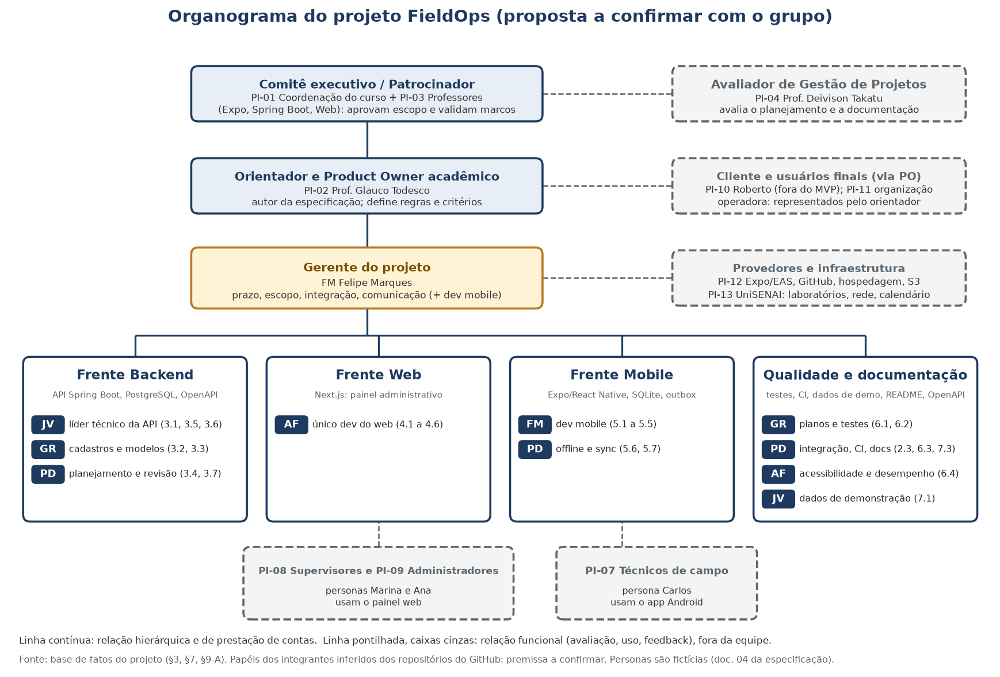
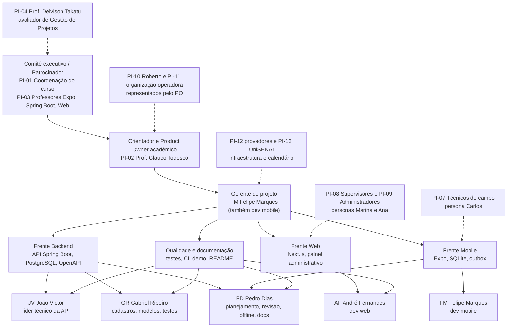

# Organograma e Matriz RACI do Projeto FieldOps

| Campo | Informação |
|---|---|
| Projeto | FieldOps — Plataforma de Inspeção em Campo (MVP) |
| Instituição / curso | Centro Universitário SENAI São Paulo (UniSENAI-SP), Campus Sorocaba. Análise e Desenvolvimento de Sistemas |
| Disciplina / atividade | Gestão de Projetos (Prof. Me. Deivison S. Takatu). Aula 06, RH: organograma e Matriz RACI |
| Gerente do projeto | Felipe Marques (FM) |
| Integrantes | Felipe Marques; Gabriel Ribeiro Camargo Miranda; Pedro Henrique Dias de Paula; André dos Santos Fernandes; João Victor de Souza Santos |
| Data / versão | 18/11/2026 — versão 1.0 |
| Situação | **Proposta de distribuição de responsabilidades, a confirmar com o grupo.** Os papéis dos integrantes foram inferidos dos repositórios do GitHub (issues, commits, PRs); não são um acordo formalizado. |
| Base de pacotes | EAP congelada (níveis 1 e 2), em `aula-03-escopo/eap-fieldops.md` |

> **Cobertura.** A EAP tem 36 pacotes de trabalho de nível 2 (4 + 4 + 7 + 6 + 7 + 4 + 4), e a matriz abaixo cobre os 36.

---

## 1. Organograma do projeto

O organograma mostra a estrutura hierárquica e os responsáveis. Linha contínua é relação hierárquica e de prestação de contas. Caixas e linhas pontilhadas são partes interessadas fora da equipe, que avaliam, usam ou influenciam, sem comando sobre ela.

Versão em Mermaid (renderiza direto no GitHub):

PD aparece em três frentes (backend, mobile e documentação) e AF e GR em duas, porque a divisão de pacotes da §9-A da base atravessa as frentes: PD responde pelas camadas offline e de sincronização do app (5.6, 5.7), além de planejamento, revisão e documentação no backend.

---

## 2. Papéis, responsabilidades, competências e autoridade

| Papel | Quem | Responsabilidades | Competências esperadas | Autoridade |
|---|---|---|---|---|
| Comitê executivo / patrocinador | PI-01 Coordenação; PI-03 Professores (Expo, Spring Boot, Web) | Aprovar o TAP e a Declaração de Escopo (1.1) e o encerramento (1.4); validar os marcos M1–M8 (1.3, 7.2, 7.4); avaliar por marco | Visão do curso e dos critérios de avaliação | Aprova ou rejeita escopo, marcos e aceite final. Define o calendário de avaliação |
| Orientador e Product Owner acadêmico | PI-02 Prof. Glauco Todesco | Manter a especificação e as regras de negócio; aprovar o Plano de Gerenciamento (1.2), as regras de modelos (3.3, 4.3), de revisão (3.7) e do checklist (5.4); esclarecer dúvidas de negócio | Domínio do problema de inspeção em campo; critérios de aceitação | Decide regra de negócio e prioridade de produto. Não gerencia a execução diária |
| Avaliador de Gestão de Projetos | PI-04 Prof. Deivison Takatu | Avaliar o planejamento e a documentação de GP | Gestão de projetos (PMBOK) | Avalia os artefatos de GP. Fora da cadeia de decisão do produto |
| Gerente do projeto | FM Felipe Marques | Planejar e controlar escopo, prazo, custos, riscos e comunicações; conduzir cerimônias; consolidar status; aprovar a maior parte dos pacotes técnicos; escalar desvios; **também** desenvolver o app (5.1 a 5.5) | Planejamento e controle, comunicação, facilitação, resolução de conflitos; Expo/React Native e TypeScript | Aloca issues e muda prioridades dentro da sprint; propõe mudança de escopo e aplica a ordem de corte (RJ07) com ciência do PI-02; **não** altera regra de negócio nem nota |
| Líder técnico do backend | JV João Victor | Dono do contrato OpenAPI e das convenções (2.1, 2.2); identidade e acesso (3.1); execução, evidências e sincronização (3.5, 3.6); dados de demonstração (7.1); revisar PRs de API | Java, Spring Boot, JWT, PostgreSQL, OpenAPI, desenho de API | Aprova mudanças no contrato da API e decisões de arquitetura do backend; aprova (A) os pacotes 2.4, 3.2, 3.4, 5.2 e 5.7 |
| Desenvolvedor backend (cadastros e qualidade) | GR Gabriel Ribeiro | Ambiente Docker/PostgreSQL (2.4); cadastros operacionais (3.2); modelos versionados e snapshot (3.3); plano e testes automatizados (6.1, 6.2) | Java/Spring, modelagem relacional, testes automatizados (JUnit), Flyway | Decide detalhes de implementação dos seus módulos, dentro do contrato aprovado |
| Desenvolvedor backend e documentação | PD Pedro Dias | Pipelines de CI (2.3); planejamento (3.4) e revisão/auditoria (3.7); persistência offline e sincronização no app (5.6, 5.7); testes de integração (6.3); documentação final (7.3) | Java/Spring, GitHub Actions, SQLite e padrões offline-first, documentação técnica | Decide a organização dos pipelines e da documentação final; propõe o desenho do outbox junto com JV |
| Desenvolvedor web | AF André Fernandes | Todo o painel administrativo (4.1 a 4.6); acessibilidade e desempenho (6.4) | Next.js/React, TypeScript, formulários e estado, consumo de API | Decide a estrutura e os componentes do frontend web, dentro do contrato aprovado |
| Desenvolvedor mobile | FM Felipe Marques | Base do app (5.1), login (5.2), lista (5.3), checklist (5.4), recursos nativos (5.5), build Android e demo (7.2, 7.4) | Expo, React Native, TypeScript, câmera, QR Code, localização, EAS | Decide a arquitetura do app, dentro do contrato aprovado |
| Usuários-chave (fora da equipe) | PI-07 Técnicos (Carlos); PI-08 Supervisores (Marina); PI-09 Administradores (Ana); PI-10 Responsáveis do cliente (Roberto) | Fornecem requisitos de uso e feedback, por meio do PO e de testes com usuários-proxy | Operação de inspeção | Nenhuma autoridade formal. As personas da especificação são **fictícias**; o PI-02 as representa |

> As colunas "Responsabilidades" e "Autoridade" derivam da §9-A da base e do CONTRIBUTING.md (revisão obrigatória de PR por outro membro, CI verde antes do merge). A alocação de pessoas às frentes é **premissa** inferida dos repositórios.

---

## 3. Matriz RACI

### 3.1 Legenda

| Sigla | Significado | Como aparece |
|---|---|---|
| **R** | Responsável: executa e responde pela entrega do pacote | exatamente um por pacote |
| **A** | Aprovador: dá o aceite final e responde pelo resultado | exatamente um por pacote |
| **A/R** | A mesma pessoa executa e aprova | só onde a §9-A define auto-aprovação (5.1, 5.3, 5.5), tratado como risco de concentração |
| **C** | Consultado: opina **antes** da decisão ou entrega (comunicação nos dois sentidos) | zero ou mais |
| **I** | Informado: recebe o resultado **depois** (comunicação em um sentido) | zero ou mais |
| · | Sem envolvimento no pacote | |

### 3.2 Regras de uso

1. Cada pacote tem **um único A** e **pelo menos um R**. Nenhum pacote ganha segundo R: se o trabalho se divide, divide-se o pacote na EAP.
2. R e A das 36 linhas vêm da §9-A da base. As colunas PI-01, PI-02 e PI-03 nunca são R, porque não executam pacotes. Só aprovam (A), são consultadas (C) ou informadas (I).
3. Critério de **C**: quem fornece uma entrada da qual o pacote depende (contrato de API, regra de negócio, ambiente) ou quem consome o resultado e precisa validar que ele serve. Exemplo: o contrato OpenAPI (2.2) tem GR, PD e AF consultados porque implementam ou consomem o contrato; o PI-02 é consultado porque os enums e as regras vêm da especificação.
4. Critério de **I**: quem só precisa saber que o pacote ficou pronto ou mudou, sem poder de veto. Exemplo: GR é informado do shell web (4.1), pois não depende dele.
5. **C responde em até 2 dias úteis** (alinhado ao plano de comunicação, COM-08 e COM-09). Se não responder, o R segue e registra a decisão na issue ou no PR.
6. Quem é A não pode aprovar o próprio PR de código. A aprovação do pacote (aceite) é diferente da revisão do PR, que o CONTRIBUTING.md exige de outro membro.
7. Mudança de R ou A só por decisão do gerente, comunicada à equipe e registrada em nova versão deste documento (comunicação COM-10). Mudança de A para PI-01, PI-02 ou PI-03 exige a ciência deles.
8. Em conflito entre dois C sobre o mesmo pacote, decide o A. Se o A é PI-xx, o gerente leva a questão na reunião semanal com o orientador (COM-12).

### 3.3 Matriz

Colunas: as cinco pessoas da equipe e as três partes interessadas que aprovam ou são consultadas (PI-01 Coordenação, PI-02 Prof. Glauco, PI-03 Comitê). A coluna final justifica o C e o I de cada linha.

| Cód. | Pacote de trabalho | FM | JV | GR | PD | AF | PI-01 Coord. | PI-02 Glauco | PI-03 Comitê | Critério de C e I |
|---|---|:-:|:-:|:-:|:-:|:-:|:-:|:-:|:-:|---|
| **1** | **Gerenciamento do Projeto** | | | | | | | | | |
| 1.1 | Termo de Abertura e Declaração de Escopo aprovados | R | I | I | C | I | A | C | I | PD redigiu o TAP; PI-02 confere o escopo com a especificação |
| 1.2 | Plano de Gerenciamento do Projeto | R | C | C | C | C | I | A | I | quem executa fornece as estimativas de cada plano |
| 1.3 | Relatórios de status e demonstrações dos marcos M1–M8 | R | C | I | I | C | I | C | A | JV e AF apresentam seus incrementos; PI-02 dá o retorno de PO |
| 1.4 | Encerramento do projeto (aceite, lições aprendidas, relatório final) | R | C | C | C | C | A | I | I | todos contribuem com as lições aprendidas |
| **2** | **Fundação Técnica** | | | | | | | | | |
| 2.1 | Repositórios e convenções Git/PR definidos | A | R | I | I | C | · | I | · | AF adota as convenções no repositório web; demais só precisam saber |
| 2.2 | Contrato OpenAPI e padrões compartilhados (enums, IDs, erros) | A | R | C | C | C | I | C | · | quem implementa e quem consome o contrato; PI-02 confere enums com a especificação |
| 2.3 | Pipelines de integração contínua (backend, web, app) | A | C | I | R | C | · | · | · | pipelines de backend e web dependem das convenções de JV e AF |
| 2.4 | Ambiente de desenvolvimento padronizado (Docker Compose, PostgreSQL, migrações) | C | A | R | C | I | · | · | · | FM e PD sobem a API local para o app e para os testes de sincronização |
| **3** | **API REST Central (Backend)** | | | | | | | | | |
| 3.1 | Identidade e acesso (JWT, perfis, autorização) | A | R | C | I | C | · | · | · | GR depende da autorização no módulo de usuários; AF implementa guards |
| 3.2 | Cadastros operacionais (usuários, clientes, locais, equipamentos, QR) | C | A | R | I | C | · | · | · | AF consome os cadastros; FM consome equipamento/QR no app |
| 3.3 | Modelos de inspeção versionados com snapshot | C | C | R | I | C | · | A | · | JV desenha o snapshot com GR; AF (construtor) e FM (checklist dinâmico) o consomem |
| 3.4 | Planejamento e atribuição de inspeções | C | A | I | R | C | · | C | · | AF agenda, FM lista no app; PI-02 define regras de planejamento |
| 3.5 | Execução, respostas e evidências (upload, localização, não conformidades) | A | R | C | C | C | · | C | · | GR (não conformidades), PD (sync reutiliza) e AF (evidências) dependem; PI-02 valida regras |
| 3.6 | Sincronização idempotente (push/pull, cursor, conflitos) | A | R | I | C | I | · | C | · | PD implementa o cliente da sincronização; PI-02 valida regras de conflito |
| 3.7 | Revisão, aprovação e trilha de auditoria | C | C | I | R | C | · | A | · | JV (autorização/auditoria), AF (tela de revisão) e FM (correção no app) |
| **4** | **Interface Administrativa Web** | | | | | | | | | |
| 4.1 | Shell administrativo, autenticação e navegação | A | C | I | I | R | · | · | · | JV garante o contrato de autenticação consumido pelo web |
| 4.2 | Gestão de usuários e cadastros | A | C | C | I | R | · | · | · | APIs de cadastros (GR) e de usuários/perfis (JV) |
| 4.3 | Construtor e publicação de modelos de inspeção | C | C | C | I | R | · | A | · | GR e JV fornecem a API de modelos; FM precisa interpretar o que o construtor gera |
| 4.4 | Agendamento, atribuição e acompanhamento de inspeções | A | I | I | C | R | · | · | · | PD entrega a API de planejamento consumida pela tela |
| 4.5 | Visualização de evidências e não conformidades | A | C | I | I | R | · | · | · | JV entrega o upload e a consulta de evidências |
| 4.6 | Revisão: aprovação, reprovação e histórico | A | I | I | C | R | · | C | · | PD entrega a API de revisão; PI-02 valida o fluxo de revisão |
| **5** | **Aplicativo Mobile (Android)** | | | | | | | | | |
| 5.1 | Base do app, navegação e design system | A/R | · | · | I | C | · | · | · | AF compartilha padrões de componentes e tokens do web |
| 5.2 | Login e sessão segura | R | A | I | C | I | · | · | · | PD depende da sessão para a sincronização autenticada; JV, como A, aprova o contrato |
| 5.3 | Lista, filtros e detalhes das inspeções | A/R | C | I | C | I | · | · | · | JV entrega o endpoint de consulta; PD fornece o cache local usado pela lista |
| 5.4 | Checklist dinâmico, respostas e progresso | R | C | C | I | C | · | A | · | GR (modelo), JV (respostas) e AF (construtor gera a estrutura renderizada) |
| 5.5 | Recursos nativos (câmera, QR Code, localização) e evidências | A/R | C | C | I | I | · | · | · | JV recebe o upload; GR mantém o QR do equipamento |
| 5.6 | Persistência offline (SQLite) e fila outbox | A | C | I | R | I | · | · | · | JV define o contrato de sincronização que o outbox respeita |
| 5.7 | Sincronização, tela de pendências e fluxo de correção | C | A | I | R | C | · | · | · | FM é dono do app onde ficam a tela e o fluxo; AF dispara a correção na revisão web |
| **6** | **Qualidade e Testes** | | | | | | | | | |
| 6.1 | Plano de testes e critérios de aceitação | A | C | R | C | C | I | C | · | cada frente define os critérios do seu componente; PI-02 é dono dos critérios de aceitação |
| 6.2 | Testes automatizados dos fluxos críticos | A | C | R | C | I | · | · | · | JV (API) e PD (sincronização) fornecem os fluxos críticos |
| 6.3 | Testes de integração mobile–API–web e validação em dispositivos Android | A | C | I | R | C | · | · | I | JV e AF corrigem o que o teste de integração apontar |
| 6.4 | Acessibilidade, desempenho e correção de falhas | A | C | I | I | R | · | · | · | JV trata o desempenho da API apontado nos testes |
| **7** | **Entrega e Release (M8)** | | | | | | | | | |
| 7.1 | Dados de demonstração reproduzíveis | A | R | C | C | I | · | · | · | GR (modelos, cadastros) e PD (cenários offline) precisam dos dados |
| 7.2 | Build Android (EAS), painel web e API publicados/executáveis | R | C | I | C | C | I | · | A | JV publica a API, AF o painel e PD mantém o CI/EAS |
| 7.3 | Documentação final (README, OpenAPI, diagramas) | A | C | C | R | C | · | I | I | cada frente escreve o README e o OpenAPI do seu repositório |
| 7.4 | Demonstração ponta a ponta e apresentação final | R | C | C | C | C | I | C | A | cada um apresenta sua parte; PI-02 assiste como PO |

---

## 4. Verificação e análise de carga

### 4.1 Verificação automática

Um script (Python) leu a matriz e verificou: 36 pacotes cobertos; **exatamente 1 A por linha** nas 36; **pelo menos 1 R por linha** nas 36; nenhuma pessoa com dois papéis na mesma linha (exceto os três A/R declarados); nenhum PI como R; R e A de cada linha idênticos à §9-A. Resultado: zero erros. Contagem total: 36 R, 36 A (nas colunas de equipe e PI; A/R conta como um R e um A).

### 4.2 Contagem por pessoa

R, A, C e I contados por célula (A/R vale um R e um A). A "carga ponderada" é uma heurística minha para comparar pessoas (R = 3, A = 2, C = 1, I = 0,25). Os pesos são premissa, não padrão do PMBOK.

| Pessoa | R | A | C | I | Pacotes com R, A ou C | Carga ponderada |
|---|--:|--:|--:|--:|--:|--:|
| FM Felipe Marques | 11 | 21 | 7 | 0 | 36 de 36 | 82,0 |
| JV João Victor | 6 | 5 | 21 | 3 | 32 de 36 | 49,8 |
| GR Gabriel Ribeiro | 5 | 0 | 12 | 18 | 17 de 36 | 31,5 |
| PD Pedro Dias | 7 | 0 | 16 | 13 | 23 de 36 | 40,3 |
| AF André Fernandes | 7 | 0 | 20 | 9 | 27 de 36 | 43,3 |
| PI-01 Coordenação | 0 | 2 | 0 | 6 | 2 de 36 | 5,5 |
| PI-02 Prof. Glauco | 0 | 5 | 9 | 3 | 14 de 36 | 19,8 |
| PI-03 Comitê | 0 | 3 | 0 | 5 | 3 de 36 | 7,3 |

### 4.3 Leitura dos números

- **FM é o ponto único de falha.** Acumula 11 R (os 4 de gestão, 5 do app, mais build e demo), **21 A** (aprovador da maioria dos pacotes técnicos) e 7 C: aparece em 36 de 36 pacotes, **100% da EAP**, e sua carga ponderada é 82,0, contra 31,5 de GR, a menor. Os três pacotes A/R (5.1, 5.3, 5.5) são o único caso em que ninguém revisa o aceite. Gestão e desenvolvimento competem pelas mesmas 12 h semanais.
- **AF é dependência de pessoa-chave.** É o único R do web (7 pacotes, inclusive 6.4) e é consultado em 20 pacotes, o segundo maior volume de C. Sem ele, o painel administrativo não evolui. Como o web só avança se os contratos da API chegarem a tempo, AF também espera por JV, GR e PD.
- **JV concentra consultas.** 21 C, mais que qualquer outro, além de 6 R e 5 A. Como líder técnico do contrato, vira gargalo de decisão. Não foi pedido na atividade, mas afeta a leitura de FM e AF.
- **GR é a pessoa com menos carga** (31,5) e nenhum A. Há folga para absorver aprovações e pacotes de qualidade.
- As partes interessadas externas têm carga leve: PI-02 em 17 pacotes (5 A, 9 C, 3 I), PI-03 e PI-01 apenas aprovam marcos e encerramento. Isso respeita o tempo dos professores.

### 4.4 Desequilíbrios e recomendações

| Desequilíbrio | Evidência | Recomendação |
|---|---|---|
| Sobrecarga do gerente (FM) | 11 R + 21 A + 7 C; 36 de 36 pacotes; carga 82,0 | (1) Delegar o A de 2.3, 6.1 e 6.2 a JV e de 6.3, 6.4 e 7.3 a GR (feito no cenário B abaixo). (2) Passar o R de 1.1 a PD (PD redigiu o TAP, conforme commits `docs: TAP`) e o R de 7.2 a JV. (3) Reservar duas janelas fixas de gestão por semana e registrar as horas. (4) Se a carga continuar acima de 12 h/semana, aplicar a ordem de corte primeiro no mobile (dashboard, tipos de resposta, só foto da câmera) |
| Auto-aprovação (5.1, 5.3, 5.5) | 3 pacotes A/R de FM | Pedir revisão cruzada do PR por JV ou PD e registrar o aceite do PI-02 na demo do marco correspondente. Não mudar o A sem confirmar com o grupo |
| Dependência de AF | único R de 4.1 a 4.6; consultado em 20 pacotes | Designar JV como suplente técnico do web (já é C em 4.1, 4.2, 4.3); revisão cruzada obrigatória de PR do web por GR; pareamento de AF com JV no construtor de modelos (4.3), o mais complexo; reduzir as consultas por lote na reunião de contrato (COM-09) |
| Gargalo de consultas em JV | 21 C | Concentrar as consultas na reunião semanal de contrato (COM-09) e registrar decisões no PR do contrato, em vez de perguntas soltas no WhatsApp |
| Folga em GR | menor carga, nenhum A | Atribuir A de 6.3, 6.4 e 7.3 a GR e usá-lo como revisor de PRs do web e do app |

### 4.5 Cenário B: distribuição alternativa sugerida (não adotada)

A matriz da §3.3 segue a §9-A à risca. O cenário B é só uma sugestão para discutir com o grupo. Mudanças: R de 1.1 passa a PD e R de 7.2 passa a JV; A de 2.3, 6.1 e 6.2 passa a JV; A de 6.3, 6.4 e 7.3 passa a GR. As demais linhas ficam iguais, e o script recalculou as 36 linhas (1 A e ≥ 1 R em todas).

| Pessoa | R | A | C | I | Pacotes com R, A ou C | Carga ponderada |
|---|--:|--:|--:|--:|--:|--:|
| FM Felipe Marques | 9 | 15 | 9 | 6 | 30 de 36 | 67,5 |
| JV João Victor | 7 | 8 | 17 | 3 | 32 de 36 | 54,8 |
| GR Gabriel Ribeiro | 5 | 3 | 11 | 16 | 19 de 36 | 36,0 |
| PD Pedro Dias | 8 | 0 | 15 | 13 | 23 de 36 | 42,3 |
| AF André Fernandes | 7 | 0 | 20 | 9 | 27 de 36 | 43,3 |
| PI-01 Coordenação | 0 | 2 | 0 | 6 | 2 de 36 | 5,5 |
| PI-02 Prof. Glauco | 0 | 5 | 9 | 3 | 14 de 36 | 19,8 |
| PI-03 Comitê | 0 | 3 | 0 | 5 | 3 de 36 | 7,3 |

FM cai de 82,0 para 67,5 de carga ponderada, com 9 R e 15 A, mas continua na primeira posição e envolvido em 30 de 36 pacotes. O cenário B alivia, não resolve: a redução real depende de usar a ordem de corte e de fixar o tempo de gestão. JV passa a 7 R e 8 A (carga 54,8), o que exige atenção para JV não virar o novo gargalo.

---

## 5. Plano de gestão da equipe (Aula 06, processos 9.1 a 9.4)

Aplicação ao contexto real: 5 alunos, sem contratação, 16 semanas, 12 h semanais cada (960 h no total), compromisso concorrente com outras disciplinas.

### 5.1 Desenvolver o plano de recursos humanos (9.1)

Este documento cumpre o processo: papéis e responsabilidades (§2), relações hierárquicas (§1), alocação por pacote (§3) e análise de carga (§4). As horas e o custo da equipe estão em `aula-05-custos-qualidade/orcamento-fieldops.md`; não repito valores aqui.

### 5.2 Mobilizar a equipe (9.2)

| Ação | Como | Quando | Responsável |
|---|---|---|---|
| Confirmar disponibilidade | Cada integrante confirma suas 12 h semanais e informa ausências (provas, feriados 07/09, 12/10, 02/11, 20/11) na planning de cada sprint | início de cada sprint | FM |
| Acordo de trabalho da equipe | Documento curto de 1 página no repositório `docs`: horários de resposta, regras de PR, dono de cada pacote, como pedir ajuda | uma vez; revisado na retro | FM, com todos |
| Acesso e ambiente | Conferir acesso à org `FieldOps-Project`, aos 4 repositórios e ao Docker Compose (2.4) | primeira semana, reconferido ao entrar pessoa em nova frente | JV |
| Eliminar pacotes e issues sem dono | Nenhuma issue entra na sprint sem responsável. Hoje há **21 issues abertas do backend sem responsável** (backend com 14 de 41 fechadas): são o principal indício de mobilização incompleta no backend | planning da próxima sprint | FM e JV |
| Plano de reposição | Se alguém sair ou ficar indisponível por mais de 3 dias, o suplente da tabela abaixo assume as issues críticas e o gerente aciona a ordem de corte | sob demanda | FM |

Suplência proposta (premissa a confirmar):

| Pessoa-chave | Suplente técnico | Observação |
|---|---|---|
| FM (gestão) | JV | assume ritos e status; PD apoia o app |
| FM (app) | PD | PD já responde por 5.6 e 5.7, então conhece o código de persistência |
| AF (web) | JV, com revisão de GR | JV já é C em 4.1 a 4.3 |
| JV (API/contrato) | GR | GR conhece o modelo e os cadastros |
| PD (CI e documentação) | GR | GR já escreve testes |

### 5.3 Desenvolver a equipe (9.3)

Objetivo: reduzir dependência de uma pessoa só e subir competência nos pontos mais difíceis (offline, contrato, construtor).

| Competência crítica | Onde pesa | Risco | Ação de desenvolvimento |
|---|---|---|---|
| Offline-first (SQLite, outbox, idempotência) | 5.6, 5.7, 3.6 | PD e JV precisam falar a mesma língua | Pareamento PD e JV no desenho do contrato de sincronização; sessão de 1 h na reunião COM-09 |
| Contrato OpenAPI | 2.2 e todos os consumidores | mudança sem aviso quebra web e app | Revisão obrigatória do PR do contrato por FM e AF (consumidores) |
| Frontend web (Next.js) | 4.1 a 4.6 | AF único | Revisão cruzada de PR do web por GR; pareamento no construtor (4.3) |
| Mobile (Expo, recursos nativos) | 5.1 a 5.5 | FM único | PD e GR leem os PRs do app e revisam ao menos um por sprint |
| Testes automatizados | 6.1, 6.2 | cobertura desigual | GR compartilha o padrão de teste com a equipe na primeira semana de S7 |

Também contam como desenvolvimento: revisão de PR com comentários explicativos (previsto no CONTRIBUTING.md), rodízio de relator da ata e da retrospectiva entre os cinco, e demos curtas por frente na review de cada sprint. Não há avaliação formal de competências feita até aqui: a matriz de competências é um **a fazer** para a retrospectiva da S8.

### 5.4 Gerenciar a equipe (9.4)

**Acompanhar o desempenho.** Indicadores vêm do GitHub: issues concluídas por sprint, PRs abertos e revisados, tempo de revisão. O critério é o da própria especificação (doc. 19.7): commits isolados não medem contribuição. O gerente verifica na daily (COM-02) e fecha o balanço na review (COM-03).

**Dar feedback.** Na retrospectiva (COM-05), por sprint, em formato "o que manter, o que mudar, o que tentar". Feedback individual é privado e curto, feito pelo gerente com base em dados do GitHub, não em impressão.

**Tratar conflitos.** Tipos esperados: divergência técnica (contrato de API, arquitetura), divisão de carga, prioridade de sprint, participação desigual (que afeta a nota individual). Escala:

1. **Conversa direta** entre as pessoas, em até 2 dias úteis.
2. **Decisão técnica por evidência:** a divergência vira issue ou PR com argumentos e, se for de contrato, é decidida por JV (A de contrato) na reunião COM-09. A decisão fica registrada.
3. **Mediação do gerente**, com dados do GitHub, quando o tema é carga ou participação. Se o gerente for parte do conflito, a mediação passa a JV.
4. **Orientador (PI-02)** se não houver acordo em uma semana ou se o conflito ameaça um marco; comunicação conforme COM-11.
5. **Coordenação (PI-01)** só para participação que afeta a avaliação, depois de passar pelos passos anteriores.

Regra: quem decide é o A da linha na matriz; o discordante registra a objeção e o que acompanhar (voto vencido em registro), sem bloquear o merge.

**Tratar a sobrecarga do gerente.** É o risco de pessoas mais provável do projeto: FM faz gestão e mobile, e o app é o componente com a maior parte do peso na avaliação (mobile, recursos nativos e offline somam 45 dos 100 pontos da rubrica integrada).

| Sinal | Limite | Ação |
|---|---|---|
| Horas semanais de FM acima da capacidade | acima de 12 h por 2 semanas seguidas | Replanejar a sprint seguinte retirando issues do app; aplicar a ordem de corte |
| PR do app sem revisão | mais de 48 h | JV ou PD assumem a revisão |
| Pacotes aguardando aceite (A) de FM | mais de 3 dias úteis | Delegar o aceite técnico a JV (suplente) |
| Relatório de status atrasado | mais de 1 dia após a demo | PD compila os números do GitHub e FM só revisa e envia |
| Sprint concluída com menos de 70% | qualquer sprint | Escalonamento COM-11 e redução de escopo |

**Controlar mudanças na equipe.** Troca de papel, suplência ou saída de integrante gera nova versão desta matriz e é comunicada pelo plano (COM-10).

---

## 6. O que o grupo precisa confirmar

1. **Quem é quem.** As siglas e papéis (JV líder técnico, GR cadastros/qualidade, PD backend + documentação + offline no app, AF web) foram inferidos de issues e commits. Falta o grupo confirmar.
2. **A distribuição da §9-A** (R e A por pacote) é proposta de planejamento. A matriz de C e I é minha e precisa ser lida por todos.
3. **O cenário B** (§4.5) só vale se o grupo aceitar.
4. **PI-01, PI-02 e PI-03 como A** em 1.1, 1.2, 1.3, 1.4, 3.3, 3.7, 4.3, 5.4, 7.2 e 7.4: confirmar com os professores que aceitam esse papel formal.
5. **Pesos de carga** (§4.2): são uma heurística, podem ser trocados por horas reais depois que o orçamento fixar as 192 h por pessoa.

## 7. Checklist

- [x] Organograma hierárquico (PNG + Mermaid) com responsáveis e papéis fora da equipe em linha pontilhada
- [x] RACI com 36 pacotes (todos os pacotes de nível 2 da EAP)
- [x] Exatamente 1 A por linha; pelo menos 1 R por linha (script)
- [x] R e A conforme a §9-A; C e I com critério explícito por linha
- [x] Contagem de R/A/C/I por pessoa e análise de desequilíbrio (FM e AF) com recomendação
- [x] Legenda, regras de uso, descrição dos papéis
- [x] Plano de gestão da equipe (9.1 a 9.4), conflitos e sobrecarga do gerente
- [x] Distribuição marcada como proposta a confirmar com o grupo
