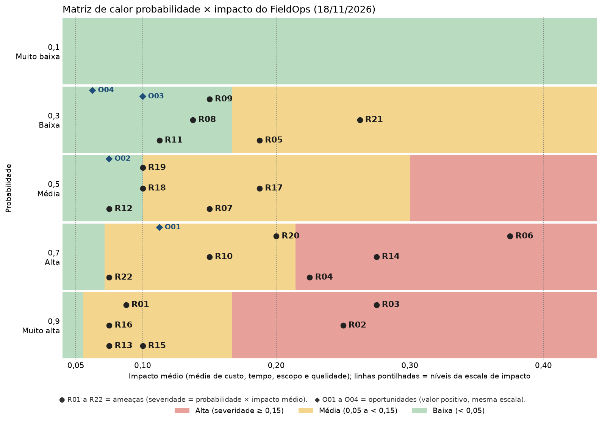

# Análise de Riscos do Projeto FieldOps

| Campo | Informação |
|---|---|
| Projeto | FieldOps — Plataforma de Inspeção em Campo (MVP) |
| Instituição / curso | UniSENAI-SP Campus Sorocaba — Análise e Desenvolvimento de Sistemas |
| Disciplina / orientador | Gestão de Projetos — Prof. Me. Deivison S. Takatu |
| Atividade | Aula 07 — Riscos |
| Gerente do projeto | Felipe Marques (FM) |
| Integrantes | Felipe Marques; Gabriel Ribeiro Camargo Miranda; Pedro Henrique Dias de Paula; André dos Santos Fernandes; João Victor de Souza Santos |
| Data-base | 18/11/2026 (semana 15, sprint S8; marco M8 em 27/11/2026) |
| Versão | 1.0 |
| Escopo | 22 ameaças (R01 a R22) e 4 oportunidades (O01 a O04) |

> **Como ler.** O documento segue o formato dos slides da Aula 07: escala de impacto, tabela probabilidade × impacto com severidade e prioridade, e tabela de respostas. Cada risco é descrito como **causa → risco → consequência**. Dados do GitHub citados (issues, PRs, commits, CI) são de 18/11/2026. Probabilidades, impactos, horas e custos de resposta são **estimativas do gerente (premissas)** e estão rotuladas como tais; as contas saem do script em `scripts/` (editando `riscos_dados.py` o ranking e as tabelas se refazem).

## 1. Resumo executivo

O projeto está na semana 15 com 57 de 103 issues concluídas (55%) e as sprints S6 e S7 com 2 de 13 e 2 de 14 issues concluídas. Dos 22 riscos do registro, **9 já se materializaram e seguem ativos** (o R11 também ocorreu, mas foi superado) e 5 têm severidade alta. Os cinco maiores são: **R06** falha de sincronização offline (severidade 0,26); **R03** backend sem responsável (severidade 0,25); **R02** backlog acima da capacidade (severidade 0,23); **R14** integração tardia entre app, web e API (severidade 0,19); **R04** sobrecarga do gerente (severidade 0,16). Os três primeiros se reforçam: a sincronização offline (RP03) ainda não existe nem no backend nem no app, 21 issues do backend estão sem responsável e restam apenas **6 dias úteis** até o M8. Nenhuma das respostas depende de dinheiro: a contingência real é a **ordem de corte do RJ07** e a redistribuição de pessoas. As respostas custam R$ 6.815 em horas adicionais, comparadas às reservas oficiais do orçamento (`aula-05-custos-qualidade/orcamento-fieldops.md`, linhas O51 e O52): as dos 5 riscos de classe Alta (R$ 2.460) e as dos 12 primeiros do ranking cabem na contingência de 10% (R$ 4.771); o conjunto inteiro cabe a soma das duas reservas (R$ 7.157), deixando R$ 342 de folga. O EMV dos riscos que ainda podem ocorrer (R$ 6.635) supera a contingência de 10%.

## 2. Plano de gerenciamento de riscos (processo 11.1)

### 2.1 Metodologia

Segue os seis processos da Aula 07 (PMBOK 11.1 a 11.6):

| Processo | Como é feito no FieldOps | Saída |
|---|---|---|
| 11.1 Planejar | este plano: escalas, limiares, papéis, reservas e frequência | plano de gerenciamento |
| 11.2 Identificar | fontes: TAP e Declaração de Escopo, documentação (regras de negócio, arquitetura, critérios de aceitação), código e CI no GitHub, retrospectivas; escrita como **causa → risco → consequência** | registro de riscos |
| 11.3 Análise qualitativa | probabilidade × impacto (custo, tempo, escopo, qualidade); severidade = probabilidade × impacto médio; ranking | matriz de calor e prioridade |
| 11.4 Análise quantitativa | valor monetário esperado (EMV) e simulação de Monte Carlo do custo; dias de atraso por risco | reserva sugerida |
| 11.5 Planejar respostas | evitar, transferir, mitigar ou aceitar (ameaças); explorar, compartilhar, melhorar ou aceitar (oportunidades) | plano de respostas |
| 11.6 Controlar | revisão a cada sprint e semanal, gatilhos, lista de observação e escalonamento | registro atualizado e relatório de status |

### 2.2 Papéis e responsabilidades

| Papel | Quem | Responsabilidade |
|---|---|---|
| Gestor do processo de riscos (R e A) | FM | mantém o registro, conduz a reunião de risco, escalona e atualiza a reserva |
| Dono do risco | JV, GR, PD, AF ou FM (campo "Responsável") | monitora o gatilho e executa a resposta no prazo |
| Equipe | JV, GR, PD, AF, FM | informa novos riscos e sinais; marca gatilho observado |
| Orientador e product owner acadêmico | PI-02 (Prof. Glauco Todesco) | decide sobre cortes de escopo e aceita mudanças de requisito |
| Comitê executivo | PI-01 (coordenação) e PI-03 (professores das disciplinas) | recebem escalonamento de riscos que ameaçam marco ou nota; validam o plano de corte |
| Avaliador da disciplina | PI-04 (Prof. Deivison Takatu) | avalia este plano |

### 2.3 Orçamento e prazos para riscos

Valores monetários são **hipóteses de valoração** (o TAP declara "sem investimento financeiro direto"). Os totais e as reservas são os do orçamento oficial (`aula-05-custos-qualidade/orcamento-fieldops.md`); o custo das respostas aos riscos usa as taxas do projeto (desenvolvedor R$ 45/h, gerente R$ 60/h só nas horas de gestão).

| Item | Valor | Como foi calculado |
|---|---:|---|
| **Custo base (referência única deste documento)** | R$ 47.714,83 | valor esperado PERT do `orcamento-fieldops.md` (967 h de mão de obra mais custos diretos), **sem reservas**. Escolhi o custo base, e não a linha de base, porque é a base sobre a qual o próprio orçamento calcula as reservas (10% e 5%); assim as faixas da escala de custo e todas as porcentagens deste documento usam o mesmo denominador |
| Reserva de contingência (10%) | R$ 4.771,48 | 10% do custo base, para riscos identificados; linha O51 do orçamento; já faz parte da linha de base e é liberada pelo gerente com registro |
| Linha de base de custos (BAC) | R$ 52.486,31 | custo base + contingência (orçamento) |
| Reserva gerencial (5%) | R$ 2.385,74 | 5% do custo base, para riscos desconhecidos; linha O52; liberada só pelo patrocinador (PI-01) |
| Orçamento total | R$ 54.872,05 | BAC + reserva gerencial; reservas somadas = R$ 7.157,22 |
| Reserva de prazo | 0 dia | o prazo é fixo em 16 semanas; **a reserva de escopo é a ordem de corte (RJ07)** |
| Custo do processo de risco | R$ 1.760 | reunião de 20 min por semana com as 5 pessoas (26,7 h) mais 30 min semanais de preparação do FM; **já está dentro das horas de gestão do pacote 1.2**, não sai da reserva |

**Prazos.** Revisão formal ao fim de cada sprint (S1 a S7) e reunião semanal de 20 minutos. Na S8 (reta final) a frequência sobe: 19/11, 23/11, 25/11 e 27/11 (20/11 é feriado).

### 2.4 Estrutura analítica dos riscos (RBS)

| Categoria (nível 1) | Subcategoria (nível 2) | Riscos |
| --- | --- | --- |
| 1. Técnico | 1.1 Offline e sincronização | R06, R11, R21 |
| 1. Técnico | 1.2 Integração e contrato de API | R07, R14, R22, O01 |
| 1. Técnico | 1.3 Plataforma Android e recursos nativos | R08 |
| 1. Técnico | 1.4 Segurança | R09 |
| 1. Técnico | 1.5 Ambiente, dependências e entrega | R13, R17, O02 |
| 2. Gerenciamento | 2.1 Prazo e capacidade | R01, R02 |
| 2. Gerenciamento | 2.2 Pessoas | R03, R04, R05 |
| 2. Gerenciamento | 2.3 Comunicação e medição | R16 |
| 3. Requisitos e qualidade | 3.1 Escopo e requisitos | R10, R18, O04 |
| 3. Requisitos e qualidade | 3.2 Qualidade de processo | R15, R19, R20 |
| 4. Externo | 4.1 Provedores de serviço | R12 |
| 4. Externo | 4.2 Instituição e docentes | O03 |

O campo **Tipo** do registro usa uma lista curta (técnico, prazo, pessoas, requisitos/escopo, integração, segurança, externo e qualidade), mais fácil de filtrar; a RBS acima dá a hierarquia.

### 2.5 Escala de probabilidade

Definida para este projeto; riscos já ocorridos recebem 0,9.

| Probabilidade | Nível | Critério |
| ---: | --- | --- |
| 0,1 | Muito baixa | improvável; nenhum sinal observado |
| 0,3 | Baixa | possível; sem sinal atual, mas a causa existe |
| 0,5 | Média | um sinal isolado já apareceu |
| 0,7 | Alta | sinais repetidos ou tendência clara |
| 0,9 | Muito alta | já ocorreu ou ocorrerá quase com certeza |

### 2.6 Escala de impacto (custo, tempo, escopo e qualidade)

Mesmos níveis da Aula 07 (0,05; 0,10; 0,20; 0,40; 0,80), com as condições definidas para o FieldOps. **Custo** e **tempo** são calculados pelo script a partir das horas e dos dias estimados de cada risco; **escopo** e **qualidade** são atribuídos pelo gerente com a tabela. Para oportunidades, a mesma escala vale como benefício.

| Objetivo | Muito baixo / 0,05 | Baixo / 0,10 | Moderado / 0,20 | Alto / 0,40 | Muito alto / 0,80 |
|---|---|---|---|---|---|
| **Custo** (referência: custo base de R$ 47.714,83) | aumento insignificante (< 2%, < R$ 954) | 2% a < 10% (até R$ 4.771) | 10% a < 20% (até R$ 9.543) | 20% a < 40% (até R$ 19.086) | ≥ 40% (acima de R$ 19.086) |
| **Tempo** (80 dias úteis) | menos de 1 dia útil | 1 a 3 dias (< 5%) | 4 a 7 dias (5% a < 10%) | 8 a 15 dias (10% a < 20%) | 16 dias ou mais (≥ 20%, perda de um marco e meio) |
| **Escopo** | diminui pouco notavelmente (um item P1) | áreas secundárias afetadas (itens P1 e P2; itens 1 e 2 da ordem de corte) | áreas principais afetadas (itens 3 e 4 da ordem de corte: só foto de câmera, construtor sem arrastar e soltar) | redução inaceitável para o patrocinador (núcleo afetado: sincronização só detecta e bloqueia, sem correção) | produto final inútil (sem o fluxo AC-RELEASE: login, checklist, offline, sincronização ou revisão) |
| **Qualidade** (DoD §18.7) | degradação pouco notável (defeito baixo) | poucas telas afetadas (defeito médio com alternativa) | redução exige aprovação do PO (defeito alto corrigível antes da release) | redução inaceitável (defeito alto sem alternativa; falha de segurança com contenção) | produto inútil (defeito crítico: perda de dados, duplicidade grave ou fluxo principal bloqueado) |

### 2.7 Cálculo e limiares de severidade

- **Impacto médio** = média dos quatro impactos (custo, tempo, escopo, qualidade), como no slide. É o critério do **ranking**.
- **Impacto máximo** = maior dos quatro. A média dilui riscos com um impacto muito alto e os demais baixos (por exemplo, perda de dados: qualidade 0,80 e custo 0,10). Por isso o máximo é usado como **regra de lista de observação**: severidade máxima ≥ 0,24.
- **Severidade** = probabilidade × impacto médio. **Severidade máxima** = probabilidade × impacto máximo.
- **Prioridade** = posição no ranking por severidade (desempate: severidade máxima, depois probabilidade).

| Classe | Severidade (P × impacto médio) | Conduta |
|---|---|---|
| Alta | ≥ 0,15 | resposta ativa, dono nomeado, revisão a cada 48 h na S8 e escalonamento ao PI-02 se um marco for afetado |
| Média | 0,05 a < 0,15 | resposta planejada e revisão semanal |
| Baixa | < 0,05 | monitorar; aceitar ou responder se o gatilho disparar |

**Frequência de revisão:** a cada sprint (S1 a S7), semanal em reunião de 20 minutos e a cada 48 h na S8 para os riscos de classe Alta e da lista de observação.

## 3. Registro de riscos (processo 11.2)

Convenções: **Inclusão** é a data em que o risco entrou no registro (TAP em 30/09/2026, Declaração de Escopo em 04/10/2026, ou 18/11/2026 para os identificados na análise do GitHub). Nos riscos que já ocorreram, a materialização foi **identificada em 18/11/2026**. **Gatilho** é o indicador que dispara a resposta (risk trigger). **EAP** usa os códigos da EAP do projeto.

| ID | Causa → Risco → Consequência | Tipo | Pacote da EAP | Gatilho (indicador) | Inclusão | Status em 18/11/2026 |
| --- | --- | --- | --- | --- | --- | --- |
| R01 | **Causa:** O calendário institucional tem feriados (07/09, 12/10, 02/11 e 20/11) e semanas com avaliações e eventos, e as 4 semanas extras não são reserva de desenvolvimento. **Risco:** as sprints têm menos dias úteis de projeto do que o planejado. **Consequência:** perda de cerca de 4 dias úteis (5% das 16 semanas) e marcos que fecham sem o incremento completo. | Prazo RBS 2.1 | 1.3, 7.4 | sprint que começa com menos de 9 dias úteis ou aula de projeto cancelada | 30/09/2026 | Materializado parcialmente: 07/09, 12/10 e 02/11 já ocorreram; resta 20/11; materialização identificada em 18/11/2026 |
| R02 | **Causa:** 103 issues P0 em 8 sprints para 960 h de capacidade (cerca de 9 h por issue, já contando gestão, revisão e retrabalho), com cards de sincronização e evidências muito maiores que os de cadastro. **Risco:** a velocidade real das sprints S6 a S8 fica muito abaixo da planejada. **Consequência:** issues P0 não concluídas, marcos M6 e M7 sem entrega completa e acionamento da ordem de corte (RJ07). | Prazo RBS 2.1 | 1.2, 1.3 | menos de 40% das issues da sprint concluídas no meio da sprint; ponto abaixo do limite inferior no gráfico p | 04/10/2026 | Materializado: S6 com 2 de 13 e S7 com 2 de 14 issues concluídas; materialização identificada em 18/11/2026 |
| R03 | **Causa:** 21 issues abertas do backend (push e pull de sincronização, conflitos, arquivos, evidências, revisão, auditoria, seed e container) estão sem responsável e o PR #64 está parado desde 04/11. **Risco:** ninguém assume a trilha de sincronização, evidências e revisão no backend a tempo. **Consequência:** mobile e web sem endpoints para integrar, marcos M6 e M7 atrasados e fluxo ponta a ponta (AC-RELEASE) inviável. | Pessoas RBS 2.2 | 3.5, 3.6, 3.7 | issue P0 de backend sem responsável por mais de 2 dias; PR parado por mais de 3 dias | 18/11/2026 | Materializado: 21 issues do backend sem responsável; identificado em 18/11/2026 |
| R04 | **Causa:** o gerente acumula a gestão (pacotes 1.x), seis pacotes do mobile e o build e a demo final (7.2 e 7.4), e o app tem 98% dos commits concentrados em um único integrante. **Risco:** o gerente não consegue acompanhar a gestão e entregar o mobile ao mesmo tempo. **Consequência:** issues do app S6 a S8 paradas (18 abertas), PRs do app sem revisão e decisões de escopo tardias. | Pessoas RBS 2.2 | 1.x, 5.x, 7.2, 7.4 | mais de 3 issues do app em andamento ao mesmo tempo; status semanal atrasado | 04/10/2026 | Materializado: issues do app S6 a S8 abertas e 98% dos commits do app concentrados em uma pessoa; materialização identificada em 18/11/2026 |
| R05 | **Causa:** em cada repositório um único integrante concentra a maior parte dos commits: 88% no backend, 75% no frontend e 98% no app. **Risco:** a ausência ou a indisponibilidade de uma dessas pessoas para a reta final. **Consequência:** uma camada inteira parada, sem quem explique ou corrija o código na defesa individual (rubrica 19.7). | Pessoas RBS 2.2 | 2.1, 2.2, 3.1, 3.5, 3.6 | pessoa-chave sem commit por 3 dias úteis ou ausente em marco | 18/11/2026 | Ativo: concentração medida em 18/11/2026; sem ausência até agora |
| R06 | **Causa:** a sincronização idempotente (RN-067 a RN-078) é a parte mais complexa do produto e ainda não tem endpoint de push e pull no backend nem motor de envio no app, e restam apenas 6 dias úteis (19/11 a 27/11, descontado o feriado de 20/11). **Risco:** reenvios criam duplicidade ou falhas parciais perdem dados coletados em campo. **Consequência:** defeito crítico (RN-068, AC-SYNC), perda dos pontos de offline e sincronização (15 pontos) e fluxo ponta a ponta reprovado na demo. | Técnico RBS 1.1 | 3.6, 5.6, 5.7 | teste de reenvio gera registro duplicado; operação some da outbox sem confirmação; push do backend sem PR até 21/11 | 30/09/2026 | Ativo e crescente: outbox local pronta (app #21 e #23), motor de envio e endpoints ainda abertos |
| R07 | **Causa:** o contrato compartilhado de enums, identificadores e erros (docs #2) continua aberto e mobile e web evoluem com mocks, enquanto o backend entrega por partes. **Risco:** web, app e API implementam estados, erros ou campos de forma diferente. **Consequência:** falhas só vistas na integração, retrabalho de telas e de DTOs e demonstração instável. | Integração RBS 1.2 | 2.2, 3.x, 4.x, 5.x | erro 4xx/5xx inesperado na primeira integração de um fluxo; OpenAPI regenerado muda um campo usado | 30/09/2026 | Ativo: docs #2 aberta; já houve correções de contrato (fix de API no web, 409 no lugar de 500 no backend) |
| R08 | **Causa:** câmera, QR Code e localização dependem de permissões e do comportamento de cada aparelho Android, e a validação ocorre em poucos dispositivos. **Risco:** a câmera, a leitura de QR Code ou o GPS se comportam de forma diferente no aparelho da demonstração. **Consequência:** funcionalidade nativa falha na demo (RJ05) e perda de pontos de recursos nativos (10 pontos). | Técnico RBS 1.3 | 5.5, 6.3 | falha de permissão ou de leitura em um aparelho de teste | 30/09/2026 | Ativo, parcialmente mitigado: foto, QR Code e localização implementados (app #17 a #19, concluídos entre 04/11 e 11/11) |
| R09 | **Causa:** o backend usa JWT_SECRET por variável de ambiente, o endpoint `by-qr` devolve qualquer equipamento a qualquer usuário autenticado (achado no app #60) e a revisão de segurança (backend #35) só está prevista para S7. **Risco:** segredo versionado, token em log ou endpoint sem escopo chegam à versão final. **Consequência:** penalidade técnica da rubrica (19.9), violação de RJ06 e RN-003 e exposição de dados de cliente na demonstração. | Segurança RBS 1.4 | 3.1, 3.5, 5.2 | alerta do secret scanning ou do CodeQL; endpoint que responde dados de outro técnico | 04/10/2026 | Ativo: falha de escopo em `by-qr` identificada em 11/11/2026; CodeQL ativo no backend desde 23/10 |
| R10 | **Causa:** há 12 issues P1 (dashboard, tema escuro, CSV, PDF, biometria, assinatura, notificações) e o dashboard P1 do web (`frontend #28`) foi entregue em 09/11 enquanto a sincronização não começou. **Risco:** horas da equipe vão para itens fora do núcleo, em vez da sincronização e da revisão. **Consequência:** atraso do núcleo (M6 e M7), escopo inflado sem aprovação formal e cobrança de itens excluídos do MVP. | Requisitos/escopo RBS 3.1 | 4.1, 1.2 | PR de item P1 aberto com issue P0 da mesma pessoa pendente | 30/09/2026 | Materializado: dashboard P1 mergeado em 09/11/2026 com issues P0 de S6 abertas; materialização identificada em 18/11/2026 |
| R11 | **Causa:** o construtor de modelos e o versionamento com snapshot (RN-019 a RN-021) são a tela mais complexa do web (20 pontos da rubrica) e foram subestimados. **Risco:** regressão em publicação, versões ou snapshot quando o fluxo for integrado ao agendamento e ao mobile. **Consequência:** inspeção criada com snapshot errado e retrabalho nas telas de planejamento. | Técnico RBS 1.1 | 3.3, 4.3 | teste de publicação ou de nova versão falha; inspeção sem snapshot | 30/09/2026 | Ocorreu e foi superado em S3 (concluído em 11/11, cerca de 7 semanas após o marco M3 de 18/09); resta risco de regressão |
| R12 | **Causa:** build Android (EAS), hospedagem da API, PostgreSQL e armazenamento S3 usam planos gratuitos com fila, cota e limites. **Risco:** o build final do app ou a publicação da API falham ou ficam na fila no dia da entrega. **Consequência:** atraso do M8, custo de caixa imprevisto e demonstração só em ambiente local. | Externo RBS 4.1 | 7.2 | fila de build maior que 1 hora ou cota de build a 80% | 04/10/2026 | Ativo: o build Android (app #34) ainda está aberto |
| R13 | **Causa:** Expo SDK 57, Spring Boot 4, springdoc e Next.js 16 recebem patches e mudanças de API durante o semestre. **Risco:** atualizações de dependência quebram o CI ou o build. **Consequência:** `develop` vermelha, tempo perdido em correção e merge sem verificação. | Técnico RBS 1.5 | 2.3, 2.4, 5.1 | CI vermelho em PR sem mudança de código; aviso do `expo-doctor` | 18/11/2026 | Materializado: `develop` do app vermelha de 18/09 a 14/10 e de novo em 11/11 |
| R14 | **Causa:** as três aplicações avançaram em paralelo com mocks, o login do app só foi integrado à API em 18/09 e a sincronização, o fluxo de revisão e as evidências ainda não foram integrados. **Risco:** defeitos de integração aparecem só nas últimas sprints, quando há pouco tempo para corrigir. **Consequência:** retrabalho em S8, demonstração com fluxo quebrado e corte de funcionalidades do núcleo. | Integração RBS 1.2 | 6.3, 3.6, 5.7 | fluxo ponta a ponta (login, lista, checklist, sincronização, revisão) sem execução na semana | 30/09/2026 | Ativo, em agravamento: S6 e S7 sem integração de sincronização |
| R15 | **Causa:** 89% dos PRs mergeados não têm revisão registrada no GitHub (revisão por chat ou presencial não aparece nos dados), embora o CONTRIBUTING.md e o RJ03 peçam revisão, e o PR médio tem 1.073 linhas. **Risco:** defeitos e vulnerabilidades passam para a `develop` sem revisão. **Consequência:** defeitos descobertos na integração, perda de pontos de processo e de testes (rubrica 19.2) e dificuldade de defender a autoria. | Qualidade RBS 3.2 | 2.1, 6.1, 6.2 | PR mergeado sem aprovação; PR com mais de 400 linhas sem revisor | 18/11/2026 | Materializado: 49 de 55 PRs sem revisão registrada no GitHub |
| R16 | **Causa:** issues são fechadas em lote (7 do web no mesmo minuto), só 3 de 955 caixas de DoD estão marcadas e nenhuma issue tem rótulo de defeito. **Risco:** o status e as métricas de progresso não refletem o estado real do produto. **Consequência:** decisões de corte e de prioridade tomadas com dados errados e evidências obrigatórias do projeto incompletas (19.8). | Qualidade RBS 2.3 | 1.3 | issue fechada sem PR vinculado ou sem critérios marcados | 18/11/2026 | Materializado: 41 de 60 issues fechadas citadas por PR; 0 com critérios de aceitação marcados |
| R17 | **Causa:** o AC-RELEASE exige 19 passos sem editar o banco, dependentes de seed (backend #32), container (backend #33), rede e build Android, todos ainda abertos. **Risco:** a demonstração final falha por ambiente, dados ou rede. **Consequência:** penalidade por edição manual do banco (19.9), nota de demonstração reduzida (4 pontos) e perda de credibilidade do MVP. | Qualidade RBS 1.5 | 7.1, 7.2, 7.4 | ensaio do AC-RELEASE com passo quebrado; seed não reproduzível | 04/10/2026 | Ativo: seed e container abertos em 18/11/2026 |
| R18 | **Causa:** o TAP, a Declaração de Escopo (R03, RJ04) e a rubrica do web falam em Angular, mas o frontend foi feito em Next.js 16, e o ADR da decisão (docs #3) ainda está pendente. **Risco:** a avaliação do web penaliza a stack ou exige justificativa não documentada. **Consequência:** perda de pontos de arquitetura (10 pontos) e discussão tardia sobre a restrição de stack. | Requisitos/escopo RBS 3.1 | 1.1, 4.1 | questionamento do avaliador sobre a stack; ADR 0008 sem aceite | 18/11/2026 | Ativo: decisão registrada no PR frontend #34, mas ADR em `docs` ainda aberto |
| R19 | **Causa:** há PRs gerados por agentes (backend #49 e #51) e branches `codex/` e `copilot/`, sem revisão registrada. **Risco:** parte do código entregue não é compreendida por quem a defende. **Consequência:** nota individual reduzida (19.7 e 19.9), defeitos difíceis de corrigir e dependência de quem gerou. | Qualidade RBS 3.2 | 3.1, 3.2, 3.5 | autor não consegue explicar o PR na revisão; PR de agente sem revisor | 18/11/2026 | Ativo: 2 PRs de agente mergeados ou substituídos |
| R20 | **Causa:** os testes automatizados dos fluxos críticos (backend #31, web #25 e app #31) e de integração estão planejados para S7 e S8 e continuam abertos. **Risco:** regressões na sincronização e na revisão não são detectadas antes da demo. **Consequência:** defeito crítico descoberto tarde (DoD 18.6) e perda de pontos de testes (7 pontos). | Qualidade RBS 3.2 | 6.2, 6.3 | PR do núcleo sem teste automatizado; teste de integração sem execução na semana | 18/11/2026 | Ativo: issues de testes abertas nos 3 repositórios |
| R21 | **Causa:** evidências e respostas pendentes ficam só no aparelho até a sincronização, e limpeza de cache, logout com pendências ou reinstalação podem apagá-las (RN-047 e RN-066). **Risco:** dados coletados em campo e fotos pendentes são perdidos. **Consequência:** perda de dados do técnico (defeito crítico, 18.7) e inspeção a refazer. | Técnico RBS 1.1 | 5.5, 5.6 | teste de reinício, logout ou limpeza de cache que apaga a outbox ou o arquivo | 30/09/2026 | Ativo: o ADR do app (logout com pendências) já define que sair não apaga a outbox |
| R22 | **Causa:** PRs longos e empilhados em branches que não são a `develop` e migrações Flyway numeradas à mão em paralelo. **Risco:** conflitos de merge, migração duplicada ou código fora da `develop`. **Consequência:** build quebrado, código perdido e horas gastas em conflito. | Integração RBS 1.2 | 2.1, 2.4, 3.x | merge em base diferente da `develop`; duas migrações com o mesmo número | 18/11/2026 | Materializado: migração V5 duplicada (backend #57) e shell fora da `develop` (frontend #36) |

## 4. Análise qualitativa: probabilidade × impacto (processo 11.3)

Tabela no formato do slide "Exemplo de Probabilidade × Impacto". Impactos de custo e tempo derivam das horas e dias da seção 6; escopo e qualidade foram atribuídos com a escala 2.6. Ordenada por prioridade.

| ID | Risco | Tipo | Prob. | Custo | Prazo | Escopo | Qualid. | Média | Máx. | Severidade | Sev. máx. | Prioridade | Classe | Lista de observação |
| --- | --- | --- | ---: | ---: | ---: | ---: | ---: | ---: | ---: | ---: | ---: | ---: | --- | --- |
| R06 | Falha de sincronização offline | Técnico | 0,7 | 0,10 | 0,20 | 0,40 | 0,80 | 0,375 | 0,80 | 0,262 | 0,560 | 1 | **Alta** | sim |
| R03 | Backend sem responsável | Pessoas | 0,9 | 0,10 | 0,40 | 0,40 | 0,20 | 0,275 | 0,40 | 0,248 | 0,360 | 2 | **Alta** | sim |
| R02 | Backlog acima da capacidade | Prazo | 0,9 | 0,10 | 0,40 | 0,40 | 0,10 | 0,250 | 0,40 | 0,225 | 0,360 | 3 | **Alta** | sim |
| R14 | Integração tardia entre app, web e API | Integração | 0,7 | 0,10 | 0,40 | 0,20 | 0,40 | 0,275 | 0,40 | 0,193 | 0,280 | 4 | **Alta** | sim |
| R04 | Sobrecarga do gerente | Pessoas | 0,7 | 0,10 | 0,40 | 0,20 | 0,20 | 0,225 | 0,40 | 0,158 | 0,280 | 5 | **Alta** | sim |
| R20 | Testes dos fluxos críticos adiados | Qualidade | 0,7 | 0,10 | 0,20 | 0,10 | 0,40 | 0,200 | 0,40 | 0,140 | 0,280 | 6 | Média | sim |
| R10 | Escopo ampliado indevidamente | Requisitos/escopo | 0,7 | 0,10 | 0,20 | 0,20 | 0,10 | 0,150 | 0,20 | 0,105 | 0,140 | 7 | Média | não |
| R17 | Demonstração ponta a ponta falha | Qualidade | 0,5 | 0,05 | 0,10 | 0,20 | 0,40 | 0,188 | 0,40 | 0,094 | 0,200 | 8 | Média | não |
| R15 | PRs sem revisão registrada de outra pessoa | Qualidade | 0,9 | 0,05 | 0,10 | 0,05 | 0,20 | 0,100 | 0,20 | 0,090 | 0,180 | 9 | Média | não |
| R21 | Perda de dados e evidências no aparelho | Técnico | 0,3 | 0,05 | 0,10 | 0,10 | 0,80 | 0,263 | 0,80 | 0,079 | 0,240 | 10 | Média | sim |
| R01 | Calendário e feriados | Prazo | 0,9 | 0,05 | 0,20 | 0,05 | 0,05 | 0,088 | 0,20 | 0,079 | 0,180 | 11 | Média | não |
| R07 | Contrato de API divergente | Integração | 0,5 | 0,10 | 0,20 | 0,10 | 0,20 | 0,150 | 0,20 | 0,075 | 0,100 | 12 | Média | não |
| R13 | Dependências em movimento | Técnico | 0,9 | 0,05 | 0,10 | 0,05 | 0,10 | 0,075 | 0,10 | 0,068 | 0,090 | 13 | Média | não |
| R16 | Quadro de issues pouco confiável | Qualidade | 0,9 | 0,05 | 0,10 | 0,05 | 0,10 | 0,075 | 0,10 | 0,068 | 0,090 | 14 | Média | não |
| R05 | Dependência de uma pessoa por camada | Pessoas | 0,3 | 0,05 | 0,40 | 0,20 | 0,10 | 0,188 | 0,40 | 0,056 | 0,120 | 15 | Média | não |
| R22 | Conflitos de merge, migrações e PRs empilhados | Integração | 0,7 | 0,05 | 0,10 | 0,05 | 0,10 | 0,075 | 0,10 | 0,053 | 0,070 | 16 | Média | não |
| R18 | Divergência de stack (Angular × Next.js) | Requisitos/escopo | 0,5 | 0,05 | 0,05 | 0,10 | 0,20 | 0,100 | 0,20 | 0,050 | 0,100 | 17 | Média | não |
| R19 | Código gerado por IA sem compreensão | Qualidade | 0,5 | 0,05 | 0,10 | 0,05 | 0,20 | 0,100 | 0,20 | 0,050 | 0,100 | 18 | Média | não |
| R09 | Segurança e segredos | Segurança | 0,3 | 0,05 | 0,10 | 0,05 | 0,40 | 0,150 | 0,40 | 0,045 | 0,120 | 19 | Baixa | não |
| R08 | Recursos nativos Android | Técnico | 0,3 | 0,05 | 0,10 | 0,20 | 0,20 | 0,138 | 0,20 | 0,041 | 0,060 | 20 | Baixa | não |
| R12 | Limites de provedores gratuitos | Externo | 0,5 | 0,05 | 0,10 | 0,05 | 0,10 | 0,075 | 0,10 | 0,038 | 0,050 | 21 | Baixa | não |
| R11 | Complexidade do construtor de modelos | Técnico | 0,3 | 0,05 | 0,10 | 0,10 | 0,20 | 0,113 | 0,20 | 0,034 | 0,060 | 22 | Baixa | não |

Resultado: **5 riscos de classe Alta, 13 Média e 4 Baixa**. Entram na lista de observação 7 riscos: os de classe Alta mais os que têm severidade máxima ≥ 0,24 (R20, R21).

### 4.1 Matriz probabilidade × impacto

*Figura 1. Mapa de calor. Cada ponto está na probabilidade do risco e no seu impacto médio exato; a cor de fundo mostra a classe de severidade (limiares em 2.7). A tabela abaixo é a versão tabular da escala, em que cada risco cai no nível de impacto mais próximo.*

| Prob. \ Impacto médio | 0,05 | 0,10 | 0,20 | 0,40 | 0,80 |
| --- | --- | --- | --- | --- | --- |
| **0,9** | — *(célula 0,05)* | R01, R13, R15, R16 *(célula 0,09)* | R02, R03 *(célula 0,18)* | — *(célula 0,36)* | — *(célula 0,72)* |
| **0,7** | — *(célula 0,03)* | R22 *(célula 0,07)* | R04, R10, R14, R20 *(célula 0,14)* | R06 *(célula 0,28)* | — *(célula 0,56)* |
| **0,5** | — *(célula 0,03)* | R12, R18, R19 *(célula 0,05)* | R07, R17 *(célula 0,10)* | — *(célula 0,20)* | — *(célula 0,40)* |
| **0,3** | — *(célula 0,01)* | R08, R11 *(célula 0,03)* | R05, R09, R21 *(célula 0,06)* | — *(célula 0,12)* | — *(célula 0,24)* |
| **0,1** | — *(célula 0,01)* | — *(célula 0,01)* | — *(célula 0,02)* | — *(célula 0,04)* | — *(célula 0,08)* |

Oportunidades (probabilidade × impacto médio): 0.7 × 0,10: O01; 0.5 × 0,10: O02; 0.3 × 0,10: O03; 0.3 × 0,05: O04.

## 5. Plano de respostas (processo 11.5)

Opções de tratamento da Aula 07: **evitar** (não iniciar ou descontinuar a atividade que origina o risco), **transferir** (passar parte do risco a terceiros), **mitigar** (reduzir probabilidade ou impacto) e **aceitar** (tolerar, com ou sem plano de contingência). O gerente escolheu **mitigar** na maioria dos casos porque os riscos vêm do próprio trabalho de desenvolvimento, e não há a quem transferi-los.

### 5.1 Respostas às ameaças (formato do slide "Exemplo de Respostas para Riscos")

| ID | Risco | Tipo | Data de inclusão | Abordagem | Resposta / observação (ação preventiva) | Responsável |
| --- | --- | --- | --- | --- | --- | --- |
| R06 | Falha de sincronização offline | Técnico | 30/09/2026 | Mitigar | Fechar o contrato de push e pull (docs #2), usar chave de idempotência única no banco e testar os 3 cenários do AC-SYNC (envio, reenvio, falha parcial) contra o backend real | JV |
| R03 | Backend sem responsável | Pessoas | 18/11/2026 | Mitigar | Distribuir as 21 issues entre JV, GR e PD com dono e data, começando pelo contrato e pelo push de sincronização (#24); FM acompanha diariamente | FM |
| R02 | Backlog acima da capacidade | Prazo | 04/10/2026 | Mitigar | Refazer a linha de base do backlog restante (S8) por criticidade do núcleo e aplicar a ordem de corte nos itens que não cabem | FM |
| R14 | Integração tardia entre app, web e API | Integração | 30/09/2026 | Mitigar | Subir o ambiente de integração com Docker Compose e dados de seed e executar o fluxo ponta a ponta em dias alternados, a começar por login, lista e checklist | PD |
| R04 | Sobrecarga do gerente | Pessoas | 04/10/2026 | Mitigar | Delegar a revisão dos PRs do app a PD (já R de 5.6 e 5.7) e o seed e a documentação a JV; reservar 1 hora diária para gestão | FM |
| R20 | Testes dos fluxos críticos adiados | Qualidade | 18/11/2026 | Mitigar | Priorizar 3 cenários do AC-SYNC e o AC-REVIEW com testes automatizados e executar no CI | GR |
| R10 | Escopo ampliado indevidamente | Requisitos/escopo | 30/09/2026 | Evitar | Congelar as 12 issues P1 até a conclusão do AC-RELEASE e exigir aprovação do gerente (e do PI-02) para qualquer item novo | FM |
| R17 | Demonstração ponta a ponta falha | Qualidade | 04/10/2026 | Mitigar | Escrever o seed reproduzível e o roteiro de 19 passos e ensaiar duas vezes (24/11 e 26/11) com usuários de demonstração | JV |
| R15 | PRs sem revisão registrada de outra pessoa | Qualidade | 18/11/2026 | Mitigar | Exigir 1 aprovação de outra pessoa e CI verde na proteção da `develop` nos 3 repositórios, com revisor definido na abertura do PR | JV |
| R21 | Perda de dados e evidências no aparelho | Técnico | 30/09/2026 | Mitigar | Armazenar arquivos em diretório persistente, testar reinício, logout e limpeza de cache e manter a outbox fora do logout (ADR-001 do app) | FM |
| R01 | Calendário e feriados | Prazo | 30/09/2026 | Mitigar | Descontar os feriados na capacidade da S8 (9 dias úteis) e antecipar a demonstração final para 26/11, sem depender do dia 27/11 | FM |
| R07 | Contrato de API divergente | Integração | 30/09/2026 | Mitigar | Congelar o OpenAPI v1 para os fluxos do núcleo, gerar tipos a partir dele e rodar a coleção de testes de contrato antes de cada merge | JV |
| R13 | Dependências em movimento | Técnico | 18/11/2026 | Mitigar | Fixar versões no `package.json`, atualizar o SDK em um único PR dedicado e congelar dependências até 27/11 | FM |
| R16 | Quadro de issues pouco confiável | Qualidade | 18/11/2026 | Mitigar | Marcar critérios de aceitação e DoD na issue ao fechá-la, vincular o PR e rotular defeitos com severidade | FM |
| R05 | Dependência de uma pessoa por camada | Pessoas | 18/11/2026 | Mitigar | Pareamento de 2 horas por camada (JV com GR/PD no push; AF com JV no web) e ADR curto de cada decisão em `docs` | JV |
| R22 | Conflitos de merge, migrações e PRs empilhados | Integração | 18/11/2026 | Mitigar | Abrir PR sempre contra a `develop`, fazer rebase diário, PRs de até 400 linhas e checagem de numeração de migração no CI | JV |
| R18 | Divergência de stack (Angular × Next.js) | Requisitos/escopo | 18/11/2026 | Mitigar | Publicar o ADR (docs #3) e obter aceite do PI-02 (Prof. Glauco), cuja especificação aceita Angular ou React, antes do M8 | FM |
| R19 | Código gerado por IA sem compreensão | Qualidade | 18/11/2026 | Mitigar | Exigir revisão humana e uma explicação de 5 linhas no PR para todo código assistido por agente e ensaiar a defesa por camada | FM |
| R09 | Segurança e segredos | Segurança | 04/10/2026 | Mitigar | Executar a revisão do AC-SECURITY (backend #35) agora, filtrar `by-qr` pelo escopo do usuário (RN-063) e rodar o secret scanning nos 4 repositórios | JV |
| R08 | Recursos nativos Android | Técnico | 30/09/2026 | Mitigar | Rodar o fluxo de foto, QR Code e GPS em pelo menos 2 aparelhos físicos com build EAS e conferir os tratamentos de permissão negada | FM |
| R12 | Limites de provedores gratuitos | Externo | 04/10/2026 | Transferir | Antecipar o build de teste para 23/11 e pagar um mês de plano EAS apenas se a fila passar de 1 hora (custo transferido ao provedor) | FM |
| R11 | Complexidade do construtor de modelos | Técnico | 30/09/2026 | Aceitar | Aceitar com monitoramento: manter os testes de publicação e de versão no CI e já usar o construtor sem arrastar e soltar (item 4 da ordem de corte) | AF |

### 5.2 Detalhamento: contingência, prazo, custo e risco residual

**Ação contingencial** é o que se faz se o gatilho disparar. **Custo da resposta** = horas adicionais × taxa + caixa (premissa; o trabalho já previsto na linha de base não entra). **Risco residual** = probabilidade esperada depois da resposta × impacto médio (o impacto não muda). **Risco secundário** é o risco criado pela própria resposta.

| ID | Ação contingencial | Prazo | Custo da resposta | Risco residual | Risco secundário |
| --- | --- | --- | ---: | --- | --- |
| R06 | Item 5 da ordem de corte: conflitos só detectados e bloqueados; demonstrar offline com um técnico, um aparelho e reenvio manual | 25/11/2026 | R$ 1.080 | P 0,3: severidade 0,112 (Média) | Restrição por unicidade pode rejeitar operações legítimas (tratar como ALREADY_APPLIED) |
| R03 | Cortar o que não for do núcleo (CSV, PDF, notificações) e usar o item 5 da ordem de corte: conflito só detectado e bloqueado | 19/11/2026 | R$ 240 | P 0,5: severidade 0,138 (Média) | Sobrecarga de JV, GR e PD no fim do semestre (ver R05) |
| R02 | Congelar o escopo em autenticação, planejamento, checklist, foto, offline, sincronização e revisão; adiar notificações, PDF e assinatura | 19/11/2026 | R$ 360 | P 0,7: severidade 0,175 (Alta) | Cortar escopo reduz a nota dos critérios cortados (rubrica 19.2) |
| R14 | Gravar o fluxo ponta a ponta como vídeo de reserva e reduzir a demo ao núcleo funcional | 23/11/2026 | R$ 540 | P 0,5: severidade 0,138 (Média) | Ambiente compartilhado vira ponto único de falha |
| R04 | Se houver 2 dias sem avanço no app, remover do mobile os itens P1 e simplificar a tela de sincronização | 19/11/2026 | R$ 240 | P 0,5: severidade 0,113 (Média) | PD acumula app e backend (ver R03) |
| R20 | Teste manual roteirizado com evidência anexada ao PR | 25/11/2026 | R$ 630 | P 0,3: severidade 0,060 (Média) | Tempo de teste disputa horas com as funcionalidades |
| R10 | Aplicar a ordem de corte a partir do item 1 e devolver as horas ao núcleo | 19/11/2026 | R$ 60 | P 0,3: severidade 0,045 (Baixa) | Equipe pode se desmotivar com os cortes |
| R17 | Demonstrar com vídeo gravado do fluxo e API e banco locais em Docker Compose | 26/11/2026 | R$ 500 | P 0,3: severidade 0,056 (Média) | Ensaios consomem horas de correção |
| R15 | Para PR urgente sem revisor, registrar a justificativa no PR e abrir issue de revisão pendente | 19/11/2026 | R$ 180 | P 0,3: severidade 0,030 (Baixa) | Revisão obrigatória pode atrasar merges na reta final |
| R21 | Permitir exportar o banco local para suporte e reabrir a inspeção afetada | 25/11/2026 | R$ 360 | P 0,1: severidade 0,026 (Baixa) | Exportação de banco expõe dados sensíveis |
| R01 | Aplicar o item 1 da ordem de corte (remover dashboard avançado) para devolver horas ao núcleo | 19/11/2026 | R$ 120 | P 0,5: severidade 0,044 (Baixa) | Antecipar a demo reduz o tempo de teste final (ver R17) |
| R07 | Congelar a versão do contrato por fluxo e mudar apenas por PR conjunto web, app e backend | 24/11/2026 | R$ 360 | P 0,3: severidade 0,045 (Baixa) | Congelar cedo pode bloquear ajustes legítimos |
| R13 | Tornar o passo `expo-doctor` não bloqueante apenas se o restante do CI estiver verde, com issue aberta | 23/11/2026 | R$ 240 | P 0,3: severidade 0,023 (Baixa) | Congelar versões atrasa correções de segurança |
| R16 | Auditar o quadro antes de cada relatório de status e corrigir as divergências | 23/11/2026 | R$ 120 | P 0,3: severidade 0,023 (Baixa) | Mais burocracia por PR |
| R05 | Cobertura nomeada: PD cobre JV, JV cobre AF, GR cobre FM no backend | 24/11/2026 | R$ 270 | P 0,1: severidade 0,019 (Baixa) | Pareamento consome horas da entrega (R02) |
| R22 | Resolver o conflito pelo dono da migração e reaplicar o PR perdido | 23/11/2026 | R$ 135 | P 0,3: severidade 0,023 (Baixa) | Mais PRs pequenos aumentam a fila de revisão |
| R18 | Apresentar o ADR e a equivalência de requisitos (RP04) na defesa | 23/11/2026 | R$ 120 | P 0,1: severidade 0,010 (Baixa) | Nenhum relevante |
| R19 | Reescrever o trecho que ninguém explica antes da defesa | 26/11/2026 | R$ 180 | P 0,3: severidade 0,030 (Baixa) | Menos produtividade com revisão obrigatória |
| R09 | Rotacionar o segredo exposto, remover do histórico e invalidar sessões (RN-008) | 25/11/2026 | R$ 360 | P 0,1: severidade 0,015 (Baixa) | Rotacionar JWT invalida sessões durante a demo |
| R08 | Usar a identificação manual do equipamento (AC-QR) e foto da galeria só se a regra permitir (item 3 da ordem de corte) | 24/11/2026 | R$ 360 | P 0,1: severidade 0,014 (Baixa) | Galeria enfraquece a rastreabilidade da evidência |
| R12 | Entregar APK gerado localmente e API em Docker Compose na máquina da demo | 23/11/2026 | R$ 270 | P 0,3: severidade 0,023 (Baixa) | Dependência da máquina local na demo |
| R11 | Se uma regressão ocorrer, corrigir direto no PR do épico e reexecutar o teste do snapshot | 24/11/2026 | R$ 90 | P 0,3: severidade 0,034 (Baixa) | Nenhum relevante |

Total de respostas às ameaças: **R$ 6.815** (14,3% do custo base). Distribuição: 19 mitigar, 1 evitar (R10), 1 transferir (R12) e 1 aceitar (R11).

### 5.3 Oportunidades (riscos positivos)

Respostas para oportunidades: **explorar** (garantir que ocorra), **compartilhar** (dividir com quem tem mais capacidade de capturá-la), **melhorar** (aumentar probabilidade ou impacto) e **aceitar** (aproveitar se ocorrer, sem ação específica).

| ID | Causa → Oportunidade → Benefício | Tipo | Prob. | Custo | Prazo | Escopo | Qualid. | Valor (P × média) | Inclusão | Gatilho |
| --- | --- | --- | ---: | ---: | ---: | ---: | ---: | ---: | --- | --- |
| O01 | **Causa:** o contrato OpenAPI v1 já foi publicado e a regra do projeto aceita mocks baseados no mesmo contrato. **Oportunidade:** o web e o app avançam o fluxo de revisão e de sincronização contra um mock fiel, sem esperar o backend. **Benefício:** menos espera pelo backend, integração mais rápida e ganho de cerca de 4 dias. | Integração | 0,7 | 0,10 | 0,20 | 0,05 | 0,10 | 0,079 | 30/09/2026 | mock servindo os endpoints de push, pull e revisão |
| O02 | **Causa:** o repositório do backend já usa agente de código (Copilot) e boa parte dos endpoints de sincronização e evidências segue o padrão dos CRUDs já feitos. **Oportunidade:** a IA gera o código repetitivo (DTOs, validações, testes) mais rápido, com revisão humana. **Benefício:** recuperar parte do atraso do backend e liberar tempo para os casos críticos. | Técnico | 0,5 | 0,10 | 0,10 | 0,05 | 0,05 | 0,038 | 18/11/2026 | PR de agente aprovado por revisão humana em menos de 1 dia |
| O03 | **Causa:** as aulas de SQLite, outbox e sincronização de Expo e Spring Boot ocorrem nas sprints finais e os docentes (PI-02 e PI-03) avaliam por marco. **Oportunidade:** os docentes aceitam revisar o desenho de push e pull antes da implementação. **Benefício:** menos retrabalho no contrato de sincronização e ganho de qualidade no núcleo. | Externo | 0,3 | 0,05 | 0,10 | 0,05 | 0,20 | 0,030 | 18/11/2026 | resposta do docente ao pedido de revisão em até 2 dias |
| O04 | **Causa:** a rubrica (19.10) valoriza diferenciais depois do MVP estável, como testes de ponta a ponta e dashboard avançado. **Oportunidade:** se o MVP ficar estável antes de 27/11, os diferenciais rendem bônus. **Benefício:** bônus de avaliação, sem comprometer o núcleo. | Requisitos/escopo | 0,3 | 0,05 | 0,05 | 0,10 | 0,05 | 0,019 | 18/11/2026 | AC-RELEASE executado sem falha em um ensaio |
| ID | Oportunidade | Abordagem | Resposta (ação) | Se não ocorrer / alternativa | Responsável | Prazo | Custo | Risco secundário |
| --- | --- | --- | --- | --- | --- | --- | ---: | --- |
| O01 | Mocks a partir do contrato OpenAPI | Explorar | Gerar um servidor de mock do OpenAPI para push, pull e revisão e usá-lo nos testes do app e do web | Se o mock divergir do backend, regenerar a partir do OpenAPI | PD | 21/11/2026 | R$ 270 | Mock divergente do backend (ver R07) |
| O02 | Assistência de IA para o código repetitivo | Melhorar | Padronizar o pedido ao agente (card + RNs + exemplo de CRUD existente) e exigir testes e revisão humana no PR | Se a revisão encontrar defeito recorrente, voltar ao desenvolvimento manual | GR | 21/11/2026 | R$ 180 | Ver R19 (compreensão do código) |
| O03 | Revisão docente antecipada do contrato de sincronização | Compartilhar | Enviar o desenho de 1 página do contrato de sincronização ao PI-02 e ao PI-03 e pedir revisão antes de 21/11 | Seguir com o desenho atual e registrar a decisão em ADR | FM | 21/11/2026 | R$ 120 | Docente pode pedir mudança tardia |
| O04 | Pontos extras por diferenciais após o MVP | Aceitar | Aceitar passivamente: não alocar horas agora; só considerar após o ensaio completo do AC-RELEASE | Registrar o diferencial pronto como melhoria futura se não houver tempo | FM | 26/11/2026 | R$ 0 | Tentação de ampliar escopo (ver R10) |

Respostas às oportunidades: R$ 570. Benefício esperado (EMV positivo, horas poupadas × taxa): R$ 1.647. Não é abatido da reserva: é tratado como folga, e não como dinheiro, porque horas poupadas só rendem se forem realocadas ao núcleo.

## 6. Análise quantitativa simples (processo 11.4)

### 6.1 Valor monetário esperado (EMV) dos riscos de custo

EMV = probabilidade × custo se ocorrer, com custo = horas extras × taxa + caixa (premissa do gerente por risco). Tabela ordenada por EMV; riscos já materializados estão marcados.

| ID | Risco | Prob. | Esforço extra se ocorrer | Custo se ocorrer | EMV | Já materializado |
| --- | --- | ---: | ---: | ---: | ---: | --- |
| R02 | Backlog acima da capacidade | 0,9 | 40 h | R$ 1.800 | R$ 1.620 | sim |
| R03 | Backend sem responsável | 0,9 | 40 h | R$ 1.800 | R$ 1.620 | sim |
| R06 | Falha de sincronização offline | 0,7 | 48 h | R$ 2.160 | R$ 1.512 | não |
| R14 | Integração tardia entre app, web e API | 0,7 | 40 h | R$ 1.800 | R$ 1.260 | não |
| R04 | Sobrecarga do gerente | 0,7 | 24 h | R$ 1.440 | R$ 1.008 | sim |
| R20 | Testes dos fluxos críticos adiados | 0,7 | 30 h | R$ 1.350 | R$ 945 | não |
| R10 | Escopo ampliado indevidamente | 0,7 | 24 h | R$ 1.080 | R$ 756 | sim |
| R07 | Contrato de API divergente | 0,5 | 24 h | R$ 1.080 | R$ 540 | não |
| R01 | Calendário e feriados | 0,9 | 12 h | R$ 540 | R$ 486 | sim |
| R13 | Dependências em movimento | 0,9 | 12 h | R$ 540 | R$ 486 | sim |
| R15 | PRs sem revisão registrada de outra pessoa | 0,9 | 12 h | R$ 540 | R$ 486 | sim |
| R17 | Demonstração ponta a ponta falha | 0,5 | 16 h + R$ 100 | R$ 820 | R$ 410 | não |
| R12 | Limites de provedores gratuitos | 0,5 | 8 h + R$ 300 | R$ 660 | R$ 330 | não |
| R22 | Conflitos de merge, migrações e PRs empilhados | 0,7 | 10 h | R$ 450 | R$ 315 | sim |
| R05 | Dependência de uma pessoa por camada | 0,3 | 20 h | R$ 900 | R$ 270 | não |
| R09 | Segurança e segredos | 0,3 | 20 h | R$ 900 | R$ 270 | não |
| R21 | Perda de dados e evidências no aparelho | 0,3 | 20 h | R$ 900 | R$ 270 | não |
| R16 | Quadro de issues pouco confiável | 0,9 | 6 h | R$ 270 | R$ 243 | sim |
| R18 | Divergência de stack (Angular × Next.js) | 0,5 | 10 h | R$ 450 | R$ 225 | não |
| R19 | Código gerado por IA sem compreensão | 0,5 | 10 h | R$ 450 | R$ 225 | não |
| R08 | Recursos nativos Android | 0,3 | 16 h | R$ 720 | R$ 216 | não |
| R11 | Complexidade do construtor de modelos | 0,3 | 12 h | R$ 540 | R$ 162 | não |

| Indicador | Valor | Leitura |
|---|---:|---|
| EMV de todas as ameaças | R$ 13.655 (28,6% do custo base) | limite superior; soma riscos correlacionados |
| EMV dos riscos **ainda não materializados** (previsão para a reserva) | R$ 6.635 (13,9%) | o que ainda pode custar |
| EMV dos riscos já materializados | R$ 7.020 (14,7%) | já está acontecendo: entra no custo real (variação), e não na reserva |
| Reserva de contingência (10%) | R$ 4.771,48 | orçamento oficial, linha O51 |
| Reserva gerencial (5%) | R$ 2.385,74 | orçamento oficial, linha O52 (só o PI-01 libera) |

### 6.2 Reserva de contingência sugerida

- **Pelo EMV dos riscos que ainda podem ocorrer:** R$ 6.635 (13,9% do custo base). Comparação com a contingência oficial de 10% (R$ 4.771,48): déficit de R$ 1.864. Somando a reserva gerencial de 5% (R$ 7.157,22 no total), a cobertura equivale a 108% do EMV: as duas reservas cobrem os riscos conhecidos, mas a reserva gerencial, que é para os desconhecidos, seria consumida por eles e só o PI-01 pode liberá-la.
- **Por simulação de Monte Carlo** (20.000 rodadas, semente 42; cada risco ainda não materializado ocorre com sua probabilidade e custa de 0,5 a 2 vezes o valor estimado, com moda no valor estimado): custo extra médio R$ 7.768, P50 R$ 7.767, **P80 R$ 9.812** e P90 R$ 10.782. A probabilidade de ultrapassar a contingência de 10% é de 89% e a de ultrapassar 10% + 5% é de 60%. O P80 equivale a 20,6% do custo base, contra 15,0% das duas reservas somadas.
- **Respostas × reservas oficiais:** as respostas planejadas custam R$ 6.815 (143% da contingência de 10% e 95% das duas reservas); as dos 5 riscos de classe Alta custam R$ 2.460 (52% da contingência). Seguindo o ranking, as respostas dos riscos R06, R03, R02, R14, R04, R20, R10, R17, R15, R21, R01, R07 cabem integralmente nos R$ 4.771,48; as demais, R$ 2.145, dependeriam da reserva gerencial (pedido formal ao PI-01).
- **Conclusão:** a contingência de 10% do orçamento cobre as respostas planejadas aos riscos mais graves, mas o EMV dos riscos que ainda podem ocorrer e o P80 da simulação excedem a contingência. O orçamento oficial já diz que um atraso generalizado se trata por escopo e prazo, e não por reserva financeira; as horas são fixas (capacidade de 960 h) e não se compram. O que passar da contingência vira **corte de escopo pela ordem do RJ07**, ou pedido de reserva gerencial ao PI-01.

### 6.3 Impacto em dias nos riscos de prazo

Dias são dias úteis de atraso no caminho crítico, se o risco ocorrer. **Não são somáveis** (as causas se sobrepõem: R02, R03, R04 e R14 descrevem o mesmo déficit visto por ângulos diferentes). O que importa é a comparação com a folga: **o prazo é fixo e restam 6 dias úteis (19/11 a 27/11, sem o feriado de 20/11)**.

| ID | Risco | Prob. | Atraso se ocorrer (dias úteis) | Dias esperados (P × dias) | Nível de impacto no prazo | Maior que os 6 dias restantes |
| --- | --- | ---: | ---: | ---: | ---: | --- |
| R03 | Backend sem responsável | 0,9 | 12 | 10,8 | 0,40 | sim |
| R02 | Backlog acima da capacidade | 0,9 | 10 | 9,0 | 0,40 | sim |
| R04 | Sobrecarga do gerente | 0,7 | 8 | 5,6 | 0,40 | sim |
| R14 | Integração tardia entre app, web e API | 0,7 | 8 | 5,6 | 0,40 | sim |
| R06 | Falha de sincronização offline | 0,7 | 6 | 4,2 | 0,20 | não |
| R01 | Calendário e feriados | 0,9 | 4 | 3,6 | 0,20 | não |
| R10 | Escopo ampliado indevidamente | 0,7 | 4 | 2,8 | 0,20 | não |
| R20 | Testes dos fluxos críticos adiados | 0,7 | 4 | 2,8 | 0,20 | não |
| R05 | Dependência de uma pessoa por camada | 0,3 | 8 | 2,4 | 0,40 | sim |
| R07 | Contrato de API divergente | 0,5 | 4 | 2,0 | 0,20 | não |

5 dos 22 riscos, se ocorrerem, consomem mais dias do que restam (R02, R03, R04, R05, R14). Como a folga é zero, **qualquer atraso adicional se converte em corte de escopo**, e não em extensão do prazo.

## 7. Controle e monitoramento (processo 11.6)

### 7.1 Indicadores

| Indicador | Fonte | Limite de alerta | Risco monitorado |
|---|---|---|---|
| Issues P0 sem responsável | GitHub (issues) | > 0 por mais de 2 dias | R03 |
| Issues concluídas por sprint (gráfico p) | GitHub (milestones) | ponto abaixo do limite inferior | R02, R14 |
| PRs mergeados sem revisão de outra pessoa | GitHub (PRs) | qualquer PR do núcleo | R15, R19 |
| Execuções de CI com falha e `develop` vermelha | GitHub Actions | `develop` vermelha por mais de 1 dia | R13, R22 |
| Cenários do AC-SYNC passando (envio, reenvio sem duplicidade, falha parcial) | testes de integração | menos de 3 de 3 até 25/11 | R06, R20 |
| Execuções do fluxo ponta a ponta no ambiente de integração | roteiro AC-RELEASE | nenhuma na semana | R14, R17 |
| Dias sem commit por camada | GitHub (commits) | 3 dias úteis | R04, R05 |
| Issues P1 em andamento | GitHub | qualquer uma antes do ensaio do AC-RELEASE | R10 |
| Fila do build EAS | Expo | mais de 1 hora | R12 |

### 7.2 Lista de observação

Riscos de classe Alta ou com severidade máxima ≥ 0,24, revisados a cada 48 h na S8:

| Prioridade | ID | Risco | Classe | Severidade | Sev. máx. | Gatilho | Dono |
| ---: | --- | --- | --- | ---: | ---: | --- | --- |
| 1 | R06 | Falha de sincronização offline | Alta | 0,262 | 0,560 | teste de reenvio gera registro duplicado; operação some da outbox sem confirmação; push do backend sem PR até 21/11 | JV |
| 2 | R03 | Backend sem responsável | Alta | 0,248 | 0,360 | issue P0 de backend sem responsável por mais de 2 dias; PR parado por mais de 3 dias | FM |
| 3 | R02 | Backlog acima da capacidade | Alta | 0,225 | 0,360 | menos de 40% das issues da sprint concluídas no meio da sprint; ponto abaixo do limite inferior no gráfico p | FM |
| 4 | R14 | Integração tardia entre app, web e API | Alta | 0,193 | 0,280 | fluxo ponta a ponta (login, lista, checklist, sincronização, revisão) sem execução na semana | PD |
| 5 | R04 | Sobrecarga do gerente | Alta | 0,158 | 0,280 | mais de 3 issues do app em andamento ao mesmo tempo; status semanal atrasado | FM |
| 6 | R20 | Testes dos fluxos críticos adiados | Média | 0,140 | 0,280 | PR do núcleo sem teste automatizado; teste de integração sem execução na semana | GR |
| 10 | R21 | Perda de dados e evidências no aparelho | Média | 0,079 | 0,240 | teste de reinício, logout ou limpeza de cache que apaga a outbox ou o arquivo | FM |

### 7.3 Regras de escalonamento

| Situação | Quem é avisado | Prazo |
|---|---|---|
| Gatilho disparado em risco de classe Alta | FM e o dono do risco | no mesmo dia |
| Risco que afeta um marco (impacto em prazo ou escopo ≥ 0,40) ou ação sem avanço por 2 dias | FM comunica ao PI-02 e ao PI-03 com a proposta de corte | em 24 h |
| Materialização de risco com impacto em qualidade 0,80 (perda de dados, duplicidade grave) ou em segurança | FM, PI-02 e PI-01 (coordenação) | em 24 h, com plano de contenção |
| Necessidade de usar a reserva de 10% ou a de 5% | FM registra no relatório de status e comunica ao PI-02 | antes de gastar |
| Mudança de escopo (aplicação de item da ordem de corte) | decisão do FM com aprovação do PI-02 | na reunião seguinte |

### 7.4 Reunião de risco

Reunião de 20 minutos, semanal (e a cada 48 h na S8), conduzida por FM. Pauta fixa:

1. Fatos novos desde a última reunião, com dados do GitHub (2 min).
2. Lista de observação: gatilho observado? resposta no prazo? (10 min).
3. Riscos novos ou que mudaram de probabilidade ou impacto (5 min).
4. Riscos a encerrar e decisão de escalonamento (3 min).

Saída: registro atualizado (`riscos.csv` e este documento) e uma linha no relatório de status do pacote 1.3.

### 7.5 Como um novo risco entra

1. Qualquer pessoa abre uma issue com o rótulo `risco`, escrevendo **causa → risco → consequência**, o pacote da EAP afetado e o gatilho.
2. O FM atribui probabilidade e impactos com as escalas 2.5 e 2.6 em até 2 dias úteis e define dono e resposta.
3. O risco entra no registro com a data de inclusão e é apresentado na reunião seguinte.
4. Um risco é encerrado quando o gatilho deixa de existir, a causa foi eliminada ou o marco passou. O encerramento fica registrado com a data.

## 8. Riscos já materializados em 18/11/2026

Dados do status real (levantamento do GitHub de 18/11/2026, base do projeto §9, milestones por sprint, 4 repositórios): **57 de 103 issues concluídas (55%)**; S1 15/17, S2 17/17, S3 7/10, S4 10/14, S5 4/8, **S6 2/13**, **S7 2/14**, S8 0/10. Por repositório: backend 14/41, frontend 22/31, app 21/39, docs 1/6. Estamos na semana 15 (S8) com os marcos M6 (30/10) e M7 (13/11) sem entrega completa: o **desvio de prazo é real** e é tratado aqui como situação monitorada, com ações corretivas e aplicação da ordem de corte (RJ07).

| ID | Risco que ocorreu | Evidência em 18/11/2026 | Efeito já visto | Ação em curso (seção 5) | Dono |
| --- | --- | --- | --- | --- | --- |
| R03 | Backend sem responsável | 21 issues abertas do backend sem responsável (push, pull, conflitos, arquivos, evidências, revisão, seed, container) | app e web sem endpoint de sincronização e revisão para integrar | Mitigar: Distribuir as 21 issues entre JV, GR e PD com dono e data, começando pelo contrato e pelo push de sincronização (#24); FM acompanha diariamente | FM |
| R02 | Backlog acima da capacidade | S6 com 2 de 13 e S7 com 2 de 14 issues concluídas; gráfico p abaixo do limite inferior | M6 (30/10) e M7 (13/11) não entregues | Mitigar: Refazer a linha de base do backlog restante (S8) por criticidade do núcleo e aplicar a ordem de corte nos itens que não cabem | FM |
| R04 | Sobrecarga do gerente | app com 21 das 39 issues concluídas; 18 abertas; 98% dos commits do app vêm de um único integrante | motor de sincronização, fila de upload e fluxo de correção do app parados | Mitigar: Delegar a revisão dos PRs do app a PD (já R de 5.6 e 5.7) e o seed e a documentação a JV; reservar 1 hora diária para gestão | FM |
| R10 | Escopo ampliado indevidamente | dashboard P1 do web (`frontend #28`) mergeado em 09/11 com issues P0 de S6 abertas | horas fora do núcleo | Evitar: Congelar as 12 issues P1 até a conclusão do AC-RELEASE e exigir aprovação do gerente (e do PI-02) para qualquer item novo | FM |
| R15 | PRs sem revisão registrada de outra pessoa | 49 de 55 PRs mergeados sem revisão registrada no GitHub (só a revisão registrada é visível) | defeitos só vistos na integração (V5 duplicada, 409 no lugar de 500) | Mitigar: Exigir 1 aprovação de outra pessoa e CI verde na proteção da `develop` nos 3 repositórios, com revisor definido na abertura do PR | JV |
| R01 | Calendário e feriados | 3 dos 4 feriados já passaram (07/09, 12/10, 02/11) | semanas curtas e marcos fechados sem o incremento completo | Mitigar: Descontar os feriados na capacidade da S8 (9 dias úteis) e antecipar a demonstração final para 26/11, sem depender do dia 27/11 | FM |
| R13 | Dependências em movimento | 8 das 10 falhas de CI no passo `expo-doctor`; `develop` do app vermelha de 18/09 a 14/10 | PRs mergeados com CI vermelho (app #46) e correção dedicada (app #49 e #57) | Mitigar: Fixar versões no `package.json`, atualizar o SDK em um único PR dedicado e congelar dependências até 27/11 | FM |
| R16 | Quadro de issues pouco confiável | 0 de 518 critérios de aceitação marcados nas issues fechadas; 7 issues do web fechadas no mesmo minuto | status do quadro não reflete o produto | Mitigar: Marcar critérios de aceitação e DoD na issue ao fechá-la, vincular o PR e rotular defeitos com severidade | FM |
| R22 | Conflitos de merge, migrações e PRs empilhados | migração V5 duplicada (backend #57) e shell fora da `develop` (frontend #36) | retrabalho de merge | Mitigar: Abrir PR sempre contra a `develop`, fazer rebase diário, PRs de até 400 linhas e checagem de numeração de migração no CI | JV |

**Concentração e carga.** Medida pelos commits, em cada repositório um único integrante concentra a maior parte: no backend 114 de 129 commits (88%), no frontend 276 de 368 (75%), no app 93 de 95 (98%). O mobile depende de um único integrante, que também acumula a gestão (papéis da base do projeto). A distribuição R do plano (FM com 1.x, 5.1 a 5.5, 7.2 e 7.4; AF único R do web; JV, GR e PD no backend e na documentação) amplifica o efeito.

**Riscos que viraram problema e o que já foi tratado.** R11 (construtor de modelos) materializou em S3, mas foi entregue em 11/11 e hoje só deixa risco de regressão. R08 (recursos nativos) está parcialmente mitigado: foto, QR Code e localização foram concluídos entre 04/11 e 11/11, e falta validar em aparelhos físicos.

**Ordem de corte (RJ07) a aplicar já.** Itens 1 e 2 liberam horas imediatamente: remover o dashboard avançado e as 12 issues P1; limitar tipos de resposta. Os itens 3 a 5 (foto só pela câmera, construtor sem arrastar e soltar, conflito de sincronização tratado por detecção e bloqueio) também entram já, como no cronograma; o item 6 (notificações, PDF e assinatura) fica fora do MVP. Se o ensaio do AC-SYNC em 24/11 falhar mesmo assim, a decisão passa ao comitê (PI-01, PI-02, PI-03), porque o que resta é o núcleo intocável. O núcleo intocável é autenticação, planejamento, checklist, foto, offline, sincronização e revisão.

## 9. Premissas e limitações

1. Probabilidades, níveis de escopo e qualidade, horas de impacto, custos de resposta e probabilidades residuais são **estimativas do gerente**, sem base estatística. Podem ser contestadas e, ao editar `scripts/riscos_dados.py`, o documento é regerado.
2. A referência monetária é o custo base PERT do orçamento oficial (R$ 47.714,83), com contingência de R$ 4.771,48 e reserva gerencial de R$ 2.385,74 (`orcamento-fieldops.md`). Se o orçamento mudar, atualize as constantes no início de `riscos_calculo.py` e rode o script. O custo das respostas e dos impactos usa R$ 45/h e R$ 60/h; as horas de impacto são estimativas minhas.
3. Responsáveis e prazos das respostas são **propostas a confirmar** com o grupo.
4. Riscos já ocorridos usam probabilidade 0,9 para manter a escala; o impacto continua em curso.
5. Os dias de atraso não são somáveis (causas correlacionadas). O Monte Carlo trata só custo e sorteia os riscos de forma independente, o que subestima a variância de eventos correlacionados.
6. O status das issues é o do levantamento do GitHub de 18/11/2026 registrado na base do projeto (§9, milestones por sprint). A coleta automática feita depois, usada em `aula-05-custos-qualidade/qualidade-7-ferramentas-fieldops.md`, traz data e hora (UTC) e a explicação da pequena diferença na seção 3 daquele documento.

**Reprodutibilidade.** `python3 scripts/analise_riscos.py` regenera este arquivo, `matriz-calor.png`, `dados/riscos.csv` e `dados/resultados-riscos.json`. Dependências: Python 3, numpy e matplotlib.

## Referências

1. TAKATU, Deivison S. **Gestão de Projetos: Riscos (Aula 07)**. UniSENAI-SP, 2026. Processos 11.1 a 11.6; causa, risco e consequência; escala de impacto; respostas a riscos.
2. FIELDOPS. **Termo de Abertura do Projeto** (principais riscos) e **Declaração do Escopo** (04/10/2026): requisitos RP01 a RP10, RJ01 a RJ08, premissas, restrições e ordem de corte.
3. FIELDOPS. **Documentação** (`docs/notion`: 09 Regras de negócio, 11 Arquitetura, 12 API, 17 Critérios de aceitação, 18 Definição de Pronto, 19 Critérios de avaliação).
4. GITHUB. Repositórios `FieldOps-Project/backend`, `frontend`, `app` e `docs` (18/11/2026).
5. CARVALHO, Fábio Câmara Araújo de. **Gestão de projetos**. 2. ed. São Paulo: Pearson, 2018.
