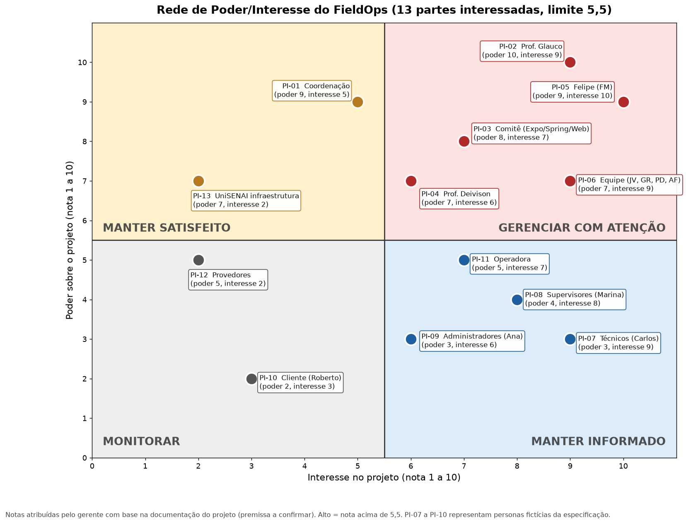

# Matriz de Rede de Poder/Interesse do Projeto FieldOps

| Campo | Informação |
|---|---|
| Projeto | FieldOps — Plataforma de Inspeção em Campo (MVP) |
| Instituição / curso | Centro Universitário SENAI São Paulo (UniSENAI-SP), Campus Sorocaba. Análise e Desenvolvimento de Sistemas |
| Disciplina / atividade | Gestão de Projetos (Prof. Me. Deivison S. Takatu). Aula 08, Partes Interessadas (processos 13.1 a 13.4) |
| Gerente do projeto | Felipe Marques (FM) |
| Integrantes | Felipe Marques; Gabriel Ribeiro Camargo Miranda; Pedro Henrique Dias de Paula; André dos Santos Fernandes; João Victor de Souza Santos |
| Data / versão | 18/11/2026 — versão 1.0 |
| Situação | As **notas de poder e interesse e os níveis de engajamento são avaliação do gerente**, feita com base na documentação do projeto (TAP, especificação, EAP, RACI, plano de comunicação). Não foram validadas com as partes interessadas. É uma premissa a confirmar |
| Documentos ligados | `aula-06-rh-comunicacoes/plano-comunicacao-fieldops.md` (códigos COM-xx), `aula-06-rh-comunicacoes/organograma-raci-fieldops.md` |

---

## 1. Como a matriz foi construída

**Partes interessadas (13.1).** São as 13 do registro do projeto (PI-01 a PI-13): quem aprova e avalia (PI-01 a PI-04), quem gerencia e executa (PI-05, PI-06), quem usa ou usará o produto (PI-07 a PI-10), o cliente representado (PI-11) e quem fornece condições externas (PI-12, PI-13).

**Escala.** Cada parte recebe duas notas inteiras de 1 a 10.

- **Poder:** capacidade de aprovar, bloquear, avaliar ou mudar escopo, prazo, nota ou condições de execução. Pergunta usada: "se essa parte quiser, consegue mudar o rumo do projeto?".
- **Interesse:** o quanto o projeto e o resultado afetam essa parte e o quanto ela acompanha. Pergunta usada: "quanto ela se importa e acompanha o projeto?".

**Quadrantes.** O limite é **5,5** nos dois eixos: nota acima de 5,5 é alta, nota até 5,5 é baixa. Os quatro quadrantes são os da Aula 08: Monitorar (poder baixo, interesse baixo); Manter informado (poder baixo, interesse alto); Manter satisfeito (poder alto, interesse baixo); Gerenciar com atenção (poder alto, interesse alto).

**Âncoras no projeto.** O poder vem de quem aprova escopo (A no RACI), quem avalia (critérios do doc. 19 da especificação) e quem controla condições externas (calendário, provedores). O interesse vem de quem usa o produto, de quem tem nota ou portfólio em jogo e de quem só se importa com o calendário. Os usuários finais (PI-07 a PI-10) são **personas fictícias** da especificação (doc. 04): têm interesse alto no que o produto faz, mas poder baixo, e o PO (PI-02) fala por eles.

---

## 2. Rede de Poder/Interesse

Distribuição: Gerenciar com atenção: 5, Manter satisfeito: 2, Manter informado: 4, Monitorar: 2.

| Quadrante | Regra | Partes interessadas | Estratégia geral |
|---|---|---|---|
| **Gerenciar com atenção** (5) | poder alto (> 5,5), interesse alto (> 5,5) | PI-02 Prof. Glauco; PI-03 Comitê (Expo/Spring/Web); PI-04 Prof. Deivison; PI-05 Felipe (FM); PI-06 Equipe (JV, GR, PD, AF) | engajar de perto: comunicar com frequência, envolver nas decisões, tratar problemas no ato |
| **Manter satisfeito** (2) | poder alto, interesse baixo (≤ 5,5) | PI-01 Coordenação; PI-13 UniSENAI infraestrutura | informar nos marcos e nunca surpreender; não sobrecarregar com detalhe técnico |
| **Manter informado** (4) | poder baixo (≤ 5,5), interesse alto | PI-07 Técnicos (Carlos); PI-08 Supervisores (Marina); PI-09 Administradores (Ana); PI-11 Operadora | comunicar com regularidade e coletar feedback de uso; são a fonte de requisitos reais |
| **Monitorar** (2) | poder baixo, interesse baixo | PI-10 Cliente (Roberto); PI-12 Provedores | esforço mínimo: acompanhar mudanças de situação e reavaliar a cada sprint |

---

## 3. Classificação das 13 partes interessadas

| ID | Parte interessada | Poder | Justificativa do poder | Interesse | Justificativa do interesse | Quadrante |
|---|---|--:|---|--:|---|---|
| PI-01 | Coordenação do curso | 9 | aprova o TAP e a Declaração de Escopo (A em 1.1 e 1.4) e controla calendário e aceite final | 5 | acompanha por marco e relatório quinzenal, não o dia a dia | **Manter satisfeito** |
| PI-02 | Prof. Glauco Todesco | 10 | autor da especificação e PO acadêmico: define regras de negócio e critérios, aprova 1.2, 3.3, 3.7, 4.3 e 5.4 e avalia as entregas | 9 | o produto é a sua especificação, e o resultado mostra se ela é implementável no prazo | **Gerenciar com atenção** |
| PI-03 | Professores das disciplinas (comitê) | 8 | validam os marcos (A em 1.3, 7.2 e 7.4) e avaliam por marco: o M6 pesa 20% e o M8 15% (doc. 19.6) | 7 | cada professor se interessa pelo seu componente (app, API, web), não pelo conjunto | **Gerenciar com atenção** |
| PI-04 | Prof. Deivison S. Takatu (Gestão de Projetos) | 7 | avalia o planejamento e a documentação de GP (a nota da disciplina depende dos artefatos) | 6 | acompanha as entregas por aula; interesse no projeto como estudo de caso, não no produto | **Gerenciar com atenção** |
| PI-05 | Felipe Marques (gerente do projeto) | 9 | decide plano, prioridades e escalonamentos; aprova 21 dos 36 pacotes; responde por prazo e integração | 10 | responde pelo resultado e acumula o app (5.1 a 5.5) | **Gerenciar com atenção** |
| PI-06 | Equipe de desenvolvimento (JV, GR, PD, AF) | 7 | executa os pacotes e decide como implementar; sem ela não há entrega | 9 | a nota individual e o portfólio dependem do resultado (doc. 19.7) | **Gerenciar com atenção** |
| PI-07 | Técnicos de campo (persona Carlos) | 3 | não decidem escopo; a persona é fictícia e é representada pelo PO; influência só por feedback de uso | 9 | usariam o app todos os dias, e a dor central é perder dados sem internet | **Manter informado** |
| PI-08 | Supervisores (persona Marina) | 4 | influência indireta: o painel web existe para o trabalho dela, mas ela não aprova escopo | 8 | usaria o painel diariamente para planejar, acompanhar e revisar | **Manter informado** |
| PI-09 | Administradores (persona Ana) | 3 | sem poder de decisão; define apenas como cadastros e permissões devem funcionar | 6 | uso semanal, concentrado no cadastro de usuários e perfis | **Manter informado** |
| PI-10 | Responsáveis do cliente (persona Roberto) | 2 | sem acesso ao MVP (portal fora do escopo); persona fictícia | 3 | só terá contato com o resultado numa versão futura | **Monitorar** |
| PI-11 | Organização operadora (cliente representado) | 5 | não decide diretamente; suas necessidades chegam por meio do PO | 7 | quer padronização, rastreabilidade e menos retrabalho: é o motivo do produto | **Manter informado** |
| PI-12 | Provedores de serviço (Expo/EAS, GitHub, hospedagem, S3) | 5 | limites de planos gratuitos (fila e cota de build, minutos de CI, armazenamento) podem bloquear o M8, mas não há decisão sobre o projeto | 2 | não acompanham o projeto | **Monitorar** |
| PI-13 | UniSENAI-SP, infraestrutura (laboratórios, rede, calendário) | 7 | define calendário, feriados, uso de laboratório e rede; um evento pode remover uma aula de marco | 2 | não acompanha o projeto, só o calendário | **Manter satisfeito** |

---

## 4. Estratégia de engajamento

### 4.1 Nível de engajamento atual e desejado

Níveis da Aula 08: **Desinformado** (sem conhecimento do projeto e dos impactos); **Resistente** (ciente e resistente à mudança); **Neutro** (ciente, mas não apoia nem resiste); **Dá apoio** (ciente e apoia); **Lidera** (ciente e ativamente engajado em garantir o êxito). A "lacuna" é a distância entre o nível atual e o desejado, na ordem em que os níveis aparecem acima. O nível atual é avaliação do gerente em 18/11/2026.

| ID | Parte interessada | Nível atual | Nível desejado | Lacuna (níveis) | Interesses | Expectativas |
|---|---|---|---|--:|---|---|
| PI-01 | Coordenação | Neutro | Dá apoio | 1 | produto integrado, avaliação justa entre as disciplinas, projeto dentro do calendário institucional | relatório curto, sem surpresas; aceite objetivo no encerramento |
| PI-02 | Prof. Glauco | Lidera | Lidera | 0 | fidelidade à especificação, fluxo ponta a ponta funcionando, regras de negócio respeitadas | dúvidas de negócio levadas com antecedência; demo parcial semanal; decisões de escopo trazidas a ele |
| PI-03 | Comitê (Expo/Spring/Web) | Neutro | Dá apoio | 1 | qualidade técnica por componente, integração real, participação equilibrada entre os integrantes | demo funcionando no app e no painel reais; evidências de commits e PRs; sem alteração manual de banco na demo |
| PI-04 | Prof. Deivison | Dá apoio | Dá apoio | 0 | documentos coerentes entre si e com o projeto real, nos formatos pedidos, entregues no GitHub | artefatos no prazo e consistentes (EAP, cronograma, orçamento, RACI, riscos) |
| PI-05 | Felipe (FM) | Lidera | Lidera | 0 | entregar o MVP no M8, equipe equilibrada, avaliação individual justa | ritos que funcionem, informação confiável do GitHub, apoio da equipe |
| PI-06 | Equipe (JV, GR, PD, AF) | Dá apoio | Lidera | 1 | escopo claro, carga equilibrada, contratos estáveis, reconhecimento da contribuição | prioridades da sprint sem mudança de última hora; decisões registradas; feedback justo |
| PI-07 | Técnicos (Carlos) | Desinformado | Dá apoio | 3 | concluir a inspeção sem papel, sem perder respostas, com poucos toques e status de sincronização claro | app simples, funcionamento offline previsível, mensagens objetivas |
| PI-08 | Supervisores (Marina) | Desinformado | Dá apoio | 3 | planejar, acompanhar e revisar sem planilhas paralelas; histórico confiável | painel com filtros e progresso claros; revisão item a item |
| PI-09 | Administradores (Ana) | Desinformado | Neutro | 2 | manter cadastros e permissões sem acessar a infraestrutura | formulários validados, inativação em vez de exclusão, mensagens claras |
| PI-10 | Cliente (Roberto) | Desinformado | Neutro | 2 | consultar resultados e evidências em modo somente leitura (futuro) | ser lembrado como trabalho futuro, sem criar expectativa no MVP |
| PI-11 | Operadora | Neutro | Dá apoio | 1 | padronizar inspeções, ter histórico e evidências rastreáveis | fluxo completo do planejamento à aprovação funcionando na demo |
| PI-12 | Provedores | Neutro | Neutro | 0 | uso dentro dos termos e limites dos planos | equipe fica dentro das cotas e cuida das chaves |
| PI-13 | UniSENAI infraestrutura | Neutro | Neutro | 0 | calendário cumprido, uso adequado dos laboratórios e da rede | pedidos de laboratório e de acesso com antecedência |

**Leitura.** As maiores lacunas (PI-07, PI-08) são dos usuários finais, que são personas e hoje não participam de forma direta. Para eles, "desinformado" quer dizer que ninguém do lado do uso viu o produto funcionando. A forma realista de fechar a lacuna é o teste com usuário-proxy (COM-15), não uma comunicação formal. Nenhuma parte interessada foi classificada como **Resistente**: não há registro de oposição ao projeto. Se o atraso de M6 e M7 mudar a postura de algum avaliador (PI-03), este é o primeiro ponto a reavaliar.

### 4.2 Prioridade de ação

Heurística simples: lacuna × poder. Ela mostra onde um ponto de engajamento rende mais.

| Ordem | ID | Parte interessada | Lacuna | Poder | Lacuna × poder |
|--:|---|---|--:|--:|--:|
| 1 | PI-08 | Supervisores (Marina) | 3 | 4 | 12 |
| 2 | PI-01 | Coordenação | 1 | 9 | 9 |
| 3 | PI-07 | Técnicos (Carlos) | 3 | 3 | 9 |
| 4 | PI-03 | Comitê (Expo/Spring/Web) | 1 | 8 | 8 |
| 5 | PI-06 | Equipe (JV, GR, PD, AF) | 1 | 7 | 7 |
| 6 | PI-09 | Administradores (Ana) | 2 | 3 | 6 |

A heurística prioriza Supervisores, Coordenação e Técnicos. Como Supervisores e Técnicos são personas, o ganho prático é fazer os testes com usuário-proxy nos marcos M3, M5 e M7. A Coordenação aparece porque tem o maior poder entre os que precisam subir um nível (de Neutro para Dá apoio), e o desvio de prazo atual é o assunto para o qual ela deve ser informada antes de saber por outro caminho. A equipe (PI-06) tem lacuna de um nível, mas é a mais crítica para a recuperação do prazo, por isso as ações com ela são diárias.

### 4.3 Riscos de relacionamento, ações e responsáveis

As ações usam os códigos do plano de comunicação (`plano-comunicacao-fieldops.md`): COM-01 planning, COM-02 daily, COM-04 demo de marco, COM-06 relatório quinzenal, COM-09 contrato OpenAPI, COM-10 mudança de escopo, COM-11 escalonamento, COM-12 alinhamento com o orientador, COM-13 entregas de GP, COM-14 aviso de build, COM-15 teste com usuário-proxy, COM-16 apoio institucional, COM-17 provedores, COM-18 entrega final, COM-19 lições aprendidas.

| ID | Risco de relacionamento | Ações de engajamento (comunicações do plano) | Responsável e frequência |
|---|---|---|---|
| PI-01 Coordenação | saber do atraso de M6 e M7 só no fim: perda de confiança e decisão de última hora sobre escopo ou nota | Relatório quinzenal de uma página (COM-06); convite às demos (COM-04, COM-18); aviso em 24 h se um marco estiver em risco (COM-11, COM-10) | FM; quinzenal e nos marcos |
| PI-02 Prof. Glauco | dúvida de negócio sem resposta travar uma sprint; regra mudar no meio da sprint; desvio descoberto tarde | Alinhamento semanal (COM-12); demos de marco (COM-04); status (COM-06); decisão de mudança de escopo (COM-10); regras de contrato (COM-09); escalonamento (COM-11) | FM; semanal |
| PI-03 Comitê (Expo/Spring/Web) | demo falhar por build não testado ou telas estáticas; percepção de participação desigual afetar a nota individual | Demo por marco (COM-04); aviso de build testado antes da demo (COM-14); relatório (COM-06); entrega final (COM-18) | FM; por marco e quinzenal |
| PI-04 Prof. Deivison | documentos desatualizados em relação ao status real, ou incoerentes entre si (códigos da EAP, datas, responsáveis) | Entregas por aula (COM-13); verificação de consistência dos códigos por script antes de cada entrega; lições aprendidas (COM-19) | FM; por aula |
| PI-05 Felipe (FM) | sobrecarga e ponto único de falha; auto-aprovação (A/R) em 5.1, 5.3 e 5.5 sem segunda leitura | Delegar A conforme o cenário B do RACI; janelas fixas de gestão; JV como suplente; aplicar a ordem de corte primeiro no mobile | FM, com revisão de JV; semanal |
| PI-06 Equipe (JV, GR, PD, AF) | carga desigual (backend com 14 de 41 issues fechadas e 21 sem responsável); desânimo com o atraso; conflito sobre contrato e participação | Planning com dono por issue (COM-01); daily (COM-02); retro com feedback (COM-05); reunião de contrato (COM-09); redistribuir as 21 issues | FM; diária e quinzenal |
| PI-07 Técnicos (Carlos) | app validado só pela equipe: botões e fluxo ruins em campo e sincronização confusa | Teste com usuário-proxy em M3, M5 e M7 (COM-15); demos mostram o fluxo offline (COM-04) | GR; nos marcos M3, M5, M7 |
| PI-08 Supervisores (Marina) | painel que obriga a recorrer a planilhas; revisão e correção pouco usáveis | Teste com usuário-proxy em M3 e M7 (COM-15); demos do painel (COM-04); regras de revisão com PI-02 (COM-12) | GR com AF; M3 e M7 |
| PI-09 Administradores (Ana) | cadastros que exigem apoio técnico a cada alteração | Teste com usuário-proxy em M3 (COM-15); demo dos cadastros (COM-04) | GR; M3 |
| PI-10 Cliente (Roberto) | expectativa de portal que o MVP não entrega, gerando frustração | Registrar o portal do cliente como trabalho futuro na demo final e no relatório (COM-18) | FM; uma vez, no M8 |
| PI-11 Operadora | requisito chegar deformado pelo caminho indireto (via PO) e a demo não responder à dor do cliente | Alinhamento semanal com o PO (COM-12); demo final com o fluxo completo (COM-18) | FM, via PI-02; semanal e final |
| PI-12 Provedores | cota de build ou CI acabar na semana do M8; mudança de plano ou de termos | Checklist semanal de cotas e status (COM-17); plano B de build local; avisar a equipe quando uma cota passar de 80% | PD; semanal, diário na semana do M8 |
| PI-13 UniSENAI infraestrutura | feriado ou evento tirar a aula de um marco; rede do laboratório bloquear Expo ou GitHub durante a demo | Revisar o calendário a cada sprint e pedir apoio com antecedência (COM-16); testar a rede do laboratório antes da demo (COM-14) | FM; início de sprint |

---

## 5. Situação em 18/11/2026 e uso desta matriz

Três fatos do snapshot de 18/11/2026 pesam nesta matriz: o projeto tem **desvio de prazo real** (57 de 103 issues fechadas, S6 e S7 muito atrasadas); há **21 issues do backend sem responsável**; e o M8 é em 27/11. Os efeitos sobre as partes interessadas:

- **PI-01 (Manter satisfeito) e PI-03 (Gerenciar com atenção)** precisam saber do desvio por nós, antes da demo do M8. A ação é o relatório de 18/11 (COM-06) e o pedido de redução do escopo do M8 ao núcleo intocável (COM-10), com o PI-02 decidindo.
- **PI-02** é quem aprova a redução de escopo. Está no quadrante "Gerenciar com atenção" e recebe a decisão pedida por escrito, não em conversa solta.
- **PI-06** é onde a recuperação acontece: redistribuir as 21 issues do backend e proteger o gerente da sobrecarga (ver `organograma-raci-fieldops.md`).
- **PI-12** passa de "Monitorar" a vigilância diária na semana do M8, porque uma cota de build do EAS acabando na semana final seria um segundo problema.
- Os níveis de engajamento são reavaliados **a cada sprint** (processo 13.4), na retrospectiva, junto com os indicadores do plano de comunicação.

## 6. Verificação

Um script (Python) conferiu: as 13 partes interessadas PI-01 a PI-13 aparecem, sem repetição; todas as notas estão entre 1 e 10; o quadrante de cada ponto bate com as notas pelo limite de 5,5 (poder > 5,5 e interesse > 5,5 é "Gerenciar com atenção", e assim por diante); os níveis atual e desejado pertencem às 5 categorias da Aula 08 e a lacuna nunca é negativa; o gráfico e as tabelas usam os mesmos dados (a mesma fonte alimenta os dois). Resultado: sem divergências. Nenhum ponto está sobre a linha de 5,5: as notas são inteiras, então não há empate de classificação.

## 7. Pontos a confirmar com o grupo

1. **As notas.** Principalmente PI-01 (interesse 5, no limite) e PI-04 (interesse 6): uma nota a mais ou a menos muda o quadrante. Se a Coordenação acompanhar o projeto mais de perto do que suponho, ela vai para "Gerenciar com atenção".
2. **Níveis atuais** de PI-01, PI-03 e PI-06, que são os que mais dependem de uma impressão do gerente. Vale conversar com o orientador.
3. **Representação por personas:** confirmar que os testes com usuário-proxy (COM-15) são a forma aceita de "engajar" PI-07 a PI-10.
4. **PI-12 e PI-13** (poder 5 e 7, interesse 2): confirmo com o grupo se há alguma restrição concreta do laboratório ou dos planos gratuitos que justifique tratá-los de outro modo.

## 8. Checklist

- [x] 13 partes interessadas (PI-01 a PI-13) classificadas nos 4 quadrantes da Aula 08
- [x] Notas de poder e interesse (1 a 10) com justificativa ancorada no projeto
- [x] Gráfico PNG com rótulos legíveis, quadrantes nomeados e limite 5,5
- [x] Níveis de engajamento atual e desejado (5 categorias da Aula 08) e lacuna
- [x] Interesses, expectativas, riscos de relacionamento, ações, responsável e frequência
- [x] Ações coerentes com os códigos COM do plano de comunicação
- [x] Quadrantes verificados por script
